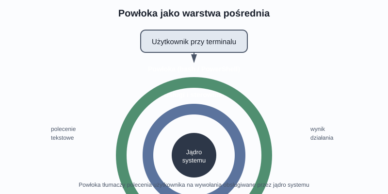
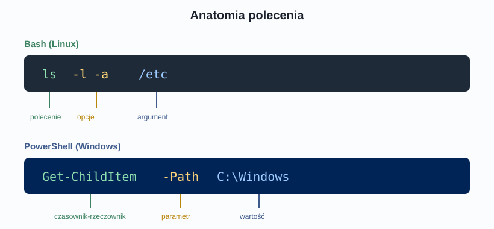
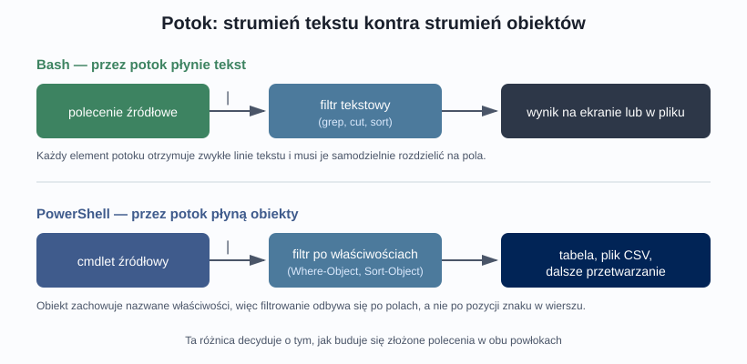

## Karta pracy
[Karta Pracy](karta-pracy-konsola.docx)

## Materiał na dwie jednostki lekcyjne: Linux (bash) i Windows (PowerShell)

---

## Wprowadzenie — po co komu konsola?

Graficzny interfejs użytkownika jest wygodny, intuicyjny i dla większości codziennych zadań zupełnie wystarczający. Skoro tak, to dlaczego administratorzy systemów spędzają większość czasu, wpatrując się w czarne okno z migającym kursorem?

Odpowiedź sprowadza się do czterech rzeczy:

- **Powtarzalność.** Kliknięcie w okienku jest jednorazowe. Polecenie można zapisać, skomentować i uruchomić ponownie za pół roku — dokładnie tak samo.
- **Automatyzacja.** Z poleceń buduje się skrypty. Zadanie, które w interfejsie graficznym zajmuje pięć minut klikania, w skrypcie wykonuje się w sekundę — i można je zaplanować na trzeciej w nocy.
- **Zdalny dostęp.** Serwery bardzo często nie mają zainstalowanego środowiska graficznego. Połączenie zdalne z konsolą działa nawet na bardzo wolnym łączu, gdzie przesyłanie obrazu pulpitu byłoby udręką.
- **Precyzja i zasięg.** Wiele opcji systemu nie ma odpowiednika w interfejsie graficznym. Konsola daje dostęp do pełnego zestawu ustawień.



Program, który przyjmuje nasze polecenia i tłumaczy je na działania systemu, nazywamy **powłoką** (ang. *shell*). W świecie Linuksa najpopularniejszą powłoką jest **bash**, w świecie Windows — **PowerShell**. Warto od razu rozróżnić dwa pojęcia, które bywają mylone: *terminal* to okno, w którym piszemy, a *powłoka* to program działający w tym oknie i interpretujący wpisywane polecenia.

---

# LEKCJA 1. Linux i powłoka bash

## 1.1. Pierwsze spojrzenie na wiersz poleceń

Po zalogowaniu do systemu Linux wita nas **znak zachęty** (ang. *prompt*), który sam w sobie niesie sporo informacji. Typowy prompt wygląda tak:

```bash
uczen@serwer:~/dokumenty$
```

Odczytujemy go następująco: użytkownik `uczen`, zalogowany na maszynie o nazwie `serwer`, znajduje się obecnie w katalogu `~/dokumenty` (tylda oznacza katalog domowy użytkownika). Ostatni znak jest szczególnie istotny: `$` oznacza zwykłego użytkownika, natomiast `#` — użytkownika uprzywilejowanego (root). Ta drobna różnica potrafi uratować przed poważną pomyłką, dlatego warto wyrobić sobie nawyk zerkania na prompt przed wciśnięciem Enter.

## 1.2. Budowa polecenia

Polecenia w bashu mają regularną, przewidywalną budowę:

```bash
polecenie [opcje] [argumenty]
```



Opcje modyfikują sposób działania polecenia i występują w dwóch formach — krótkiej (jedna litera po pojedynczym myślniku, np. `-l`) oraz długiej (pełna nazwa po podwójnym myślniku, np. `--long`). Krótkie opcje można zwykle łączyć: `ls -l -a` to dokładnie to samo co `ls -la`. Argumenty natomiast wskazują, **na czym** polecenie ma działać — najczęściej jest to ścieżka do pliku lub katalogu.

Bardzo ważny szczegół, który początkującym sprawia najwięcej kłopotu: **Linux rozróżnia wielkość liter**. Pliki `Raport.txt`, `raport.txt` i `RAPORT.TXT` to trzy różne pliki, a polecenie `LS` po prostu nie istnieje.

## 1.3. Poruszanie się po systemie plików

System plików w Linuksie ma jeden wspólny korzeń oznaczany ukośnikiem `/`. Nie ma tu liter dysków — wszystkie nośniki są „wpinane” (montowane) w wybrane miejsca tego jednego drzewa.

| Polecenie | Działanie |
|---|---|
| `pwd` | wypisuje pełną ścieżkę bieżącego katalogu |
| `ls` | wyświetla zawartość katalogu |
| `ls -l` | wyświetla zawartość w formie szczegółowej listy |
| `ls -a` | pokazuje także pliki ukryte (zaczynające się kropką) |
| `cd katalog` | przechodzi do wskazanego katalogu |
| `cd ..` | przechodzi o jeden poziom wyżej |
| `cd ~` | wraca do katalogu domowego |
| `cd -` | wraca do poprzedniego katalogu |

Warto od początku rozróżniać **ścieżkę bezwzględną** (zaczyna się od `/` i opisuje położenie od korzenia systemu, np. `/etc/network`) oraz **ścieżkę względną** (opisuje położenie względem miejsca, w którym aktualnie jesteśmy, np. `../konfiguracja`).

Najbardziej niedocenianym narzędziem pracy w konsoli jest klawisz **Tab**. Uzupełnia on nazwy poleceń i plików — wystarczy napisać kilka pierwszych liter. Oszczędza czas, ale przede wszystkim eliminuje literówki w nazwach plików, które bywają źródłem wielu frustracji.

## 1.4. Praca z plikami i katalogami

```bash
mkdir projekty              # utworzenie katalogu
mkdir -p projekty/2026/maj  # utworzenie całej ścieżki naraz
touch notatki.txt           # utworzenie pustego pliku
cp notatki.txt kopia.txt    # kopiowanie
cp -r projekty archiwum     # kopiowanie katalogu wraz z zawartością
mv kopia.txt dokumenty/     # przeniesienie pliku
mv stara.txt nowa.txt       # zmiana nazwy (to ta sama operacja!)
rm plik.txt                 # usunięcie pliku
rm -r katalog               # usunięcie katalogu z zawartością
```

Dwie uwagi praktyczne. Po pierwsze, w Linuksie **przeniesienie i zmiana nazwy to ta sama operacja** — polecenie `mv` obsługuje oba przypadki. Po drugie, `rm` nie przenosi niczego do kosza. Usunięte znaczy usunięte. Dlatego wiele osób na początku dodaje do poleceń usuwających opcję `-i`, która przed każdym plikiem prosi o potwierdzenie.

Do podglądania zawartości plików tekstowych używamy: `cat` (wypisuje cały plik), `less` (przegląda plik stronami, wyjście klawiszem `q`), `head` i `tail` (pokazują odpowiednio początek i koniec pliku). Szczególnie użyteczne jest `tail -f plik.log`, które pokazuje na bieżąco dopisywane linie — to podstawowe narzędzie przy obserwowaniu logów systemowych.

## 1.5. Uprawnienia — kto może co zrobić

Wypisanie zawartości katalogu w trybie szczegółowym zaczyna się od zestawu znaków w rodzaju `-rwxr-xr--`. To zapis uprawnień. Czytamy go w czterech częściach:

- pierwszy znak to **typ obiektu**: `-` plik zwykły, `d` katalog, `l` dowiązanie symboliczne,
- następne trzy znaki to uprawnienia **właściciela**,
- kolejne trzy — uprawnienia **grupy**,
- ostatnie trzy — uprawnienia **pozostałych użytkowników**.

Poszczególne uprawnienia oznaczamy literami: `r` (odczyt), `w` (zapis), `x` (wykonanie). Każdemu przypisana jest wartość liczbowa — odpowiednio 4, 2 i 1 — a ich suma daje popularny zapis ósemkowy. Przykładowo `chmod 755 skrypt.sh` oznacza: właściciel ma pełne prawa (4+2+1=7), grupa i pozostali mogą czytać i wykonywać (4+1=5).

Właściciela i grupę pliku zmienia się poleceniem `chown`. Operacje dotyczące całego systemu wymagają uprawnień administratora, które uzyskujemy przez poprzedzenie polecenia słowem `sudo`.

## 1.6. Procesy i stan systemu

Każdy uruchomiony program to **proces** o unikalnym numerze identyfikacyjnym (PID). Do podglądu służą `ps aux` (statyczna lista wszystkich procesów) oraz `top` lub `htop` (widok odświeżany na bieżąco, przypominający menedżer zadań). Proces zamykamy poleceniem `kill PID`, a gdy nie reaguje — `kill -9 PID`, które wymusza jego zakończenie.

Stan systemu poznamy, używając m.in.: `df -h` (zajętość dysków w czytelnych jednostkach), `free -h` (wykorzystanie pamięci), `uptime` (czas działania systemu i obciążenie), `uname -a` (informacje o jądrze i architekturze).

## 1.7. Potoki i przekierowania — łączenie poleceń

To właśnie ta możliwość sprawia, że praca w konsoli bywa nieporównanie szybsza od klikania.

```bash
ls -l > lista.txt          # zapis wyniku do pliku (nadpisanie)
ls -l >> lista.txt         # dopisanie na końcu pliku
ps aux | grep firefox      # wynik pierwszego polecenia trafia do drugiego
cat log.txt | sort | uniq  # potoki można łączyć w łańcuch
```

Znak `|` (potok) kieruje wyjście jednego polecenia na wejście następnego. W ten sposób z prostych, wyspecjalizowanych narzędzi buduje się złożone operacje — to podstawowa filozofia systemów uniksowych: każdy program robi jedną rzecz, ale robi ją dobrze.

## 1.8. Skąd czerpać wiedzę o poleceniach

Nikt nie pamięta wszystkich opcji. Dokumentację uzyskamy poleceniem `man nazwa_polecenia` (pełny podręcznik), a szybkie przypomnienie — `nazwa_polecenia --help`. Jeśli nie pamiętamy nazwy polecenia, pomoże `apropos słowo_kluczowe`, które przeszuka opisy dostępnych podręczników.

---

# LEKCJA 2. Windows i PowerShell

## 2.1. Inna filozofia, ten sam cel

PowerShell bywa przedstawiany jako „windowsowy odpowiednik basha”, co jest sporym uproszczeniem. Owszem, służy do tego samego — zarządzania systemem z poziomu tekstowego interfejsu — ale opiera się na innym założeniu.

W bashu wszystkie polecenia komunikują się ze sobą za pomocą **zwykłego tekstu**. W PowerShellu przez potok płyną **obiekty** — struktury posiadające nazwane właściwości i metody. Ta z pozoru techniczna różnica ma ogromne konsekwencje praktyczne.



W podejściu tekstowym, chcąc wyfiltrować procesy zużywające dużo pamięci, musimy najpierw „wyciąć” odpowiednią kolumnę z wiersza tekstu, licząc znaki lub pola. W podejściu obiektowym po prostu odwołujemy się do właściwości po nazwie — kolejność kolumn, szerokość czy sposób formatowania nie mają znaczenia.

## 2.2. Cmdlety i konwencja nazewnicza

Podstawową jednostką w PowerShellu jest **cmdlet** (czytane: *command-let*). Wszystkie cmdlety nazywane są według schematu **Czasownik-Rzeczownik**:

| Cmdlet | Znaczenie |
|---|---|
| `Get-ChildItem` | pobierz elementy podrzędne (zawartość katalogu) |
| `Get-Process` | pobierz procesy |
| `Stop-Process` | zatrzymaj proces |
| `Get-Service` | pobierz usługi |
| `Start-Service` | uruchom usługę |
| `New-Item` | utwórz nowy element (plik lub katalog) |
| `Remove-Item` | usuń element |
| `Set-Location` | zmień bieżącą lokalizację |

Konwencja ta jest ogromną zaletą dydaktyczną: znając kilkanaście czasowników (`Get`, `Set`, `New`, `Remove`, `Start`, `Stop`, `Test`, `Export`) oraz rzeczowniki opisujące obszary systemu, można **odgadnąć** nazwę cmdletu, którego jeszcze nigdy nie używaliśmy. Pełną listę dostępnych czasowników wypisze `Get-Verb`.

Dla wygody PowerShell udostępnia **aliasy**, czyli skróty. `Get-ChildItem` można wywołać jako `dir` (z tradycji Windows) albo `ls` (z tradycji uniksowej). Jest to bardzo pomocne na początku, ale w skryptach przeznaczonych dla innych osób zaleca się pełne nazwy — są jednoznaczne i czytelne.

Warto też wiedzieć, że **PowerShell nie rozróżnia wielkości liter** w nazwach poleceń i parametrów — `get-process`, `Get-Process` i `GET-PROCESS` zadziałają identycznie. Stosowany zapis z wielkimi literami na początku każdego członu służy wyłącznie czytelności.

## 2.3. Parametry

Cmdlety przyjmują **parametry**, które zapisujemy po pojedynczym myślniku wraz z nazwą:

```powershell
Get-ChildItem -Path C:\Windows -Recurse
Get-Process -Name notepad
New-Item -Path C:\Dane\raport.txt -ItemType File
```

Nazwy parametrów można skracać, dopóki pozostają jednoznaczne (`-Rec` zamiast `-Recurse`). Klawisz **Tab** uzupełnia zarówno nazwy cmdletów, jak i parametrów — działa więc dokładnie tak samo pomocnie jak w bashu.

## 2.4. System pomocy

PowerShell ma rozbudowany, wbudowany system pomocy, którego znajomość jest ważniejsza niż zapamiętanie pojedynczych poleceń:

```powershell
Get-Help Get-Process            # podstawowy opis
Get-Help Get-Process -Examples  # gotowe przykłady użycia
Get-Help Get-Process -Full      # pełna dokumentacja
Get-Command *service*           # wyszukanie cmdletów po fragmencie nazwy
Get-Member -InputObject (Get-Process)  # jakie właściwości ma dany obiekt
```

Szczególnie warto zwrócić uwagę na `Get-Member`. Skoro przez potok płyną obiekty, to właśnie ten cmdlet pokazuje, **jakie właściwości mamy do dyspozycji** przy filtrowaniu i sortowaniu. To naturalny pierwszy krok przy pracy z nieznanym typem danych.

## 2.5. Nawigacja i praca z plikami

```powershell
Get-Location                      # gdzie jestem (odpowiednik pwd)
Set-Location C:\Dane              # zmiana katalogu
Get-ChildItem                     # zawartość katalogu
Get-Content raport.txt            # wyświetlenie zawartości pliku
Copy-Item raport.txt kopia.txt    # kopiowanie
Move-Item kopia.txt C:\Archiwum   # przeniesienie
Remove-Item stary.txt             # usunięcie
```

Ciekawostką jest to, że PowerShell traktuje jako „dyski” nie tylko woluminy, ale też inne obszary systemu. Po wydaniu `Get-PSDrive` zobaczymy m.in. dysk `Env:` (zmienne środowiskowe) czy `HKLM:` (gałąź rejestru). Można po nich nawigować dokładnie tak samo jak po katalogach — `Set-Location Env:` i `Get-ChildItem` wypiszą wszystkie zmienne środowiskowe. To elegancka konsekwencja obiektowego podejścia.

## 2.6. Potok w praktyce

Tutaj PowerShell pokazuje swoją siłę:

```powershell
# pięć procesów zużywających najwięcej pamięci
Get-Process | Sort-Object WorkingSet -Descending | Select-Object -First 5

# tylko usługi aktualnie uruchomione
Get-Service | Where-Object {$_.Status -eq "Running"}

# lista uruchomionych usług zapisana do pliku CSV
Get-Service | Where-Object {$_.Status -eq "Running"} | Export-Csv uslugi.csv -NoTypeInformation
```

Zapis `$_` oznacza „bieżący obiekt przetwarzany w potoku”, a kropka po nim pozwala odwołać się do jego właściwości. Najważniejsze cmdlety do przetwarzania potoku to: `Where-Object` (filtrowanie), `Sort-Object` (sortowanie), `Select-Object` (wybór właściwości lub liczby elementów), `Measure-Object` (obliczenia statystyczne) oraz `ForEach-Object` (wykonanie operacji na każdym elemencie).

Zwróćmy uwagę na ostatni przykład: eksport do pliku CSV działa poprawnie bez żadnego ręcznego formatowania, bo obiekty niosą ze sobą nazwy swoich właściwości, które stają się nagłówkami kolumn.

## 2.7. Zarządzanie usługami i procesami

```powershell
Get-Service -Name Spooler          # stan konkretnej usługi
Restart-Service -Name Spooler      # ponowne uruchomienie usługi
Stop-Process -Name notepad         # zamknięcie procesu po nazwie
Stop-Process -Id 4312 -Force       # wymuszone zamknięcie po identyfikatorze
Get-EventLog -LogName System -Newest 20   # ostatnie wpisy dziennika systemu
```

Operacje zmieniające stan systemu wymagają uruchomienia PowerShella **jako administrator** — analogicznie do `sudo` w Linuksie, choć realizowane inaczej: przez uruchomienie całej sesji z podwyższonymi uprawnieniami.

## 2.8. Skrypty i zasady wykonywania

Skrypty PowerShella zapisujemy w plikach z rozszerzeniem `.ps1`. Ze względów bezpieczeństwa system domyślnie blokuje ich uruchamianie — kontroluje to mechanizm **ExecutionPolicy**. Bieżące ustawienie sprawdzimy poleceniem `Get-ExecutionPolicy`, a zmienimy (w sesji administratora) przez `Set-ExecutionPolicy`. Typowe ustawienie na stacji roboczej to `RemoteSigned`, które pozwala uruchamiać skrypty lokalne, ale wymaga podpisu cyfrowego dla skryptów pobranych z internetu.

To ważny temat nie tylko techniczny, ale i z zakresu bezpieczeństwa: bezrefleksyjne wyłączanie tej ochrony (`Unrestricted`) jest jednym z częstszych błędów popełnianych przez początkujących administratorów.

---

## Zestawienie porównawcze obu powłok

| Zagadnienie | Bash (Linux) | PowerShell (Windows) |
|---|---|---|
| Przez potok płynie | tekst | obiekty |
| Wielkość liter w poleceniach | rozróżniana | nierozróżniana |
| Nazewnictwo poleceń | krótkie, historyczne skróty | Czasownik-Rzeczownik |
| Zawartość katalogu | `ls` | `Get-ChildItem` |
| Bieżący katalog | `pwd` | `Get-Location` |
| Zmiana katalogu | `cd` | `Set-Location` |
| Zawartość pliku | `cat` | `Get-Content` |
| Lista procesów | `ps aux` | `Get-Process` |
| Zakończenie procesu | `kill` | `Stop-Process` |
| Pomoc | `man`, `--help` | `Get-Help` |
| Podniesienie uprawnień | `sudo` przed poleceniem | uruchomienie sesji jako administrator |
| Rozszerzenie skryptów | `.sh` | `.ps1` |
| Korzeń systemu plików | jedno drzewo od `/` | osobne dyski (`C:`, `D:`, `Env:`) |

Znajomość obu środowisk nie jest dziś luksusem, lecz standardem. PowerShell działa również na Linuksie, a Windows udostępnia podsystem pozwalający uruchomić pełnoprawnego basha — granica między tymi światami coraz bardziej się zaciera, a administrator, który sprawnie porusza się w obu, ma wyraźną przewagę.

---

## Dobre praktyki pracy w konsoli

- **Czytaj polecenie przed wciśnięciem Enter**, zwłaszcza gdy zawiera `rm`, `Remove-Item` lub działa z podwyższonymi uprawnieniami.
- **Testuj na kopii.** Zanim uruchomisz operację masową, wykonaj ją na jednym pliku testowym.
- **Korzystaj z klawisza Tab** — mniej literówek, szybsza praca.
- **Zapisuj przydatne polecenia.** Własny plik z notatkami jest wart więcej niż godziny wyszukiwania w sieci.
- **Historia poleceń to twój przyjaciel** — strzałka w górę oraz polecenie `history` (bash) lub `Get-History` (PowerShell).
- **Nie kopiuj poleceń z internetu bez zrozumienia.** Sprawdź w dokumentacji, co robi każda opcja.

---

## Pytania sprawdzające

1. Wyjaśnij różnicę między pojęciami „terminal” i „powłoka”.
2. Podaj trzy sytuacje, w których praca z poziomu konsoli jest wyraźnie wygodniejsza niż korzystanie z interfejsu graficznego.
3. Jak na podstawie samego znaku zachęty w Linuksie rozpoznać, że pracujemy z uprawnieniami administratora?
4. Czym różni się ścieżka bezwzględna od względnej? Podaj po jednym przykładzie.
5. Odczytaj zapis uprawnień `-rwxr-xr--`: jakim obiektem jest ten element i jakie prawa mają kolejno właściciel, grupa i pozostali użytkownicy?
6. Do czego służy znak `|` i czym różni się od znaku `>`?
7. Wyjaśnij konwencję nazewniczą cmdletów w PowerShellu i podaj, dlaczego ułatwia ona naukę.
8. Na czym polega podstawowa różnica między potokiem w bashu a potokiem w PowerShellu i jakie ma to znaczenie praktyczne?
9. Do czego służy cmdlet `Get-Member` i dlaczego jest szczególnie przydatny w PowerShellu?
10. Czym jest mechanizm ExecutionPolicy i dlaczego ustawienie go na `Unrestricted` uznaje się za złą praktykę?