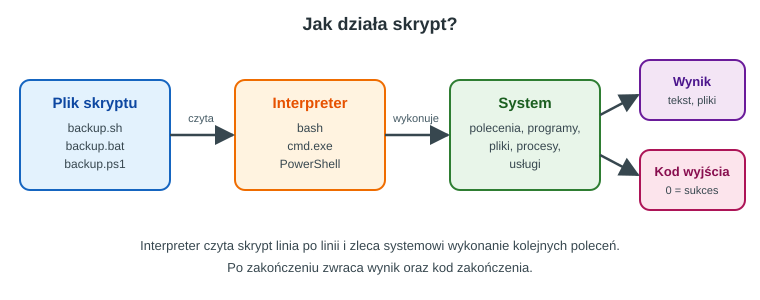
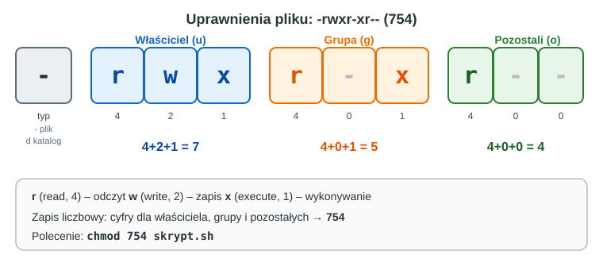

## Karta Pracy
[Karta Pracy](karta-pracy-skrypty-windows-linux.docx)

## 1. Czym jest skrypt?

**Skrypt** to plik tekstowy zawierający ciąg poleceń, które **interpreter** wykonuje jedno po drugim. Zamiast wpisywać te same polecenia ręcznie, zapisujemy je raz i uruchamiamy, kiedy potrzeba.



### Do czego używamy skryptów?

- **kopie zapasowe** plików i katalogów,
- **zarządzanie kontami** użytkowników (dodawanie, usuwanie, zmiana uprawnień),
- **monitorowanie** systemu (miejsce na dysku, procesy, usługi),
- **instalacja i konfiguracja** oprogramowania na wielu komputerach,
- **przetwarzanie plików** (zmiana nazw, sortowanie, generowanie raportów),
- **automatyzacja zadań cyklicznych** (czyszczenie katalogów tymczasowych, logi).

### Języki skryptowe w systemach

| System | Interpreter | Rozszerzenie | Uwagi |
|---|---|---|---|
| Linux | `bash` (Bourne Again Shell) | `.sh` | najpopularniejsza powłoka w dystrybucjach Linuksa |
| Windows | `cmd.exe` | `.bat`, `.cmd` | skrypty wsadowe, starszy, ale nadal powszechny |
| Windows (i Linux) | PowerShell | `.ps1` | nowoczesny, obiektowy język skryptowy |

**Ważne pojęcia:**

- **powłoka (shell)**: program, który przyjmuje polecenia od użytkownika i przekazuje je systemowi,
- **interpreter**: program, który czyta skrypt linia po linii i go wykonuje,
- **argument**: dana przekazana do skryptu przy uruchomieniu,
- **kod zakończenia (exit code)**: liczba zwracana po zakończeniu programu; `0` oznacza sukces, każda inna wartość oznacza błąd.

---

## 2. Skrypty w Linuksie (bash)

### 2.1. Pierwszy skrypt

Utwórz plik `hello.sh`:

```bash
#!/bin/bash
# To jest komentarz
echo "Witaj, świecie!"
```

**Objaśnienie:**

- `#!/bin/bash` to tzw. **shebang**. Informuje system, jakim interpreterem uruchomić plik. Musi być w pierwszej linii.
- Linie zaczynające się od `#` (poza shebangiem) to komentarze.
- `echo` wypisuje tekst na ekranie.

**Uruchamianie skryptu** (są dwa sposoby):

```bash
bash hello.sh        # 1. przekazanie pliku do interpretera
chmod +x hello.sh    # 2. nadanie prawa wykonywania...
./hello.sh           #    ...i uruchomienie bezpośrednio
```

### 2.2. Uprawnienia do plików

Każdy plik w Linuksie ma trzy zestawy uprawnień: dla **właściciela**, **grupy** i **pozostałych**. Każdy zestaw składa się z trzech bitów: `r` (odczyt, wartość 4), `w` (zapis, wartość 2), `x` (wykonywanie, wartość 1).



Uprawnienia zmieniamy poleceniem `chmod`:

```bash
chmod +x skrypt.sh      # dodaj prawo wykonywania wszystkim
chmod u+x skrypt.sh     # dodaj prawo wykonywania tylko właścicielowi
chmod 755 skrypt.sh     # rwxr-xr-x
chmod 700 skrypt.sh     # rwx------ (tylko właściciel)
ls -l skrypt.sh         # sprawdź uprawnienia
```

### 2.3. Zmienne

```bash
#!/bin/bash
imie="Ala"
wiek=17
echo "Cześć, $imie. Masz $wiek lat."
```

**Zasady:**

- **bez spacji** wokół znaku `=` (`imie="Ala"`, a nie `imie = "Ala"`),
- odwołujemy się do zmiennej przez `$` (`$imie` lub `${imie}`),
- wartości ze spacjami zapisujemy w cudzysłowie,
- wynik polecenia zapisujemy przez podstawienie: `data=$(date +%Y-%m-%d)`.

**Wczytywanie danych od użytkownika:**

```bash
read -p "Podaj imię: " imie
echo "Witaj, $imie!"
```

**Obliczenia** wykonujemy w konstrukcji `$(( ))`:

```bash
a=7
b=3
echo "Suma: $((a + b))"
echo "Iloczyn: $((a * b))"
echo "Reszta z dzielenia: $((a % b))"
```

### 2.4. Argumenty skryptu i zmienne specjalne

| Zmienna | Znaczenie |
|---|---|
| `$0` | nazwa skryptu |
| `$1`, `$2`, ... | kolejne argumenty |
| `$#` | liczba argumentów |
| `$@` | wszystkie argumenty |
| `$?` | kod zakończenia ostatniego polecenia |
| `$USER` | nazwa zalogowanego użytkownika |
| `$HOME` | katalog domowy |

```bash
#!/bin/bash
echo "Uruchomiono skrypt: $0"
echo "Pierwszy argument: $1"
echo "Liczba argumentów: $#"
```

Wywołanie: `./arg.sh jabłko gruszka` wypisze `jabłko` jako `$1` i `2` jako `$#`.

### 2.5. Instrukcja warunkowa `if`

```bash
#!/bin/bash
read -p "Podaj liczbę: " n

if [ "$n" -gt 0 ]; then
    echo "Liczba dodatnia"
elif [ "$n" -lt 0 ]; then
    echo "Liczba ujemna"
else
    echo "Zero"
fi
```

**Uwaga na składnię:** spacje wewnątrz nawiasów `[ ... ]` są **obowiązkowe**, a po warunku pojawia się `then`. Instrukcję zamykamy słowem `fi`.

**Najczęściej używane testy:**

| Test | Znaczenie |
|---|---|
| `-e plik` | plik lub katalog istnieje |
| `-f plik` | istnieje i jest zwykłym plikiem |
| `-d katalog` | istnieje i jest katalogiem |
| `-r`, `-w`, `-x` | plik można odczytać, zapisać, wykonać |
| `-z "$tekst"` | tekst jest pusty |
| `"$a" = "$b"` | teksty są równe |
| `"$a" != "$b"` | teksty są różne |
| `-eq`, `-ne` | liczby równe, różne |
| `-lt`, `-le` | mniejsze, mniejsze lub równe |
| `-gt`, `-ge` | większe, większe lub równe |

**Łączenie warunków:** `[ "$a" -gt 0 ] && [ "$a" -lt 10 ]` (oraz), `||` (lub), `!` (negacja).

### 2.6. Instrukcja `case`

```bash
#!/bin/bash
read -p "Wybierz (t/n): " odp
case "$odp" in
    t|T) echo "Zgoda" ;;
    n|N) echo "Odmowa" ;;
    *)   echo "Nie rozumiem" ;;
esac
```

### 2.7. Pętle

**Pętla `for` po liście:**

```bash
for owoc in jabłko gruszka śliwka; do
    echo "Lubię: $owoc"
done
```

**Pętla `for` po plikach:**

```bash
for plik in *.txt; do
    echo "Znaleziono: $plik"
done
```

**Pętla `for` z licznikiem:**

```bash
for ((i = 1; i <= 5; i++)); do
    echo "Krok $i"
done
```

**Pętla `while`:**

```bash
licznik=1
while [ "$licznik" -le 3 ]; do
    echo "Obieg numer $licznik"
    licznik=$((licznik + 1))
done
```

**Czytanie pliku linia po linii:**

```bash
while read -r linia; do
    echo "Linia: $linia"
done < dane.txt
```

### 2.8. Funkcje

```bash
#!/bin/bash

powitaj() {
    echo "Witaj, $1!"
}

powitaj "Ola"
powitaj "Marek"
```

Funkcja może zwrócić kod zakończenia przez `return`, a wartość tekstową przez `echo`, którą przechwytujemy podstawieniem `wynik=$(funkcja)`.

### 2.9. Przekierowania i potoki

| Zapis | Działanie |
|---|---|
| `polecenie > plik` | zapisz wynik do pliku (nadpisz) |
| `polecenie >> plik` | dopisz wynik na końcu pliku |
| `polecenie < plik` | wczytaj dane z pliku |
| `polecenie 2> błędy.log` | zapisz komunikaty o błędach do pliku |
| `polecenie1 \| polecenie2` | przekaż wynik pierwszego polecenia do drugiego |

```bash
ls -l | wc -l                    # ile jest wpisów w katalogu
cat log.txt | grep "ERROR"       # wiersze zawierające ERROR
echo "Start: $(date)" >> log.txt # dopisz linię do logu
```

### 2.10. Kody zakończenia i obsługa błędów

```bash
#!/bin/bash
if [ ! -f "$1" ]; then
    echo "Błąd: plik $1 nie istnieje" >&2
    exit 1
fi
echo "Plik istnieje"
exit 0
```

- `exit 0`: sukces, `exit 1` (lub inna liczba): błąd,
- `>&2` kieruje komunikat na strumień błędów,
- `$?` pozwala sprawdzić wynik poprzedniego polecenia:

```bash
cp a.txt b.txt
if [ $? -eq 0 ]; then
    echo "Skopiowano"
else
    echo "Nie udało się skopiować"
fi
```

### 2.11. Przykład kompletny: kopia zapasowa

```bash
#!/bin/bash
# backup.sh - kopia katalogu do archiwum tar.gz z datą w nazwie

zrodlo="$HOME/dokumenty"
cel="$HOME/kopie"
data=$(date +%Y-%m-%d_%H-%M)

if [ ! -d "$zrodlo" ]; then
    echo "Błąd: brak katalogu $zrodlo" >&2
    exit 1
fi

mkdir -p "$cel"
tar -czf "$cel/backup_$data.tar.gz" "$zrodlo"

if [ $? -eq 0 ]; then
    echo "Kopia zapisana: $cel/backup_$data.tar.gz"
else
    echo "Błąd podczas tworzenia kopii" >&2
    exit 1
fi
```

---

## 3 Skrypty w Windows (cmd i PowerShell)

### 3.1. Skrypty wsadowe (`.bat`)

#### Pierwszy skrypt

Utwórz w Notatniku plik `hello.bat` (zapisz jako *Wszystkie pliki*, nie `.txt`):

```bat
@echo off
echo Witaj, swiecie!
pause
```

**Objaśnienie:**

- `@echo off` wyłącza wyświetlanie samych poleceń (widać tylko ich wyniki),
- `echo` wypisuje tekst,
- `pause` czeka na naciśnięcie klawisza (okno nie zamyka się od razu).

> **Polskie znaki w cmd:** aby wyświetlać ą, ę, ż itd., zapisz plik w kodowaniu UTF-8 i dodaj na początku `chcp 65001 >nul`. W przykładach dla prostoty używamy tekstu bez polskich znaków.

**Komentarze:** `REM to jest komentarz` lub `:: to też komentarz`.

#### Zmienne

```bat
@echo off
set imie=Ala
set wiek=17
echo Czesc, %imie%. Masz %wiek% lat.
```

- zmienną tworzymy poleceniem `set`, **bez spacji** wokół `=`,
- odwołujemy się przez `%nazwa%`,
- dane od użytkownika: `set /p imie=Podaj imie: `,
- obliczenia: `set /a suma=5+3`,
- przydatne zmienne środowiskowe: `%USERNAME%`, `%USERPROFILE%`, `%DATE%`, `%TIME%`, `%COMPUTERNAME%`.

#### Argumenty

| Zapis | Znaczenie |
|---|---|
| `%0` | nazwa skryptu |
| `%1` ... `%9` | kolejne argumenty |
| `%~1` | pierwszy argument bez cudzysłowów |
| `%*` | wszystkie argumenty |
| `%errorlevel%` | kod zakończenia ostatniego polecenia |

#### Instrukcja warunkowa `if`

```bat
@echo off
if "%~1"=="" (
    echo Nie podano argumentu.
    exit /b 1
)

if exist "%~1" (
    echo Plik lub folder %~1 istnieje.
) else (
    echo Plik lub folder %~1 nie istnieje.
)
```

**Operatory porównań liczb:** `equ` (równe), `neq` (różne), `lss` (mniejsze), `leq` (mniejsze lub równe), `gtr` (większe), `geq` (większe lub równe).

```bat
set /p n=Podaj liczbe:
if %n% gtr 0 (echo Dodatnia) else (echo Nie jest dodatnia)
```

> **Uwaga:** klamra `else` musi znajdować się w tej samej linii co zamykający nawias `)` poprzedniego bloku.

#### Pętle

```bat
:: po liście wartości
for %%o in (jablko gruszka sliwka) do echo Lubie: %%o

:: po plikach
for %%f in (*.txt) do echo Znaleziono: %%f

:: z licznikiem (start, krok, koniec)
for /l %%i in (1,1,5) do echo Krok %%i
```

> W skrypcie `.bat` zmienną pętli zapisujemy z **dwoma** znakami procentu (`%%f`), a w wierszu poleceń wpisanym ręcznie z jednym (`%f`).

#### Etykiety i skoki (`goto`, `call`)

```bat
@echo off
:start
echo Wybierz: 1 - data, 0 - koniec
choice /c 10 /n /m "Twoj wybor: "
if errorlevel 2 goto koniec
if errorlevel 1 goto data

:data
echo %date% %time%
goto start

:koniec
echo Do widzenia!
```

`choice` zwraca numer wybranej opcji w `errorlevel`. Sprawdzamy od **największej** wartości do najmniejszej, ponieważ `if errorlevel N` oznacza „kod większy lub równy N”.

#### Przykład kompletny: kopia zapasowa

```bat
@echo off
rem backup.bat - kopiowanie dokumentow do C:\Kopie

set zrodlo=%USERPROFILE%\Documents
set cel=C:\Kopie

if not exist "%cel%" mkdir "%cel%"

robocopy "%zrodlo%" "%cel%" /E /NFL /NDL
if %errorlevel% geq 8 (
    echo Blad kopiowania!
    exit /b 1
) else (
    echo Kopia zakonczona pomyslnie.
)
pause
```

> `robocopy` zwraca kody 0-7 w przypadku powodzenia (różne kombinacje skopiowanych i pominiętych plików), a dopiero **8 i więcej** oznacza błąd.

---

### 3.2. PowerShell (`.ps1`)

PowerShell różni się od `cmd` tym, że polecenia (**cmdlety**) zwracają **obiekty**, a nie tylko tekst. Cmdlety mają nazwy w formacie `Czasownik-Rzeczownik`, np. `Get-ChildItem`, `Set-Location`, `Remove-Item`.

#### Pierwszy skrypt i polityka wykonywania

Utwórz plik `hello.ps1`:

```powershell
# To jest komentarz
Write-Host "Witaj, świecie!"
```

Uruchomienie z poziomu PowerShell w katalogu ze skryptem:

```powershell
.\hello.ps1
```

Jeśli system zgłosi, że wykonywanie skryptów jest wyłączone, sprawdź i zmień **politykę wykonywania** (tylko dla bieżącego użytkownika):

```powershell
Get-ExecutionPolicy
Set-ExecutionPolicy -Scope CurrentUser RemoteSigned
```

#### Zmienne i typy

```powershell
$imie = "Ala"
$wiek = 17
Write-Host "Cześć, $imie. Masz $wiek lat."

$imie2 = Read-Host "Podaj imię"
$suma = $wiek + 3
$lista = 1..5                     # tablica liczb 1, 2, 3, 4, 5
$data = Get-Date -Format "yyyy-MM-dd"
```

- zmienne zaczynają się od `$`, a wokół `=` spacje są dozwolone,
- typ ustalany jest automatycznie, ale można go wymusić: `[int]$wiek = 17`,
- w cudzysłowie `"..."` zmienne są podstawiane, w apostrofach `'...'` traktowane dosłownie.

#### Parametry skryptu

```powershell
param(
    [string]$Imie = "Nieznajomy",
    [int]$Powtorzenia = 1
)

for ($i = 1; $i -le $Powtorzenia; $i++) {
    Write-Host "Witaj, $Imie!"
}
```

Wywołanie: `.\powitanie.ps1 -Imie Ola -Powtorzenia 3`.

#### Operatory porównania

| Operator | Znaczenie |
|---|---|
| `-eq`, `-ne` | równe, różne |
| `-lt`, `-le` | mniejsze, mniejsze lub równe |
| `-gt`, `-ge` | większe, większe lub równe |
| `-like` | dopasowanie do wzorca z `*` |
| `-and`, `-or`, `-not` | operatory logiczne |

#### Instrukcje warunkowe i pętle

```powershell
$n = [int](Read-Host "Podaj liczbę")

if ($n -gt 0) {
    Write-Host "Dodatnia"
} elseif ($n -lt 0) {
    Write-Host "Ujemna"
} else {
    Write-Host "Zero"
}

foreach ($owoc in "jabłko", "gruszka", "śliwka") {
    Write-Host "Lubię: $owoc"
}

$i = 1
while ($i -le 3) {
    Write-Host "Obieg $i"
    $i++
}
```

#### Potoki i obiekty

W PowerShell potok `|` przekazuje **obiekty** wraz z ich właściwościami:

```powershell
Get-ChildItem -File |
    Where-Object { $_.Length -gt 1MB } |
    Sort-Object Length -Descending |
    Select-Object Name, Length
```

- `Where-Object` filtruje obiekty (`$_` oznacza bieżący obiekt),
- `Sort-Object` sortuje,
- `Select-Object` wybiera właściwości,
- `ForEach-Object` wykonuje blok dla każdego obiektu,
- `Out-File` lub `>` zapisuje wynik do pliku.

#### Funkcje

```powershell
function Powitaj {
    param([string]$Imie)
    return "Witaj, $Imie!"
}

Powitaj -Imie "Ola"
```

#### Obsługa błędów

```powershell
try {
    Get-Content "brak.txt" -ErrorAction Stop
}
catch {
    Write-Host "Wystąpił błąd: $_" -ForegroundColor Red
}
```

#### Przykład kompletny: kopia zapasowa

```powershell
# backup.ps1 - archiwum ZIP z dokumentów

$zrodlo = "$env:USERPROFILE\Documents"
$cel    = "C:\Kopie"
$data   = Get-Date -Format "yyyy-MM-dd_HH-mm"

if (-not (Test-Path $cel)) {
    New-Item -ItemType Directory -Path $cel | Out-Null
}

try {
    Compress-Archive -Path $zrodlo -DestinationPath "$cel\backup_$data.zip" -ErrorAction Stop
    Write-Host "Kopia zapisana: backup_$data.zip"
}
catch {
    Write-Host "Błąd: $_" -ForegroundColor Red
    exit 1
}
```

---

## 4. Porównanie środowisk

| Czynność | bash (Linux) | cmd (Windows) | PowerShell |
|---|---|---|---|
| Wypisz tekst | `echo "Hej"` | `echo Hej` | `Write-Host "Hej"` |
| Komentarz | `# tekst` | `REM tekst` lub `:: tekst` | `# tekst` |
| Zmienna | `x=5` | `set x=5` | `$x = 5` |
| Odczyt zmiennej | `$x` | `%x%` | `$x` |
| Wczytaj dane | `read x` | `set /p x=` | `$x = Read-Host` |
| Argument 1 | `$1` | `%1` | `$args[0]` lub `param()` |
| Kod zakończenia | `$?` | `%errorlevel%` | `$?`, `$LASTEXITCODE` |
| Warunek | `if [ ... ]; then ... fi` | `if ... (...) else (...)` | `if (...) { ... }` |
| Pętla po liście | `for x in a b c; do ... done` | `for %%x in (a b c) do ...` | `foreach ($x in a,b,c) { ... }` |
| Lista plików | `ls` | `dir` | `Get-ChildItem` |
| Zmiana katalogu | `cd` | `cd` | `Set-Location` |
| Tworzenie katalogu | `mkdir` | `mkdir` lub `md` | `New-Item -ItemType Directory` |
| Kopiowanie pliku | `cp` | `copy` | `Copy-Item` |
| Usuwanie pliku | `rm` | `del` | `Remove-Item` |
| Zawartość pliku | `cat` | `type` | `Get-Content` |
| Konfiguracja sieci | `ip a` | `ipconfig` | `Get-NetIPAddress` |
| Wyszukiwanie w tekście | `grep` | `findstr` | `Select-String` |
| Zakończenie skryptu | `exit 0` | `exit /b 0` | `exit 0` |

**Najważniejsze różnice:**

- w bash i PowerShell zmienną tworzy się bez słowa kluczowego, w cmd trzeba użyć `set`,
- bash operuje głównie na **tekście**, PowerShell na **obiektach**,
- ścieżki w Linuksie używają `/`, w Windows `\`,
- Linux rozróżnia wielkość liter w nazwach plików i poleceniach, Windows zwykle nie.

---

## 5. Automatyzacja: cron i Harmonogram zadań

### 5.1. Linux: cron

Zadania cykliczne definiujemy w tabeli `crontab`:

```bash
crontab -e        # edycja własnej tabeli zadań
crontab -l        # podgląd zadań
```

Format wpisu:

```
minuta godzina dzień_miesiąca miesiąc dzień_tygodnia polecenie
```

Przykłady:

```
30 18 * * 1-5  /home/uczen/skrypty/backup.sh     # pon-pt o 18:30
0  3  * * *    /home/uczen/skrypty/czysc.sh      # codziennie o 3:00
*/15 * * * *   /home/uczen/skrypty/monitor.sh    # co 15 minut
```

> W `crontab` używaj **pełnych ścieżek** do skryptów i plików, ponieważ zadanie uruchamiane jest w innym środowisku niż interaktywny terminal.

### 5.2. Windows: Harmonogram zadań

Zadanie można utworzyć graficznie (aplikacja **Harmonogram zadań**) lub z wiersza poleceń:

```bat
schtasks /create /tn "KopiaDokumentow" /tr "C:\skrypty\backup.bat" /sc daily /st 18:00
schtasks /query /tn "KopiaDokumentow"
schtasks /delete /tn "KopiaDokumentow" /f
```

Skrypt PowerShell uruchamiamy przez wywołanie interpretera:

```bat
schtasks /create /tn "KopiaPS" /tr "powershell -ExecutionPolicy Bypass -File C:\skrypty\backup.ps1" /sc daily /st 18:00
```

---

## 6. Dobre praktyki i bezpieczeństwo

1. **Komentuj kod.** Za pół roku nie będziesz pamiętać, co robi skrypt, a inni administratorzy też muszą go rozumieć.
2. **Nadawaj czytelne nazwy** zmiennym (`katalog_zrodlowy`, a nie `k`) i skryptom (`backup_dokumentow.sh`).
3. **Cytuj zmienne w bash:** `"$plik"`, a nie `$plik`. Inaczej skrypt zepsuje się na nazwach plików ze spacjami.
4. **Sprawdzaj dane wejściowe.** Zawsze zakładaj, że użytkownik poda zły argument lub nie poda żadnego.
5. **Obsługuj błędy** i zwracaj sensowne kody zakończenia.
6. **Testuj na kopii danych** lub w katalogu testowym. Polecenia `rm -rf` i `Remove-Item -Recurse` są nieodwracalne.
7. **Nie zapisuj haseł w skryptach.** Skrypt często jest czytelny dla innych użytkowników i trafia do repozytoriów.
8. **Nie uruchamiaj skryptów z nieznanego źródła**, dopóki nie przeczytasz ich zawartości.
9. **Stosuj zasadę najmniejszych uprawnień.** Skrypt powinien działać na koncie zwykłego użytkownika, jeśli nie wymaga uprawnień administratora.
10. **Loguj działanie** ważnych skryptów do pliku (`echo "$(date) Start" >> log.txt`).

> **Polityka wykonywania PowerShell** nie jest zabezpieczeniem przed złośliwym oprogramowaniem, tylko zabezpieczeniem przed przypadkowym uruchomieniem skryptu. Nie należy jej traktować jako ochrony systemu.

---

## 7. Ćwiczenia prowadzone

Wykonuj ćwiczenia po kolei. Rozwiązania znajdziesz w rozdziale 10, ale najpierw spróbuj samodzielnie.

### Część A: Linux (bash)

#### Ćwiczenie L1: Pierwszy skrypt i uprawnienia

1. Utwórz katalog `~/skrypty` i przejdź do niego.
2. Napisz skrypt `hello.sh`, który wypisuje tekst „Witaj w świecie skryptów!” oraz nazwę zalogowanego użytkownika i aktualną datę.
3. Spróbuj uruchomić go przez `./hello.sh`. Co się stało i dlaczego?
4. Nadaj skryptowi prawo wykonywania i uruchom go ponownie.
5. Sprawdź uprawnienia poleceniem `ls -l` i zapisz, jak wygląda ich zapis znakowy i liczbowy.

#### Ćwiczenie L2: Pozdrowienie z argumentem

Napisz skrypt `pozdrow.sh`, który:

- przyjmuje imię jako pierwszy argument i wypisuje `Witaj, <imię>!`,
- jeśli nie podano argumentu, wypisuje komunikat o sposobie użycia na strumień błędów i kończy pracę z kodem `1`.

Sprawdź działanie w obu sytuacjach oraz odczytaj kod zakończenia przez `echo $?`.

#### Ćwiczenie L3: Kalkulator

Napisz skrypt `kalkulator.sh`, który wczytuje dwie liczby i symbol działania (`+`, `-`, `x`, `/`), a następnie wypisuje wynik. Użyj instrukcji `case`. Zabezpiecz skrypt przed dzieleniem przez zero i nieznanym działaniem.

#### Ćwiczenie L4: Raport plików tekstowych

Napisz skrypt `raport.sh`, który dla podanego katalogu (domyślnie bieżącego) wypisze każdy plik `.txt` wraz z liczbą jego linii, a na końcu sumę linii we wszystkich plikach. Jeśli nie ma żadnego pliku `.txt`, wypisze odpowiedni komunikat.

*Wskazówka:* liczbę linii pliku zwróci `wc -l < plik`.

#### Ćwiczenie L5: Kopia zapasowa i cron

1. Utwórz katalog `~/dokumenty` z kilkoma plikami testowymi.
2. Skopiuj do `~/skrypty/backup.sh` skrypt z podrozdziału 3.11 i uruchom go.
3. Sprawdź zawartość katalogu `~/kopie` i rozpakuj archiwum poleceniem `tar -tzf` (podgląd zawartości).
4. Dodaj wpis do `crontab`, który uruchomi skrypt co 5 minut. Po kilkunastu minutach sprawdź, czy powstały nowe archiwa, a następnie **usuń wpis**.

---

### Część B: Windows (cmd i PowerShell)

#### Ćwiczenie W1: Pierwszy skrypt `.bat`

Napisz `hello.bat`, który wypisuje „Witaj w swiecie skryptow!”, nazwę użytkownika (`%USERNAME%`), nazwę komputera (`%COMPUTERNAME%`) oraz datę i kończy poleceniem `pause`. Uruchom go przez dwukrotne kliknięcie oraz z poziomu wiersza poleceń.

#### Ćwiczenie W2: Argument i warunek

Napisz `pozdrow.bat`, który przyjmuje imię jako argument i wypisuje `Witaj, <imie>!`. Gdy argumentu brakuje, wypisuje instrukcję użycia i kończy pracę z kodem `1`. Sprawdź kod zakończenia przez `echo %errorlevel%`.

#### Ćwiczenie W3: Menu tekstowe

Napisz `menu.bat` z pętlą menu (etykiety i `goto`), która oferuje:

1. wyświetlenie daty i godziny,
2. wyświetlenie adresu IPv4 komputera (`ipconfig | findstr /i "IPv4"`),
3. wyświetlenie listy uruchomionych procesów (`tasklist`),
4. wyjście (opcja `0`).

Po każdej akcji program wraca do menu.

#### Ćwiczenie W4: PowerShell, największe pliki

Napisz `najwieksze.ps1` z parametrami `-Sciezka` (domyślnie bieżący katalog) i `-Ile` (domyślnie 5), który wypisze `Ile` największych plików z podanego folderu wraz z rozmiarem w KB. Jeśli folder nie istnieje, wypisze komunikat błędu na czerwono i zakończy pracę z kodem `1`.

#### Ćwiczenie W5: PowerShell, kopia zapasowa i harmonogram

1. Uruchom skrypt `backup.ps1` z podrozdziału 4.2 (dostosuj ścieżki, jeśli potrzeba).
2. Sprawdź, czy w `C:\Kopie` pojawił się plik ZIP.
3. Utwórz zadanie w Harmonogramie zadań (`schtasks`), które uruchomi skrypt za kilka minut. Sprawdź jego działanie, a następnie **usuń zadanie**.

---

## 8. Zadania samodzielne

**Zadanie 1 (Linux).** Napisz skrypt `czysc.sh`, który usuwa z podanego katalogu pliki `.tmp` starsze niż 7 dni, ale **przed usunięciem** wypisuje ich listę i prosi o potwierdzenie (`t/n`).
*Podpowiedź:* `find katalog -name "*.tmp" -mtime +7`.

**Zadanie 2 (Linux).** Napisz skrypt `miejsce.sh`, który sprawdza zajętość partycji `/` (polecenie `df`) i wypisuje ostrzeżenie, jeśli zajętość przekracza 80%.

**Zadanie 3 (Windows, cmd).** Napisz `zmien_nazwy.bat`, który dodaje prefiks `stary_` do nazw wszystkich plików `.txt` w bieżącym folderze (`ren`).

**Zadanie 4 (Windows, PowerShell).** Napisz `uslugi.ps1`, który wypisze wszystkie **uruchomione** usługi (`Get-Service`) posortowane alfabetycznie i zapisze ich nazwy do pliku `uslugi.txt`.

**Zadanie 5 (dowolne środowisko).** Napisz skrypt tworzący konta użytkowników z listy zapisanej w pliku tekstowym (jedno imię na linię). Dla bezpieczeństwa skrypt **nie tworzy** realnych kont, tylko wypisuje polecenia, które by je utworzyły (`useradd` w Linuksie, `New-LocalUser` w PowerShell).

**Zadanie dodatkowe (*).** Przygotuj wersję skryptu kopii zapasowej, która zapisuje wynik działania do pliku dziennika `backup.log` (data, godzina, sukces lub błąd) i usuwa kopie starsze niż 30 dni.

---

## Ściągawka

### bash

```bash
#!/bin/bash                          # shebang
zmienna="tekst"                      # zmienna (bez spacji przy =)
read -p "Pytanie: " zmienna          # wczytanie
echo "$zmienna $1 $# $?"             # użycie zmiennych
if [ warunek ]; then ... fi          # warunek
for x in lista; do ... done          # pętla for
while [ warunek ]; do ... done       # pętla while
funkcja() { ...; }                   # funkcja
exit 0                               # zakończenie z sukcesem
```

### cmd (.bat)

```bat
@echo off                            :: wyłącz echo poleceń
set zmienna=tekst                    :: zmienna
set /p zmienna=Pytanie:              :: wczytanie
echo %zmienna% %1 %errorlevel%       :: użycie zmiennych
if warunek (...) else (...)          :: warunek
for %%x in (lista) do ...            :: pętla for
goto etykieta                        :: skok
exit /b 0                            :: zakończenie
```

### PowerShell

```powershell
$zmienna = "tekst"                   # zmienna
$zmienna = Read-Host "Pytanie"       # wczytanie
param([string]$Nazwa)                # parametry skryptu
if ($a -gt 0) { ... }                # warunek
foreach ($x in $lista) { ... }       # pętla foreach
Get-ChildItem | Where-Object {...}   # potok obiektów
try { ... } catch { ... }            # obsługa błędów
exit 0                               # zakończenie
```

---

## Pytania sprawdzające

1. Co to jest skrypt i czym różni się od programu skompilowanego? Podaj dwa przykłady zastosowania skryptów w pracy administratora.
2. Do czego służy shebang (`#!/bin/bash`) i dlaczego musi znajdować się w pierwszej linii skryptu?
3. Jakie uprawnienia ma plik z uprawnieniami `rwxr-x---`? Zapisz je również w postaci liczbowej i podaj polecenie, które je ustawi.
4. Wskaż i popraw błędy w linii bash: `imie = "Ola"`. Wyjaśnij, dlaczego zapis jest niepoprawny.
5. Jak w bash, cmd i PowerShell odwołać się do pierwszego argumentu przekazanego do skryptu?
6. Co oznacza kod zakończenia `0`, a co wartość różna od `0`? Jak go odczytać w bash i w cmd?
7. Wyjaśnij różnicę między `>` a `>>` oraz podaj przykład zastosowania potoku `|` w systemie Linux.
8. Czym cmdlety PowerShell różnią się od klasycznych poleceń cmd? Wyjaśnij na przykładzie potoku `Get-ChildItem | Where-Object { $_.Length -gt 1MB }`.
9. Dlaczego w skryptach bash zaleca się cytowanie zmiennych (`"$plik"`)? Co może pójść nie tak bez cudzysłowu?
10. Opisz, jak zaplanować codzienne uruchamianie skryptu o godzinie 18:00 w Linuksie (cron) i w Windows (Harmonogram zadań lub `schtasks`).