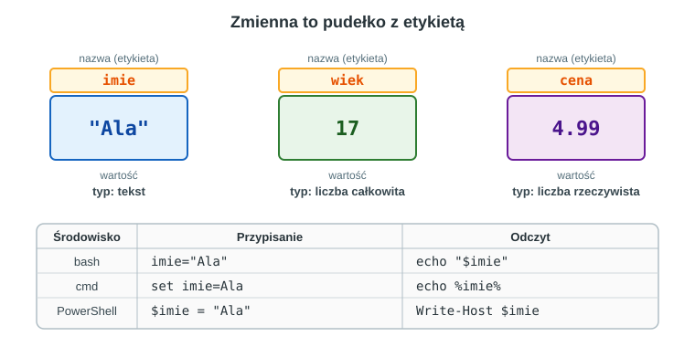
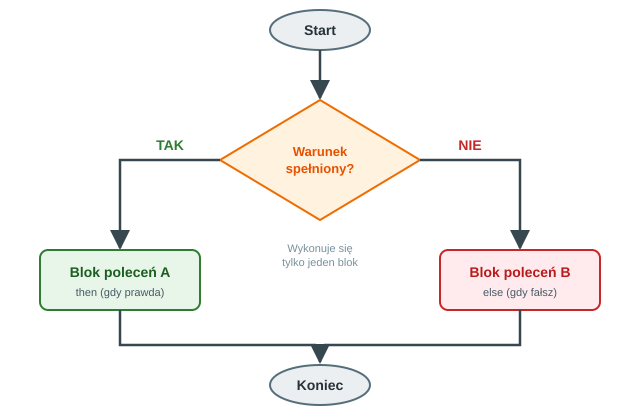
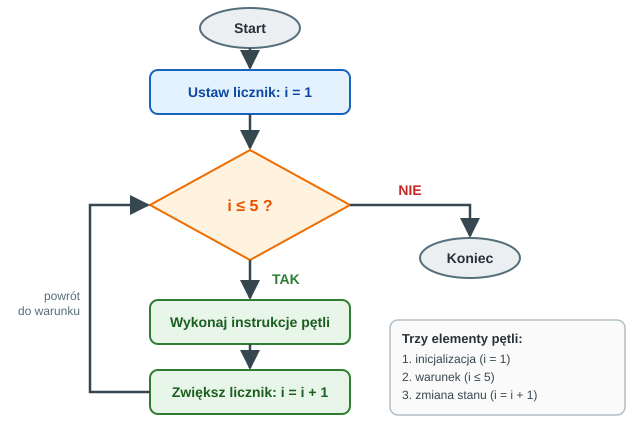

## Karta Pracy
[Karta Pracy](karta-pracy-zmienne-warunki-petle.docx)
## 1. Zmienne

### 1.1. Czym jest zmienna?

**Zmienna** to nazwany fragment pamięci, w którym skrypt przechowuje dane, np. imię użytkownika, liczbę prób czy ścieżkę do katalogu. Można ją porównać do **pudełka z etykietą**: etykieta to **nazwa**, zawartość to **wartość**, a rodzaj tej zawartości (tekst, liczba) to **typ**.



Dzięki zmiennym skrypt jest **uniwersalny**: zamiast wpisywać na stałe `C:\Dane`, zapisujemy ścieżkę raz w zmiennej i używamy jej w wielu miejscach. Gdy ścieżka się zmieni, poprawiamy tylko jedną linię.

### 1.2. Typy danych

| Typ | Przykład | Uwagi |
|---|---|---|
| tekst (napis) | `"Ala"`, `"C:\Dane"` | ciąg znaków |
| liczba całkowita | `17`, `-5`, `0` | do obliczeń i liczników |
| liczba rzeczywista | `4.99`, `3.14` | tylko PowerShell liczy na nich wprost |
| wartość logiczna | `$true`, `$false` | PowerShell; w bash i cmd stosuje się kody `0`/`1` |
| tablica (lista) | `1, 2, 3` | kilka wartości pod jedną nazwą |

**Jak radzą sobie z typami poszczególne środowiska?**

- **bash**: wszystko jest tekstem. Obliczenia wykonujemy jawnie w konstrukcji `$(( ))` i tylko na liczbach całkowitych.
- **cmd**: wszystko jest tekstem. Liczby całkowite (32-bitowe) obsługuje polecenie `set /a`.
- **PowerShell**: zmienne mają typy (`[string]`, `[int]`, `[double]`, `[bool]`, `[datetime]`), a wartości są obiektami platformy .NET.

### 1.3. Zasady nazywania zmiennych

- nazwa składa się z liter, cyfr i znaku `_`, i **nie zaczyna się od cyfry**,
- nazwa powinna mówić, co zmienna przechowuje: `liczba_prob`, a nie `x1`,
- bash **rozróżnia** wielkość liter (`Imie` i `imie` to dwie różne zmienne), cmd i PowerShell **nie rozróżniają**,
- zmienne systemowe w bash zwyczajowo zapisujemy WIELKIMI literami (`HOME`, `USER`), własne małymi.

### 1.4. Zmienne w bash

**Przypisanie i odczyt:**

```bash
#!/bin/bash
imie="Ala"
wiek=17
echo "Cześć, $imie. Masz $wiek lat."
echo "Nazwa w klamrach: ${imie}ka"
```

- **bez spacji** wokół `=` (`imie = "Ala"` wywoła błąd),
- odczyt przez `$nazwa`; klamry `${nazwa}` są potrzebne, gdy tuż za nazwą stoją inne znaki,
- brakująca zmienna to po prostu pusty tekst.

**Cudzysłów a apostrof:**

```bash
imie="Ala"
echo "Cześć, $imie"     # Cześć, Ala      (zmienna jest podstawiana)
echo 'Cześć, $imie'     # Cześć, $imie    (tekst dosłownie)
```

**Podstawienie polecenia** zapisuje wynik polecenia w zmiennej:

```bash
data=$(date +%Y-%m-%d)
liczba_plikow=$(ls | wc -l)
echo "Dziś jest $data, w katalogu jest $liczba_plikow wpisów."
```

**Wczytywanie danych i obliczenia:**

```bash
read -p "Podaj dwie liczby: " a b
echo "Suma: $((a + b))"
echo "Iloraz całkowity: $((a / b))"
echo "Reszta: $((a % b))"
```

**Wartości domyślne:**

```bash
katalog="${1:-.}"          # pierwszy argument, a gdy go brak: bieżący katalog
```

**Tablice:**

```bash
owoce=(jabłko gruszka śliwka)
echo "${owoce[0]}"          # pierwszy element (numeracja od 0)
echo "${owoce[@]}"          # wszystkie elementy
echo "${#owoce[@]}"         # liczba elementów
owoce+=(wiśnia)             # dodanie elementu
```

**Zmienne środowiskowe i zasięg:**

```bash
export PROJEKT="skrypty"    # zmienna widoczna także dla uruchamianych programów
readonly PI=3               # stała: nie można jej zmienić

funkcja() {
    local licznik=5         # zmienna lokalna, widoczna tylko w funkcji
    echo "$licznik"
}
```

Bez słowa `local` zmienna ustawiona w funkcji staje się **globalna** i widoczna w całym skrypcie.

### 1.5. Zmienne w cmd (`.bat`)

```bat
@echo off
set imie=Ala
set wiek=17
echo Czesc, %imie%. Masz %wiek% lat.
```

- `set nazwa=wartosc`: bez spacji wokół `=` (spacja stałaby się częścią nazwy lub wartości),
- odczyt przez `%nazwa%`,
- usunięcie zmiennej: `set nazwa=`,
- zmienne systemowe: `%USERNAME%`, `%COMPUTERNAME%`, `%USERPROFILE%`, `%DATE%`, `%TIME%`, `%RANDOM%`.

**Wczytywanie danych i obliczenia:**

```bat
set /p imie=Podaj imie:
set /a suma=5+3
set /a i+=1
set /a reszta=17 %% 5
echo Suma: %suma%, reszta: %reszta%
```

- `set /p` wczytuje tekst od użytkownika,
- `set /a` wykonuje obliczenia na liczbach całkowitych (`+ - * / %%`), a w wyrażeniu można pisać nazwy zmiennych bez `%`,
- w pliku `.bat` operator reszty zapisujemy jako `%%`, w wierszu poleceń jako `%`.

**Sprawdzanie, czy zmienna istnieje:**

```bat
if defined imie echo Imie jest ustawione.
if not defined imie echo Brak imienia.
```

**Zasięg zmiennych.** Domyślnie zmienne ustawione w skrypcie zostają w sesji okna cmd. Aby zmienne były lokalne dla skryptu, ujmij kod w `setlocal` ... `endlocal`:

```bat
@echo off
setlocal
set tajne=123
endlocal
echo Po endlocal: %tajne%
```

**Opóźnione rozwijanie zmiennych.** Cmd podstawia wartości `%zmienna%` **przed** wykonaniem całego bloku w nawiasach `( )`, dlatego wewnątrz pętli zmienna wydaje się „nie zmieniać”. Rozwiązaniem jest opóźnione rozwijanie i zapis `!zmienna!`:

```bat
@echo off
setlocal enabledelayedexpansion
set suma=0
for /l %%i in (1,1,5) do (
    set /a suma+=%%i
    echo Po dodaniu %%i suma wynosi !suma!
)
echo Suma koncowa: %suma%
endlocal
```

Bez `enabledelayedexpansion` i wykrzykników w tej pętli zobaczyłbyś stale tę samą (początkową) wartość sumy.

### 1.6. Zmienne w PowerShell

```powershell
$imie = "Ala"
$wiek = 17
Write-Host "Cześć, $imie. Masz $wiek lat."
```

- nazwa zaczyna się od `$`, wokół `=` mogą być spacje,
- w cudzysłowie `"..."` zmienne są podstawiane, w apostrofach `'...'` traktowane dosłownie,
- wyrażenia wstawiamy jako `$( )`: `"Długość: $($imie.Length)"`,
- gdy zaraz po nazwie stoi dwukropek, użyj klamer: `"${imie}: OK"` (zapis `"$imie: OK"` zostanie odczytany błędnie jako zmienna z zakresem).

**Typy i rzutowanie:**

```powershell
[int]$licznik = 0
[string]$nazwa = "Test"
$cena = 4.99
$cena.GetType().Name         # Double

$tekst = Read-Host "Podaj liczbę"    # Read-Host ZAWSZE zwraca tekst
$liczba = [int]$tekst                # zamiana tekstu na liczbę
$suma = $liczba + 10
```

**Tablice i tablice asocjacyjne (hashtable):**

```powershell
$owoce = "jabłko", "gruszka", "śliwka"
$owoce[0]                    # pierwszy element (numeracja od 0)
$owoce.Count                 # liczba elementów
$owoce += "wiśnia"           # dodanie elementu

$osoba = @{ imie = "Ala"; wiek = 17 }
$osoba.imie                  # Ala
$osoba["wiek"]               # 17
```

**Zmienne środowiskowe i zasięg:**

```powershell
$env:USERNAME                # nazwa użytkownika
$env:COMPUTERNAME            # nazwa komputera
$env:MOJA = "wartość"        # własna zmienna środowiskowa (na czas sesji)

$x = 10
function Test { $x = 99; "Wewnątrz: $x" }
Test                         # Wewnątrz: 99
$x                           # 10  (funkcja zmieniła tylko własną kopię)
```

### 1.7. Zmienne: porównanie

| Czynność | bash | cmd | PowerShell |
|---|---|---|---|
| Przypisanie | `x=5` | `set x=5` | `$x = 5` |
| Odczyt | `$x` | `%x%` | `$x` |
| Wczytanie od użytkownika | `read x` | `set /p x=` | `$x = Read-Host` |
| Obliczenie | `x=$((x + 2))` | `set /a x=x+2` | `$x = $x + 2` lub `$x += 2` |
| Zwiększenie o 1 | `x=$((x + 1))` | `set /a x+=1` | `$x++` |
| Wynik polecenia w zmiennej | `d=$(date)` | `for /f` (skomplikowane) | `$d = Get-Date` |
| Zmienna środowiskowa | `$HOME` | `%USERPROFILE%` | `$env:USERPROFILE` |
| Tablica | `t=(a b c)` | brak (obejścia) | `$t = "a","b","c"` |
| Zmienna lokalna | `local x` | `setlocal` | domyślnie w funkcji |

---

## 2. Instrukcje warunkowe

### 2.1. Idea

**Instrukcja warunkowa** pozwala skryptowi **podjąć decyzję**: jeśli warunek jest prawdziwy, wykonuje jeden blok poleceń, a w przeciwnym razie inny (lub żaden).



Instrukcje warunkowe stosujemy m.in. do:

- sprawdzania, czy plik lub katalog istnieje,
- weryfikacji danych podanych przez użytkownika,
- reagowania na błędy (kod zakończenia polecenia),
- wyboru działania z menu.

### 2.2. Warunki w bash

```bash
#!/bin/bash
read -p "Podaj liczbę: " n

if [ "$n" -gt 0 ]; then
    echo "Dodatnia"
elif [ "$n" -lt 0 ]; then
    echo "Ujemna"
else
    echo "Zero"
fi
```

**Zasady składni:**

- spacje po `[` i przed `]` są **obowiązkowe**,
- po warunku stawiamy `; then` (lub `then` w nowej linii), a całość kończymy `fi`,
- zmienne w testach zapisujemy w cudzysłowie: `"$n"`.

**Operatory porównań:**

| Liczby | Znaczenie | Teksty | Znaczenie |
|---|---|---|---|
| `-eq` | równe | `=` | równe |
| `-ne` | różne | `!=` | różne |
| `-lt` | mniejsze | `-z "$t"` | pusty |
| `-le` | mniejsze lub równe | `-n "$t"` | niepusty |
| `-gt` | większe | | |
| `-ge` | większe lub równe | | |

> **Pułapka:** w `[ ]` zapis `>` i `<` oznacza przekierowanie, a nie porównanie. Do liczb używamy `-gt`, `-lt`, a do porównań w podwójnych nawiasach `(( n > 5 ))`.

**Testy plików:** `-e` (istnieje), `-f` (plik), `-d` (katalog), `-r`/`-w`/`-x` (uprawnienia).

**Łączenie warunków:**

```bash
if [ "$n" -ge 1 ] && [ "$n" -le 100 ]; then
    echo "Liczba z zakresu 1-100"
fi

if [ "$odp" = "t" ] || [ "$odp" = "T" ]; then
    echo "Zgoda"
fi

if [ ! -d "$katalog" ]; then
    echo "Brak katalogu"
fi
```

**Nawiasy podwójne `[[ ]]`** (rozszerzone testy w bash) pozwalają na wzorce i wyrażenia regularne:

```bash
if [[ "$plik" == *.txt ]]; then echo "To plik tekstowy"; fi
if [[ "$n" =~ ^[0-9]+$ ]]; then echo "To liczba całkowita"; fi
```

**Instrukcja `case`** upraszcza wybór spośród wielu wariantów:

```bash
read -p "Wybierz (1-3): " opcja
case "$opcja" in
    1) echo "Data: $(date)" ;;
    2) echo "Użytkownik: $USER" ;;
    3) echo "Katalog: $PWD" ;;
    *) echo "Nieznana opcja" ;;
esac
```

### 2.3. Warunki w cmd

```bat
@echo off
set /p n=Podaj liczbe:

if %n% gtr 0 (
    echo Dodatnia
) else (
    echo Nie jest dodatnia
)
```

**Operatory porównań:**

| Operator | Znaczenie |
|---|---|
| `equ` | równe (liczby) |
| `neq` | różne |
| `lss` | mniejsze |
| `leq` | mniejsze lub równe |
| `gtr` | większe |
| `geq` | większe lub równe |
| `==` | równe (teksty, w cudzysłowie) |
| `not` | negacja |

**Przydatne warianty:**

```bat
if "%imie%"=="Ala" echo To Ala               :: porównanie tekstów
if /i "%odp%"=="t" echo Zgoda (bez rozróżniania wielkości liter)
if exist plik.txt echo Plik istnieje
if not exist C:\Dane mkdir C:\Dane
if defined zmienna echo Zmienna ustawiona
if errorlevel 1 echo Poprzednie polecenie zakonczylo sie bledem
```

**Ograniczenia cmd:**

- **nie ma** `elseif`: kolejne warunki zagnieżdżamy w `else` lub używamy etykiet i `goto`,
- **nie ma** operatorów `&&`/`||` do łączenia warunków w `if`: zagnieżdżamy kolejne `if`,
- `else` musi stać w tej samej linii co zamykający nawias `)`,
- puste zmienne psują składnię (`if  gtr 0`): dlatego teksty porównujemy w cudzysłowie i sprawdzamy `if defined`.

Wybór z kilku opcji z użyciem `goto`:

```bat
@echo off
set /p opcja=Wybierz (1-3):
if "%opcja%"=="1" goto jeden
if "%opcja%"=="2" goto dwa
if "%opcja%"=="3" goto trzy
echo Nieznana opcja
goto koniec

:jeden
echo Wybrano jeden
goto koniec
:dwa
echo Wybrano dwa
goto koniec
:trzy
echo Wybrano trzy
:koniec
```

### 2.4. Warunki w PowerShell

```powershell
$n = [int](Read-Host "Podaj liczbę")

if ($n -gt 0) {
    Write-Host "Dodatnia"
}
elseif ($n -lt 0) {
    Write-Host "Ujemna"
}
else {
    Write-Host "Zero"
}
```

**Operatory:**

| Operator | Znaczenie |
|---|---|
| `-eq`, `-ne` | równe, różne |
| `-gt`, `-ge` | większe, większe lub równe |
| `-lt`, `-le` | mniejsze, mniejsze lub równe |
| `-like`, `-notlike` | dopasowanie do wzorca z `*` i `?` |
| `-match` | dopasowanie do wyrażenia regularnego |
| `-and`, `-or`, `-not` (lub `!`) | operatory logiczne |
| `-contains`, `-in` | sprawdzenie, czy element jest w tablicy |
| `-ceq`, `-clike` | wersje **rozróżniające** wielkość liter |

**Przykłady:**

```powershell
if ($n -ge 1 -and $n -le 100) { Write-Host "Zakres 1-100" }
if ($plik -like "*.txt")      { Write-Host "Plik tekstowy" }
if (Test-Path "C:\Dane")      { Write-Host "Folder istnieje" }
if (-not (Test-Path $sciezka)) { New-Item -ItemType Directory -Path $sciezka | Out-Null }
```

**Instrukcja `switch`:**

```powershell
$opcja = Read-Host "Wybierz (1-3)"
switch ($opcja) {
    "1"     { Write-Host "Data: $(Get-Date)" }
    "2"     { Write-Host "Użytkownik: $env:USERNAME" }
    "3"     { Write-Host "Katalog: $PWD" }
    default { Write-Host "Nieznana opcja" }
}
```

> **Pułapka:** `Read-Host` zwraca **tekst**. Porównanie `"10" -lt "9"` jest porównaniem napisów i daje wynik `True` (bo `"1"` występuje przed `"9"`). Zawsze zamieniaj dane na liczby: `[int](Read-Host ...)`.

### 2.5. Warunki: porównanie

| Konstrukcja | bash | cmd | PowerShell |
|---|---|---|---|
| Prosty warunek | `if [ "$x" -gt 5 ]; then ... fi` | `if %x% gtr 5 (...)` | `if ($x -gt 5) { ... }` |
| Wariant „w przeciwnym razie” | `else` | `else` | `else` |
| Kolejny warunek | `elif` | brak (zagnieżdżanie) | `elseif` |
| Plik istnieje | `[ -e plik ]` | `if exist plik` | `Test-Path plik` |
| Oraz / lub | `&&`, `\|\|` | brak | `-and`, `-or` |
| Wybór z wielu | `case ... esac` | `goto` + etykiety | `switch` |
| Zamknięcie instrukcji | `fi` | `)` | `}` |

---

## 3. Pętle

### 3.1. Idea

**Pętla** powtarza blok poleceń wielokrotnie: określoną liczbę razy, dla każdego elementu listy albo dopóki jest spełniony (lub nie jest spełniony) pewien warunek.



Każda poprawna pętla ma trzy elementy:

1. **inicjalizację**: ustawienie licznika lub stanu początkowego (`i = 1`),
2. **warunek**: sprawdzany przed każdym obiegiem (`i ≤ 5`),
3. **zmianę stanu**: coś, co w końcu doprowadzi do fałszywego warunku (`i = i + 1`). Bez tego pętla będzie **nieskończona**.

### 3.2. Którą pętlę wybrać?

| Sytuacja | Pętla |
|---|---|
| znana liczba powtórzeń lub gotowa lista elementów | `for` |
| powtarzaj, **dopóki** warunek jest prawdziwy | `while` |
| powtarzaj, **aż** warunek stanie się prawdziwy | `until` (bash), `do-until` (PowerShell) |
| wykonaj **co najmniej raz**, potem sprawdź warunek | `do-while` (PowerShell), `while true` + `break` (bash) |
| przetwarzanie wyniku innego polecenia element po elemencie | `for` po liście, `while read`, `ForEach-Object` |

### 3.3. Pętle w bash

**`for` po liście:**

```bash
for owoc in jabłko gruszka śliwka; do
    echo "Lubię: $owoc"
done
```

**`for` po zakresie i po plikach:**

```bash
for i in {1..5}; do echo "Krok $i"; done       # zakres o stałych końcach
for i in $(seq 1 "$n"); do echo "Krok $i"; done # zakres ze zmienną granicą

for plik in *.txt; do
    echo "Znaleziono: $plik"
done
```

> `{1..$n}` **nie zadziała**, bo bash rozwija zakresy w nawiasach klamrowych, zanim podstawi zmienną. Użyj `seq` albo pętli w stylu C.

**`for` w stylu C:**

```bash
for ((i = 1; i <= 5; i++)); do
    echo "Krok $i"
done
```

**`while`:**

```bash
licznik=1
while [ "$licznik" -le 3 ]; do
    echo "Obieg numer $licznik"
    licznik=$((licznik + 1))
done
```

**`until`** (pętla działa, dopóki warunek jest **fałszywy**):

```bash
liczba=1
until [ "$liczba" -gt 5 ]; do
    echo "Liczba: $liczba"
    liczba=$((liczba + 1))
done
```

**Czytanie pliku linia po linii:**

```bash
while read -r linia; do
    echo "Linia: $linia"
done < dane.txt
```

**Przerwanie pętli i pominięcie obiegu:**

```bash
for i in {1..10}; do
    if [ "$i" -eq 3 ]; then continue; fi    # pomiń 3
    if [ "$i" -eq 6 ]; then break; fi       # zakończ pętlę na 6
    echo "i = $i"
done
```

**Pętle zagnieżdżone i nieskończone:**

```bash
for i in {1..3}; do
    for j in {1..3}; do
        echo "$i x $j = $((i * j))"
    done
done

while true; do          # pętla nieskończona, przerwana przez break lub Ctrl+C
    read -p "Wpisz 'koniec': " tekst
    [ "$tekst" = "koniec" ] && break
done
```

### 3.4. Pętle w cmd

**`for` po liście i po plikach:**

```bat
for %%o in (jablko gruszka sliwka) do echo Lubie: %%o

for %%f in (*.txt) do echo Znaleziono: %%f
```

**`for /l`: pętla z licznikiem** (początek, krok, koniec):

```bat
for /l %%i in (1,1,5) do echo Krok %%i
for /l %%i in (10,-2,0) do echo Odliczanie: %%i
```

**`for /f`: czytanie pliku linia po linii:**

```bat
for /f "delims=" %%l in (dane.txt) do echo Linia: %%l
```

**Pętla `while` zbudowana z `goto`:**

```bat
@echo off
set /a licznik=1
:petla
if %licznik% gtr 3 goto koniec
echo Obieg numer %licznik%
set /a licznik+=1
goto petla
:koniec
```

W cmd nie ma `break` ani `continue`: wyjście z pętli realizujemy przez `goto` do etykiety za pętlą, a pominięcie obiegu przez `goto` do etykiety na jej końcu.

> **Uwaga:** w pliku `.bat` zmienną pętli `for` zapisujemy jako `%%i`, a w wierszu poleceń jako `%i`. Wewnątrz bloku `( )` pamiętaj o opóźnionym rozwijaniu (`!zmienna!`).

### 3.5. Pętle w PowerShell

**`for`, `foreach`, `while`:**

```powershell
for ($i = 1; $i -le 5; $i++) {
    Write-Host "Krok $i"
}

foreach ($owoc in "jabłko", "gruszka", "śliwka") {
    Write-Host "Lubię: $owoc"
}

$licznik = 1
while ($licznik -le 3) {
    Write-Host "Obieg numer $licznik"
    $licznik++
}
```

**`do-while` i `do-until`** (blok wykona się **co najmniej raz**):

```powershell
$i = 1
do {
    Write-Host "Obieg $i"
    $i++
} while ($i -le 3)

do {
    $haslo = Read-Host "Wpisz 'tajne'"
} until ($haslo -eq "tajne")
```

**Zakresy i `ForEach-Object`** (przetwarzanie w potoku, `$_` to bieżący element):

```powershell
1..5 | ForEach-Object { Write-Host "Krok $_" }

Get-ChildItem -Filter *.txt | ForEach-Object {
    Write-Host "$($_.Name): $($_.Length) bajtów"
}
```

**`break` i `continue`:**

```powershell
foreach ($i in 1..10) {
    if ($i -eq 3) { continue }     # pomiń 3
    if ($i -eq 6) { break }        # zakończ pętlę na 6
    Write-Host "i = $i"
}
```

### 3.6. Pętle: porównanie

| Konstrukcja | bash | cmd | PowerShell |
|---|---|---|---|
| Po liście | `for x in a b c; do ... done` | `for %%x in (a b c) do ...` | `foreach ($x in a,b,c) { ... }` |
| Licznik | `for ((i=1; i<=5; i++))` | `for /l %%i in (1,1,5) do ...` | `for ($i=1; $i -le 5; $i++)` |
| Dopóki warunek | `while [ ... ]; do ... done` | `goto` + `if` | `while (...) { ... }` |
| Aż do warunku | `until [ ... ]; do ... done` | `goto` + `if` | `do { ... } until (...)` |
| Co najmniej raz | `while true` + `break` | `goto` | `do { ... } while (...)` |
| Po plikach | `for f in *.txt` | `for %%f in (*.txt)` | `Get-ChildItem \| ForEach-Object` |
| Po liniach pliku | `while read -r l; do ... done < plik` | `for /f %%l in (plik)` | `Get-Content plik \| ForEach-Object` |
| Przerwij pętlę | `break` | `goto` za pętlę | `break` |
| Pomiń obieg | `continue` | `goto` na koniec obiegu | `continue` |

---

## 4. Łączymy wszystko: przykłady kompletne

### 4.1. Zgadywanie liczby

Program losuje liczbę od 1 do 100, a gracz zgaduje ją, dostając podpowiedzi „za mało” i „za dużo”. Wykorzystuje **zmienne** (cel, liczba prób), **warunki** (porównanie strzału z celem) i **pętlę** (powtarzanie do skutku).

**bash:**

```bash
#!/bin/bash
cel=$((RANDOM % 100 + 1))
proby=0

while true; do
    read -p "Zgadnij liczbę (1-100): " strzal
    proby=$((proby + 1))

    if [ "$strzal" -lt "$cel" ]; then
        echo "Za mało"
    elif [ "$strzal" -gt "$cel" ]; then
        echo "Za dużo"
    else
        echo "Brawo! Zgadłeś w $proby próbach."
        break
    fi
done
```

**cmd:**

```bat
@echo off
set /a cel=%random% %% 100 + 1
set /a proby=0

:petla
set /p strzal=Zgadnij liczbe (1-100):
set /a proby+=1
if %strzal% lss %cel% (
    echo Za malo
    goto petla
)
if %strzal% gtr %cel% (
    echo Za duzo
    goto petla
)
echo Brawo! Zgadles w %proby% probach.
pause
```

**PowerShell:**

```powershell
$cel = Get-Random -Minimum 1 -Maximum 101     # górna granica jest wyłączona
$proby = 0

do {
    $strzal = [int](Read-Host "Zgadnij liczbę (1-100)")
    $proby++
    if ($strzal -lt $cel)     { Write-Host "Za mało" }
    elseif ($strzal -gt $cel) { Write-Host "Za dużo" }
} until ($strzal -eq $cel)

Write-Host "Brawo! Zgadłeś w $proby próbach."
```

### 4.2. Tabliczka mnożenia

**bash** (pętle zagnieżdżone):

```bash
#!/bin/bash
for i in {1..10}; do
    for j in {1..10}; do
        printf "%4d" $((i * j))
    done
    echo
done
```

**PowerShell:**

```powershell
foreach ($i in 1..10) {
    $wiersz = ""
    foreach ($j in 1..10) {
        $wiersz += ($i * $j).ToString().PadLeft(4)
    }
    Write-Host $wiersz
}
```

### 4.3. Sprawdzanie dostępności komputerów

**bash:**

```bash
#!/bin/bash
for host in 127.0.0.1 localhost 192.0.2.1; do
    if ping -c 1 -W 1 "$host" > /dev/null 2>&1; then
        echo "$host: dostępny"
    else
        echo "$host: brak odpowiedzi"
    fi
done
```

**cmd:**

```bat
@echo off
for %%h in (127.0.0.1 localhost 192.0.2.1) do (
    ping -4 -n 1 -w 1000 %%h | find "TTL=" >nul
    if errorlevel 1 (
        echo %%h: brak odpowiedzi
    ) else (
        echo %%h: dostepny
    )
)
```

**PowerShell:**

```powershell
foreach ($h in "127.0.0.1", "localhost", "192.0.2.1") {
    if (Test-Connection -ComputerName $h -Count 1 -Quiet) {
        Write-Host "${h}: dostępny"
    } else {
        Write-Host "${h}: brak odpowiedzi"
    }
}
```

> Adres `192.0.2.1` należy do zakresu zarezerwowanego do dokumentacji i nie powinien odpowiadać, więc dobrze nadaje się do testowania gałęzi „brak odpowiedzi”.

### 4.4. Analiza pliku dziennika (logu)

Przykładowy plik `system.log`:

```powershell
2026-09-29 08:00:01 INFO Start systemu
2026-09-29 08:05:12 WARN Wysoka temperatura procesora
2026-09-29 08:07:45 ERROR Brak polaczenia z baza danych
2026-09-29 08:09:03 INFO Polaczenie przywrocone
2026-09-29 08:15:30 ERROR Blad zapisu na dysku
```

Skrypt zliczający wpisy według poziomu (bash):

```bash
#!/bin/bash
info=0; warn=0; error=0

while read -r linia; do
    case "$linia" in
        *INFO*)  info=$((info + 1)) ;;
        *WARN*)  warn=$((warn + 1)) ;;
        *ERROR*) error=$((error + 1)) ;;
    esac
done < system.log

echo "INFO: $info, WARN: $warn, ERROR: $error"
```

Ten sam pomysł w PowerShell:

```powershell
$info = 0; $warn = 0; $err = 0
foreach ($linia in Get-Content "system.log") {
    if     ($linia -like "*INFO*")  { $info++ }
    elseif ($linia -like "*WARN*")  { $warn++ }
    elseif ($linia -like "*ERROR*") { $err++ }
}
Write-Host "INFO: $info, WARN: $warn, ERROR: $err"
```

---

## 5. Typowe błędy i jak ich unikać

| Objaw | Prawdopodobna przyczyna | Jak naprawić |
|---|---|---|
| bash: `imie: command not found` | spacje wokół `=` w przypisaniu | `imie="Ala"` |
| bash: `[: missing ]` lub `unary operator expected` | brak spacji w `[ ]` albo niecytowana pusta zmienna | `[ "$x" -eq 5 ]` |
| bash: warunek `[ $a > 5 ]` „zawsze prawdziwy” | `>` jest przekierowaniem (powstaje plik `5`) | użyj `-gt` |
| bash: `syntax error near unexpected token` | brak `then`, `do`, `fi` lub `done` | sprawdź, czy każdy blok jest zamknięty |
| bash: `{1..$n}` wypisuje dosłowny tekst | rozwinięcie klamer poprzedza podstawienie zmiennej | `seq 1 "$n"` lub `for ((...))` |
| cmd: pętla „nie zmienia” zmiennej | brak opóźnionego rozwijania | `setlocal enabledelayedexpansion` i `!zmienna!` |
| cmd: `else` powoduje błąd | `else` w nowej linii, poza `)` | `) else (` w jednej linii |
| cmd: `%%i` wypisuje się dosłownie lub `%i` powoduje błąd | pomylony zapis w pliku i w wierszu poleceń | w `.bat`: `%%i`, w konsoli: `%i` |
| cmd: `set /a x = 5` tworzy zmienną o dziwnej nazwie | spacje w `set` bez `/a` | `set x=5`; przy `set /a` spacje są dozwolone |
| PowerShell: `"10" -lt "9"` daje `True` | porównanie tekstów zamiast liczb | rzutowanie: `[int]$x` |
| PowerShell: `Variable reference is not valid` | zapis `"$h: tekst"` | `"${h}: tekst"` |
| PowerShell: skrypt nie startuje | polityka wykonywania | `Set-ExecutionPolicy -Scope CurrentUser RemoteSigned` |
| dowolne: pętla nigdy się nie kończy | brak zmiany licznika lub błędny warunek | przerwij `Ctrl+C`, popraw warunek i zmianę stanu |
| dowolne: pętla wykonuje się o jeden raz za dużo lub za mało | pomyłka `<` / `<=` (błąd „o jeden”) | zapisz na kartce, jakie wartości przyjmuje licznik |

---

## 6. Ćwiczenia prowadzone

Wykonuj ćwiczenia po kolei. Rozwiązania znajdziesz w rozdziale 9, ale najpierw spróbuj samodzielnie.

### Część A: Linux (bash)

#### Ćwiczenie L1: Wizytówka i obliczenia

Napisz skrypt `wizytowka.sh`, który wczytuje imię, wiek i miasto, a następnie wypisuje zdanie w formacie: „Cześć, jestem *imię* z miasta *miasto*.” oraz oblicza i wypisuje przybliżony rok urodzenia (aktualny rok pobierz poleceniem `date +%Y`).

#### Ćwiczenie L2: Ocena punktowa

Napisz `ocena.sh`, który wczytuje liczbę punktów (0-100) i wypisuje ocenę słowną: 90-100 bardzo dobry, 75-89 dobry, 50-74 dostateczny, 30-49 dopuszczający, poniżej 30 niedostateczny. Dla wartości spoza zakresu 0-100 skrypt wypisuje błąd na strumień błędów i kończy pracę z kodem `1`.

#### Ćwiczenie L3: Suma i tabliczka mnożenia

Napisz `liczby.sh`, który wczytuje liczbę `n`, wypisuje sumę liczb od 1 do `n` (pętla `for` w stylu C), a następnie tabliczkę mnożenia liczby `n` od 1 do 10.

#### Ćwiczenie L4: Zgadywanka z walidacją

Uzupełnij grę z podrozdziału 5.1 o sprawdzanie, czy użytkownik wpisał **liczbę całkowitą** (wyrażenie regularne `^[0-9]+$` w `[[ ]]`). Przy błędnych danych skrypt wypisuje komunikat, **nie zalicza próby** i pyta ponownie (`continue`).

---

### Część B: Windows (cmd i PowerShell)

#### Ćwiczenie W1: Zmienne i obliczenia (cmd)

Napisz `wizytowka.bat`, który wczytuje imię i wiek, wypisuje „Czesc, *imie*! Za 5 lat bedziesz miec *X* lat.”, a następnie wczytuje długości dwóch boków prostokąta i wypisuje jego pole.

#### Ćwiczenie W2: Parzysta czy nieparzysta (cmd)

Napisz `parzysta.bat`, który wczytuje liczbę całkowitą i wypisuje, czy jest parzysta, czy nieparzysta (użyj operatora reszty z dzielenia).

#### Ćwiczenie W3: Tabliczka mnożenia (cmd)

Napisz `tabliczka.bat`, który wczytuje liczbę `n` i wypisuje jej tabliczkę mnożenia od 1 do 10 w formacie `n x i = wynik`. Zwróć uwagę na opóźnione rozwijanie zmiennych.

#### Ćwiczenie W4: Zgadywanka (PowerShell)

Napisz `zgadywanka.ps1` na podstawie wersji z podrozdziału 5.1, a następnie rozszerz ją o **limit 7 prób**: po przekroczeniu limitu gra kończy się komunikatem „Przegrana! Szukana liczba to ...”.

---

## 7. Zadania samodzielne

**Zadanie 1 (bash): liczby pierwsze.** Napisz skrypt wczytujący liczbę `n` i wypisujący wszystkie liczby pierwsze od 2 do `n`. Użyj dwóch zagnieżdżonych pętli i zmiennej pomocniczej „czy_pierwsza”.

**Zadanie 2 (bash lub PowerShell): silnia.** Oblicz `n!` (iloczyn liczb od 1 do `n`). Dla `n < 0` wypisz błąd. Sprawdź, co się dzieje dla dużych `n` (przekroczenie zakresu liczb) i opisz obserwacje.

**Zadanie 3 (cmd): liczenie plików.** Napisz `licz.bat`, który w bieżącym folderze policzy pliki `.txt` oraz `.jpg` i wypisze obie liczby. Użyj dwóch pętli `for` i opóźnionego rozwijania.

**Zadanie 4 (PowerShell): analiza logu.** Rozbuduj skrypt z podrozdziału 5.4 tak, aby dodatkowo wypisywał **wszystkie linie z poziomem ERROR** oraz procentowy udział błędów wśród wszystkich wpisów.

**Zadanie 5 (dowolne środowisko): FizzBuzz.** Wypisz liczby od 1 do 30, przy czym: dla wielokrotności 3 wypisz `Fizz`, dla wielokrotności 5 `Buzz`, dla wielokrotności obu liczb `FizzBuzz`. Rozwiąż zadanie w **dwóch** wybranych językach i porównaj długość oraz czytelność kodu.

**Zadanie dodatkowe (*): menu z pętlą.** Napisz skrypt z menu (1 - data i godzina, 2 - nazwa użytkownika, 3 - zawartość bieżącego katalogu, 0 - wyjście), który po każdej akcji wraca do menu. Użyj `while` + `case` (bash) lub `do-until` + `switch` (PowerShell).

---

## Ściągawka

### bash

```bash
x=5                                  # przypisanie (bez spacji)
echo "$x"                            # odczyt
read -p "Pytanie: " x                # wczytanie
y=$((x + 2))                         # obliczenie
d=$(date +%F)                        # wynik polecenia w zmiennej
t=(a b c); echo "${t[0]}"            # tablica

if [ "$x" -gt 5 ]; then ...          # warunek
elif [ ... ]; then ...
else ...
fi
case "$x" in a) ... ;; *) ... ;; esac

for i in lista; do ... done          # for po liście
for ((i=1; i<=5; i++)); do ... done  # for z licznikiem
while [ warunek ]; do ... done       # dopóki
until [ warunek ]; do ... done       # aż do
break; continue                      # sterowanie pętlą
```

### cmd (.bat)

```bat
set x=5                              :: przypisanie
echo %x%                             :: odczyt
set /p x=Pytanie:                    :: wczytanie
set /a y=x+2                         :: obliczenie
setlocal enabledelayedexpansion      :: włączenie !zmienna! w pętlach

if %x% gtr 5 (...) else (...)        :: warunek
if exist plik ...  /  if defined x ...
for %%i in (a b c) do ...            :: for po liście
for /l %%i in (1,1,5) do ...         :: for z licznikiem
goto etykieta                        :: skok (pętla while, break)
```

### PowerShell

```powershell
$x = 5                               # przypisanie
$x = [int](Read-Host "Pytanie")      # wczytanie i rzutowanie
$y = $x + 2                          # obliczenie
$t = "a","b","c"; $t[0]              # tablica

if ($x -gt 5) { } elseif ($x -lt 0) { } else { }
switch ($x) { 1 { } default { } }

for ($i=1; $i -le 5; $i++) { }
foreach ($e in $lista) { }
while ($x -lt 5) { }
do { } while ($x -lt 5)
do { } until ($x -ge 5)
1..5 | ForEach-Object { $_ }
break; continue
```

---

## Pytania sprawdzające

1. Czym jest zmienna i z jakich trzech elementów się składa? Podaj przykład zmiennej tekstowej i liczbowej.
2. Wskaż i popraw błąd w zapisie `imie = "Ola"` w bash. Jak wygląda poprawne przypisanie tej wartości w cmd i w PowerShell?
3. Wyjaśnij różnicę między cudzysłowem `"..."` a apostrofem `'...'` w bash i PowerShell. Co wypisze `echo '$imie'`?
4. Dlaczego w PowerShell wynik `Read-Host` trzeba rzutować na liczbę, zanim porówna się go z inną liczbą? Jaki błąd można popełnić, porównując `"10" -lt "9"`?
5. Do czego służy opóźnione rozwijanie zmiennych w cmd (`setlocal enabledelayedexpansion`) i czym różni się zapis `%zmienna%` od `!zmienna!`?
6. Jaka jest różnica między instrukcjami `if ... elif ... else` a `case` (`switch`)? Kiedy wygodniej użyć drugiej z nich?
7. Jakich operatorów użyjesz w bash, cmd i PowerShell do sprawdzenia, że liczba `x` jest większa od 10?
8. Czym różni się pętla `while` od `until` (lub `do-until`)? Podaj sytuację, w której wybierzesz pętlę wykonującą się co najmniej raz.
9. Jakie trzy elementy musi mieć poprawna pętla, żeby nie stała się nieskończoną? Jak przerwać skrypt, który zapętlił się w terminalu?
10. Co wypisze poniższy fragment PowerShell i dlaczego?

    ```powershell
    foreach ($i in 1..6) {
        if ($i -eq 2) { continue }
        if ($i -eq 5) { break }
        Write-Host $i
    }
    ```