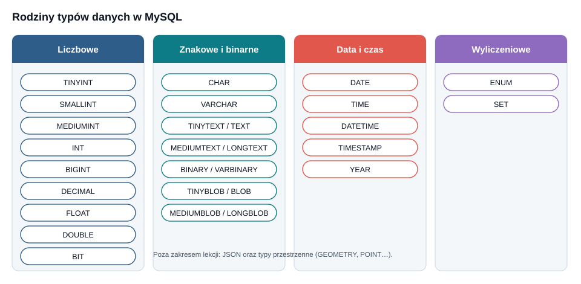
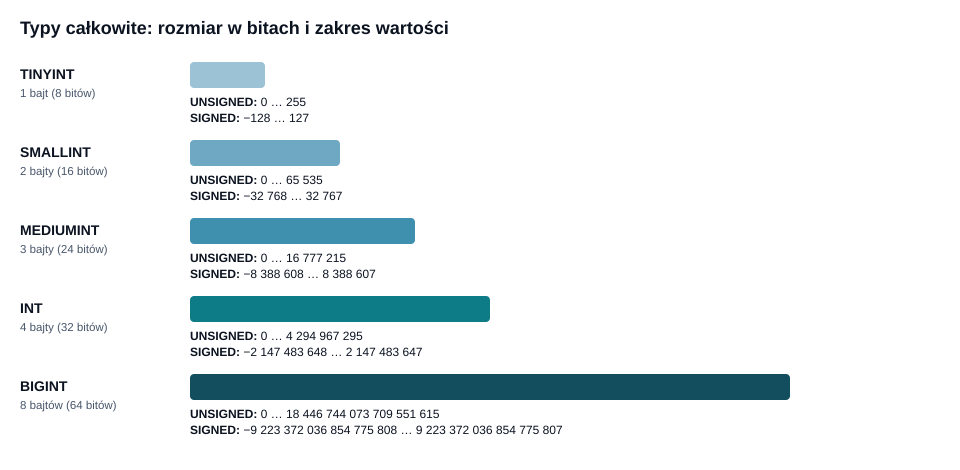
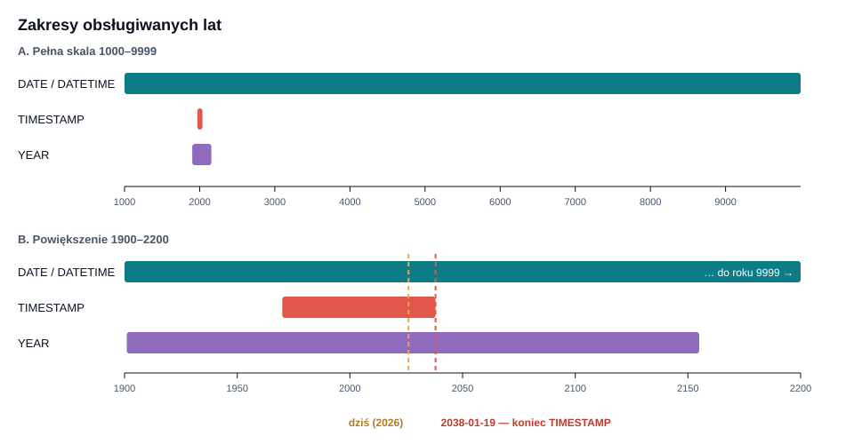
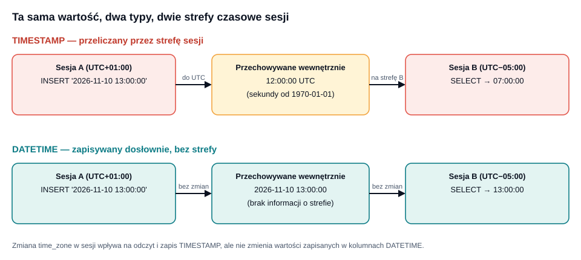
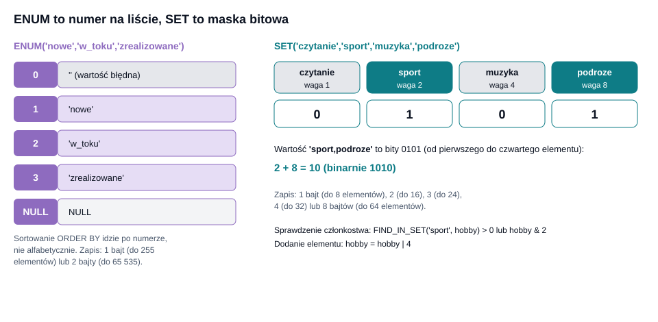

# Typy danych w MySQL: liczby, tekst, dane binarne, data i czas oraz typy wyliczeniowe

## 1. Wprowadzenie: dlaczego typ danych ma znaczenie

Każda kolumna w tabeli relacyjnej baza danych musi mieć zdefiniowany **typ danych**. Typ określa trzy rzeczy jednocześnie: jakie wartości można w kolumnie przechowywać (dziedzinę), ile miejsca zajmuje pojedyncza wartość na dysku i w pamięci oraz jakie operacje można na niej wykonywać (arytmetyka, porównania, sortowanie, funkcje daty).

Wybór typu nie jest szczegółem technicznym. Ma bezpośredni wpływ na:

- **poprawność danych** – kolumna typu `DATE` odrzuci wartość `'31 lutego'`, a kolumna tekstowa przyjmie ją bez protestu;
- **wydajność** – mniejsze typy oznaczają mniejsze wiersze, więcej wierszy na stronie danych (domyślnie 16 KB w InnoDB), mniejsze indeksy i lepsze wykorzystanie pamięci podręcznej;
- **dokładność obliczeń** – różnica między `DECIMAL` a `FLOAT` bywa różnicą między poprawnym a błędnym rachunkiem finansowym;
- **przenośność i przyszłość systemu** – zbyt wąski typ (np. `SMALLINT` na identyfikator) po kilku latach kończy się awarią, bo zakres się wyczerpał.

MySQL dzieli typy na cztery główne rodziny, które omawiamy w tej lekcji.



| Rodzina | Typy omawiane w lekcji | Typowe zastosowanie |
|---|---|---|
| Liczbowe | `TINYINT`, `SMALLINT`, `MEDIUMINT`, `INT`, `BIGINT`, `DECIMAL`, `FLOAT`, `DOUBLE` | identyfikatory, liczniki, ceny, pomiary |
| Znakowe i binarne | `CHAR`, `VARCHAR`, `TEXT`, `BINARY`, `VARBINARY`, `BLOB` | nazwy, opisy, hasze, pliki |
| Data i czas | `DATE`, `TIME`, `DATETIME`, `TIMESTAMP`, `YEAR` | zdarzenia, terminy, logi |
| Wyliczeniowe | `ENUM`, `SET` | słowniki o stałej, małej liczbie wartości |

> **Zasada ogólna:** wybieraj najmniejszy typ, który z zapasem pomieści wszystkie realne wartości, i który najwierniej oddaje znaczenie danych. Oszczędność miejsca jest drugorzędna wobec poprawności semantycznej.

### 1.1. Tryb ścisły (strict mode) i jego znaczenie

Zachowanie MySQL przy wartościach niepasujących do typu zależy od zmiennej `sql_mode`. W nowoczesnych instalacjach (MySQL 5.7 i nowszych) domyślnie włączony jest tryb ścisły (`STRICT_TRANS_TABLES`). Wówczas próba zapisania wartości spoza zakresu kończy się **błędem**, a polecenie jest odrzucane:

```sql
CREATE TABLE test (liczba TINYINT);
INSERT INTO test VALUES (300);
-- ERROR 1264 (22003): Out of range value for column 'liczba' at row 1
```

Bez trybu ścisłego MySQL zapisałby po cichu `127` (największą wartość typu) i wyświetlił jedynie ostrzeżenie. Takie ciche przycinanie danych to częste źródło trudnych do wykrycia błędów, dlatego tryb ścisły należy zawsze pozostawiać włączony. Aktualny tryb sprawdzisz poleceniem:

```sql
SELECT @@sql_mode;
```

## 2. Liczby całkowite

### 2.1. Pięć rozmiarów

MySQL oferuje pięć typów całkowitoliczbowych, różniących się liczbą bajtów, a więc zakresem.



| Typ | Bajty | Zakres ze znakiem (`SIGNED`) | Zakres bez znaku (`UNSIGNED`) |
|---|---|---|---|
| `TINYINT` | 1 | −128 … 127 | 0 … 255 |
| `SMALLINT` | 2 | −32 768 … 32 767 | 0 … 65 535 |
| `MEDIUMINT` | 3 | −8 388 608 … 8 388 607 | 0 … 16 777 215 |
| `INT` (`INTEGER`) | 4 | −2 147 483 648 … 2 147 483 647 | 0 … 4 294 967 295 |
| `BIGINT` | 8 | −2⁶³ … 2⁶³−1 (ok. ±9,22·10¹⁸) | 0 … 2⁶⁴−1 (ok. 1,84·10¹⁹) |

Zakres wynika wprost z liczby bitów $n = 8 \cdot b$, gdzie $b$ to liczba bajtów. Dla typu ze znakiem (zapis w kodzie uzupełnień do dwóch):

$$ -2^{n-1} \;\le\; x \;\le\; 2^{n-1}-1 $$

a dla typu bez znaku:

$$ 0 \;\le\; x \;\le\; 2^{n}-1 $$

Przykład: `TINYINT` ma $n=8$, więc zakres ze znakiem to $-2^7 \ldots 2^7-1 = -128 \ldots 127$, a bez znaku $0 \ldots 2^8-1 = 0 \ldots 255$.

### 2.2. Atrybut UNSIGNED

Atrybut `UNSIGNED` przesuwa zakres w całości na liczby nieujemne, podwajając górną granicę. Warto go stosować wszędzie tam, gdzie wartość nie może być ujemna: identyfikatory, liczniki, ilości sztuk, wiek.

```sql
CREATE TABLE produkty (
    id        INT UNSIGNED NOT NULL AUTO_INCREMENT PRIMARY KEY,
    sztuk     SMALLINT UNSIGNED NOT NULL DEFAULT 0,
    ocena     TINYINT UNSIGNED NULL
);
```

**Pułapka odejmowania.** W wyrażeniach z kolumnami `UNSIGNED` wynik odejmowania, który byłby ujemny, powoduje błąd (`BIGINT UNSIGNED value is out of range`). Jeżeli potrzebujesz różnicy ze znakiem, rzutuj jawnie:

```sql
SELECT CAST(a AS SIGNED) - CAST(b AS SIGNED) FROM t;
```

### 2.3. Szerokość wyświetlania i ZEROFILL

Zapis `INT(11)` bywa mylnie rozumiany jako „liczba na 11 cyfr". Liczba w nawiasie to jedynie **sugerowana szerokość wyświetlania**, która nie ma żadnego wpływu na zakres ani miejsce zajmowane przez wartość. Od MySQL 8.0.17 ta składnia jest oficjalnie przestarzała (`deprecated`) i nie należy jej używać w nowych projektach. Podobnie przestarzały jest atrybut `ZEROFILL`, który uzupełniał wyświetlaną liczbę zerami z lewej strony.

### 2.4. AUTO_INCREMENT i dobór typu identyfikatora

Kolumna `AUTO_INCREMENT` automatycznie nadaje kolejne numery. Typ identyfikatora trzeba dobrać do przewidywanej liczby wierszy w całym okresie życia systemu, wliczając numery „zgubione" (po odrzuconych transakcjach i usuniętych wierszach licznik nie cofa się).

| Przewidywana liczba rekordów | Sensowny typ klucza |
|---|---|
| do 255 (słowniki) | `TINYINT UNSIGNED` |
| do 65 tysięcy | `SMALLINT UNSIGNED` |
| do ok. 4,29 mld | `INT UNSIGNED` |
| praktycznie nieograniczona | `BIGINT UNSIGNED` |

Przy tempie 1000 nowych rekordów na sekundę `INT UNSIGNED` wystarczy na

$$ t = \frac{4\,294\,967\,295}{1000\ \text{rek./s}} \approx 4{,}29\cdot10^{6}\ \text{s} \approx 49{,}7\ \text{dnia} $$

To pokazuje, że w systemach o dużym natężeniu zapisów `INT` bywa zbyt mały i trzeba użyć `BIGINT`. Dla porównania `BIGINT UNSIGNED` przy tym samym tempie starcza na ponad 584 miliony lat.

### 2.5. BOOLEAN i BIT

MySQL nie ma prawdziwego typu logicznego. Słowa `BOOL` i `BOOLEAN` są jedynie synonimami `TINYINT(1)`: wartość 0 oznacza fałsz, każda inna prawda, a stałe `TRUE` i `FALSE` to odpowiednio 1 i 0. Typ `BIT(M)` przechowuje ciąg bitów (od 1 do 64) i bywa używany do flag, ale jest niewygodny w obsłudze i zwykle lepszy jest `TINYINT`.

### 2.6. Zachowanie przy przepełnieniu

| Sytuacja | Tryb ścisły | Tryb nieścisły |
|---|---|---|
| `INSERT` wartości spoza zakresu | błąd 1264, wiersz odrzucony | zapis wartości granicznej + ostrzeżenie |
| Przekroczenie w wyrażeniu `BIGINT` | błąd `BIGINT value is out of range` | jak obok |
| Wpisanie tekstu `'abc'` do `INT` | błąd 1366 | zapis `0` + ostrzeżenie |

## 3. DECIMAL: liczby stałoprzecinkowe o dokładnej wartości

### 3.1. Po co istnieje DECIMAL

Komputery przechowują liczby w układzie dwójkowym. Ułamek dziesiętny taki jak 0,1 nie ma skończonego rozwinięcia dwójkowego, tak jak $1/3$ nie ma skończonego rozwinięcia dziesiętnego. Typy `FLOAT` i `DOUBLE` przechowują więc jedynie przybliżenie. Typ **`DECIMAL`** (synonimy: `NUMERIC`, `DEC`, `FIXED`) działa inaczej: zapisuje cyfry dziesiętne dokładnie, w postaci pakietów cyfr, i wykonuje na nich arytmetykę dokładną. Jest to jedyny właściwy wybór dla kwot pieniężnych.

### 3.2. Składnia: precyzja i skala

```sql
DECIMAL(M, D)
```

- **M** – precyzja, łączna liczba cyfr znaczących (1 … 65);
- **D** – skala, liczba cyfr po przecinku (0 … 30, nie więcej niż M).

Liczba cyfr przed przecinkiem wynosi $M - D$. Kolumna `DECIMAL(8,2)` pomieści więc wartości od `-999999.99` do `999999.99`.

```sql
CREATE TABLE faktury (
    id      INT UNSIGNED AUTO_INCREMENT PRIMARY KEY,
    netto   DECIMAL(10,2) NOT NULL,
    vat     DECIMAL(4,2)  NOT NULL DEFAULT 23.00,
    brutto  DECIMAL(10,2) GENERATED ALWAYS AS (ROUND(netto * (1 + vat/100), 2)) STORED
);
```

Gdy wpisywana wartość ma więcej cyfr po przecinku niż D, następuje **zaokrąglenie** (połówki zaokrąglane od zera). Gdy ma za dużo cyfr przed przecinkiem, w trybie ścisłym zgłaszany jest błąd 1264.

### 3.3. Zajętość miejsca

MySQL zapisuje cyfry w grupach po 9 w 4 bajtach, osobno dla części całkowitej i ułamkowej. Resztka cyfr (mniej niż 9) zajmuje liczbę bajtów zgodną z tabelą:

| Liczba cyfr w resztce | 0 | 1–2 | 3–4 | 5–6 | 7–9 |
|---|---|---|---|---|---|
| Bajty | 0 | 1 | 2 | 3 | 4 |

Zajętość kolumny to suma zajętości części całkowitej i ułamkowej. Przykład dla `DECIMAL(20,6)`: część całkowita ma 14 cyfr = 9 + 5, czyli 4 + 3 = 7 bajtów; część ułamkowa ma 6 cyfr, czyli 3 bajty; razem **10 bajtów**.

### 3.4. Dlaczego nie FLOAT dla pieniędzy

```sql
SELECT 0.1 + 0.2 = 0.3;                 -- 1 (literały dziesiętne to DECIMAL)
SELECT 0.1e0 + 0.2e0 = 0.3e0;           -- 0 (literały zmiennoprzecinkowe)
```

Pierwsze wyrażenie daje prawdę, bo literały bez notacji wykładniczej są traktowane jako `DECIMAL`. Drugie daje fałsz, ponieważ suma przybliżeń $0{,}1 + 0{,}2$ w arytmetyce binarnej to $0{,}30000000000000004\ldots$, a nie dokładnie $0{,}3$. W systemie fakturowym takie różnice po zsumowaniu tysięcy pozycji dają niezgodne salda.

> **Alternatywa:** przechowywanie kwot w groszach jako `BIGINT`. Jest szybkie i dokładne, ale wymaga pamiętania o skali w całej aplikacji. `DECIMAL` jest czytelniejszy i bezpieczniejszy.

## 4. FLOAT i DOUBLE: liczby zmiennoprzecinkowe

### 4.1. Reprezentacja

Typy `FLOAT` i `DOUBLE` implementują standard IEEE 754. Liczba jest zapisana jako znak, wykładnik i mantysa:

$$ x = (-1)^s \cdot m \cdot 2^{e} $$

| Typ | Bajty | Standard | Cyfry znaczące | Przybliżony zakres |
|---|---|---|---|---|
| `FLOAT` | 4 | pojedyncza precyzja | ok. 7 | $\pm 3{,}4\cdot10^{38}$ |
| `DOUBLE` (`DOUBLE PRECISION`, `REAL`) | 8 | podwójna precyzja | ok. 15–16 | $\pm 1{,}8\cdot10^{308}$ |

Zaletą jest ogromny zakres wartości przy małej zajętości, a wadą – **brak dokładności**. Błąd względny reprezentacji jest rzędu $2^{-24} \approx 6\cdot10^{-8}$ dla `FLOAT` i $2^{-53} \approx 1{,}1\cdot10^{-16}$ dla `DOUBLE`.

### 4.2. Konsekwencje praktyczne

1. **Porównania równościowe są zawodne.** Zamiast `WHERE x = 0.3` stosuj przedział: `WHERE ABS(x - 0.3) < 0.000001`.
2. **Błędy kumulują się** przy sumowaniu wielu wartości.
3. **Kolejność działań wpływa na wynik** (dodawanie nie jest łączne).
4. Składnia `FLOAT(M,D)` i `DOUBLE(M,D)` jest przestarzała; zalecany zapis to samo `FLOAT` lub `DOUBLE`. Wariant `FLOAT(p)` z jedną liczbą wybiera `FLOAT` dla $p \le 24$ i `DOUBLE` dla $p$ z przedziału 25–53.

### 4.3. Kiedy FLOAT i DOUBLE są właściwe

Wszędzie tam, gdzie dane z natury są przybliżone, a liczy się zakres i szybkość: pomiary z czujników, współrzędne geograficzne, wyniki obliczeń naukowych, statystyki. Dla współrzędnych geograficznych `DOUBLE` daje precyzję rzędu milimetrów, `FLOAT` – rzędu metrów.

### 4.4. Zestawienie typów liczbowych

| Potrzeba | Zalecany typ |
|---|---|
| Identyfikator, licznik | `INT UNSIGNED` / `BIGINT UNSIGNED` |
| Mała liczba (wiek, ocena, flaga) | `TINYINT [UNSIGNED]` |
| Kwota, stawka, waga handlowa | `DECIMAL(M,D)` |
| Pomiar fizyczny, współrzędna | `DOUBLE` (lub `FLOAT`) |
| Wartość logiczna | `TINYINT(1)` / `BOOLEAN` |

## 5. Typy znakowe

### 5.1. Zestaw znaków i porównywanie (collation)

Każda kolumna tekstowa ma dwa powiązane atrybuty:

- **zestaw znaków** (`CHARACTER SET`) – określa, jakie znaki można zapisać i ile bajtów zajmuje każdy z nich;
- **reguła porównywania** (`COLLATE`) – określa, jak tekst jest porównywany i sortowany (czy wielkość liter ma znaczenie, czy `a` i `ą` są równe).

W MySQL 8.0 domyślnym zestawem jest **`utf8mb4`**, w którym znak zajmuje od 1 do 4 bajtów: litery łacińskie 1 bajt, polskie znaki diakrytyczne 2 bajty, większość znaków CJK 3 bajty, emoji 4 bajty. Starszy zestaw `utf8` (alias `utf8mb3`) mieści tylko znaki do 3 bajtów, więc nie zapisze emoji i jest przestarzały.

| Collation | Cechy |
|---|---|
| `utf8mb4_0900_ai_ci` | domyślna w MySQL 8.0; `ai` = niewrażliwa na akcenty, `ci` = niewrażliwa na wielkość liter; nie dopełnia spacjami (NO PAD) |
| `utf8mb4_unicode_ci` | starsza reguła Unicode, popularna w MySQL 5.7 |
| `utf8mb4_polish_ci` | polskie reguły sortowania (ą po a, ć po c itd.) |
| `utf8mb4_bin` | porównanie bajt po bajcie, wrażliwe na wielkość liter i akcenty |

```sql
CREATE TABLE klienci (
    id       INT UNSIGNED AUTO_INCREMENT PRIMARY KEY,
    nazwisko VARCHAR(80) CHARACTER SET utf8mb4 COLLATE utf8mb4_polish_ci NOT NULL
) DEFAULT CHARSET = utf8mb4;
```

Przy kolacji z końcówką `_ci` zapytanie `WHERE nazwisko = 'KOWALSKI'` znajdzie także `Kowalski`. Jeśli potrzebujesz rozróżniania wielkości liter (np. dla tokenów), użyj kolacji `_bin` lub `_cs`.

> **Uwaga:** przy `utf8mb4` indeks na kolumnie `VARCHAR(255)` zajmuje do $255 \cdot 4 = 1020$ bajtów. Limit długości klucza indeksu w InnoDB to 3072 bajty (przy formacie wierszy DYNAMIC), co zostawia zapas, ale trzeba o nim pamiętać przy indeksach złożonych.

### 5.2. CHAR(N): ciąg o stałej długości

`CHAR(N)` (N od 0 do 255) przechowuje dokładnie N znaków. Krótsze wartości są dopełniane spacjami z prawej strony, a przy odczycie spacje końcowe są zazwyczaj usuwane.

```sql
CREATE TABLE kraje (kod CHAR(2) NOT NULL PRIMARY KEY, nazwa VARCHAR(60));
INSERT INTO kraje VALUES ('PL', 'Polska');
```

Zajętość to maksymalnie $N \cdot (\text{maks. bajtów na znak})$; InnoDB zapisuje jednak wartości `CHAR` w zestawach wielobajtowych ze zmienną długością, więc rzeczywista zajętość bywa mniejsza. Typ stosuj dla wartości o **stałej, krótkiej długości**: kody krajów (ISO 3166), kody walut, hasze o znanej długości zapisane szesnastkowo (np. SHA-256 = `CHAR(64)`), stałe identyfikatory.

### 5.3. VARCHAR(N): ciąg o zmiennej długości

`VARCHAR(N)` przechowuje tekst o długości do N znaków. Wartość zajmuje faktyczną liczbę bajtów plus **1 bajt prefiksu długości** (gdy wartość mieści się w 255 bajtach) lub **2 bajty** (gdy większa).

$$ \text{rozmiar} = L_{\text{bajty}} + \begin{cases} 1 & L_{\text{bajty}} \le 255 \\ 2 & L_{\text{bajty}} > 255 \end{cases} $$

Przykład: słowo `Łódź` w `utf8mb4` to $1\cdot2 + 1\cdot2 + 1\cdot1 + 1\cdot2 = 7$ bajtów (Ł – 2, ó – 2, d – 1, ź – 2 → razem 7), plus 1 bajt prefiksu = **8 bajtów**.

Maksymalna długość jest ograniczona **wspólnym limitem 65 535 bajtów na cały wiersz** (z wyłączeniem typów `TEXT` i `BLOB`, których zawartość zwykle leży poza wierszem). Dla `utf8mb4` oznacza to teoretycznie najwyżej 16 383 znaki w jednej kolumnie `VARCHAR`, i to bez żadnych innych kolumn w tabeli.

### 5.4. CHAR czy VARCHAR

| Kryterium | `CHAR(N)` | `VARCHAR(N)` |
|---|---|---|
| Długość wartości | stała | zmienna |
| Prefiks długości | brak | 1 lub 2 bajty |
| Spacje końcowe | usuwane przy odczycie | zachowywane (obcinane tylko przy zapisie nadmiaru z ostrzeżeniem) |
| Typowe zastosowanie | kody, hasze | nazwiska, adresy, tytuły |
| Zmiana długości wartości | bez fragmentacji | może wymusić przeniesienie wiersza |

**Dobra praktyka:** nie ustawiaj „na zapas" `VARCHAR(255)` wszędzie. Choć sama zajętość na dysku zależy od faktycznej długości, MySQL przy sortowaniu i tabelach tymczasowych rezerwuje pamięć według deklarowanego maksimum, więc zawyżone N szkodzi wydajności. Dobieraj N do realnych wymagań (np. `VARCHAR(2)` dla kodu kraju nie ma sensu, bo `CHAR(2)` jest lepszy; `VARCHAR(100)` dla nazwiska jest rozsądne).

### 5.5. TEXT: długie teksty

Dla długich tekstów MySQL oferuje cztery typy:

| Typ | Maks. długość | Prefiks długości |
|---|---|---|
| `TINYTEXT` | 255 bajtów | 1 bajt |
| `TEXT` | 65 535 bajtów (64 KB) | 2 bajty |
| `MEDIUMTEXT` | 16 777 215 bajtów (16 MB) | 3 bajty |
| `LONGTEXT` | 4 294 967 295 bajtów (4 GB) | 4 bajty |

Różnice względem `VARCHAR`:

1. Kolumna `TEXT` **nie może mieć wartości domyślnej** (w klasycznej składni; w MySQL 8.0.13+ dopuszczalne są wyrażenia w nawiasach: `DEFAULT ('')`).
2. Indeks wymaga **podania długości prefiksu**: `CREATE INDEX idx ON artykuly (tresc(100));`. Do wyszukiwania w pełnym tekście służy indeks `FULLTEXT`.
3. Zawartość dużych wartości jest zwykle przechowywana **poza wierszem** na stronach przepełnienia, co oznacza dodatkowe odczyty.
4. Sortowanie po `TEXT` używa tylko pierwszych `max_sort_length` bajtów (domyślnie 1024).

**Zalecenie:** jeśli tekst ma rozsądny limit (do kilku tysięcy znaków), `VARCHAR` jest zwykle lepszym wyborem. `TEXT` zostaw na artykuły, komentarze o dużej objętości, opisy produktów, treści wiadomości.

### 5.6. Porównywanie ciągów i spacje końcowe

W MySQL 8.0 z kolacją `utf8mb4_0900_ai_ci` (atrybut NO PAD) spacje końcowe są znaczące: `'a' = 'a '` daje fałsz. W starszych kolacjach z atrybutem PAD SPACE (np. `utf8mb4_unicode_ci`) wynik byłby prawdziwy. Operator `LIKE` zawsze uwzględnia spacje końcowe.

### 5.7. Typowe błędy

- **Błąd 1406 (Data too long for column)** – wartość dłuższa niż N znaków w trybie ścisłym. W trybie nieścisłym nadmiar jest po cichu obcinany.
- **Błąd 1366 (Incorrect string value)** – zapis znaków, których zestaw kolumny nie obsługuje (typowo emoji w `utf8mb3`). Rozwiązanie: konwersja do `utf8mb4`.
- **Mieszanie kolacji** – złączenie kolumn o różnych kolacjach daje błąd `Illegal mix of collations`. Rozwiązanie: ujednolicić kolacje lub użyć `COLLATE` w wyrażeniu.

## 6. Typy binarne

### 6.1. Różnica między tekstem a danymi binarnymi

Typy znakowe przechowują **znaki** interpretowane przez zestaw znaków i kolację. Typy binarne przechowują **surowe bajty** bez żadnej interpretacji. Porównania są wykonywane bajt po bajcie, więc wielkość liter ma znaczenie, a długość mierzy się w bajtach, nie w znakach.

| Typ znakowy | Odpowiednik binarny |
|---|---|
| `CHAR(N)` | `BINARY(N)` |
| `VARCHAR(N)` | `VARBINARY(N)` |
| `TINYTEXT` / `TEXT` / `MEDIUMTEXT` / `LONGTEXT` | `TINYBLOB` / `BLOB` / `MEDIUMBLOB` / `LONGBLOB` |

### 6.2. BINARY i VARBINARY

`BINARY(N)` ma stałą długość i dopełnia krótsze wartości bajtami `0x00` (nie spacjami). `VARBINARY(N)` ma długość zmienną, z prefiksem długości jak `VARCHAR`. Zastosowania:

- **Hasze i skróty kryptograficzne** w postaci surowej: SHA-256 to 32 bajty, czyli `BINARY(32)`, zamiast 64 znaków hex w `CHAR(64)` – oszczędność połowy miejsca i szybsze porównania.
- **Identyfikatory UUID.** Tekstowy UUID ma 36 znaków, a w postaci binarnej tylko 16 bajtów.
- **Adresy IP:** `VARBINARY(16)` mieści zarówno IPv4, jak i IPv6.

```sql
CREATE TABLE sesje (
    id    BINARY(16) PRIMARY KEY,
    ip    VARBINARY(16) NOT NULL
);

INSERT INTO sesje VALUES (UUID_TO_BIN(UUID(), 1), INET6_ATON('2001:db8::1'));

SELECT BIN_TO_UUID(id, 1) AS uuid, INET6_NTOA(ip) AS adres FROM sesje;
```

Drugi argument `1` w `UUID_TO_BIN` zamienia kolejność części czasowych UUID wersji 1, dzięki czemu kolejne identyfikatory są rosnące, a klucz główny nie ulega silnej fragmentacji. Dla adresów IPv4 przechowywanych jako liczba dostępna jest para `INET_ATON` / `INET_NTOA` (wynik mieści się w `INT UNSIGNED`).

### 6.3. BLOB

Typy `BLOB` służą do przechowywania dużych porcji danych binarnych: obrazów, dokumentów, skompresowanych danych. Rozmiary odpowiadają typom `TEXT`: 255 B, 64 KB, 16 MB i 4 GB (odpowiednio `TINYBLOB`, `BLOB`, `MEDIUMBLOB`, `LONGBLOB`).

Ograniczenie dla zapisu dużych wartości wyznacza parametr serwera `max_allowed_packet` (domyślnie 64 MB w MySQL 8.0), który musi być większy od przesyłanej wartości.

### 6.4. Czy przechowywać pliki w bazie

To częsty dylemat projektowy.

| Argumenty za bazą (BLOB) | Argumenty za systemem plików |
|---|---|
| spójność transakcyjna i kopie zapasowe w jednym miejscu | mniejsza baza i szybsze kopie zapasowe |
| prosty model uprawnień | tańsze przechowywanie, możliwość użycia CDN |
| brak „osieroconych" plików | szybsze serwowanie dużych plików |

W typowej aplikacji WWW zaleca się przechowywać pliki w systemie plików lub w magazynie obiektowym, a w bazie jedynie **ścieżkę/klucz**, typ MIME, rozmiar i sumę kontrolną. BLOB sprawdza się dla małych obiektów (ikony, podpisy, niewielkie załączniki) przy wymaganiu spójności.

## 7. Typy daty i czasu

### 7.1. Przegląd

| Typ | Format | Zakres | Bajty | Zawartość |
|---|---|---|---|---|
| `DATE` | `YYYY-MM-DD` | 1000-01-01 … 9999-12-31 | 3 | sama data |
| `TIME` | `HH:MM:SS` | −838:59:59 … 838:59:59 | 3 | godzina lub czas trwania |
| `DATETIME` | `YYYY-MM-DD HH:MM:SS` | 1000-01-01 00:00:00 … 9999-12-31 23:59:59 | 5 | data i godzina |
| `TIMESTAMP` | `YYYY-MM-DD HH:MM:SS` | 1970-01-01 00:00:01 UTC … 2038-01-19 03:14:07 UTC | 4 | moment w czasie (UTC) |
| `YEAR` | `YYYY` | 1901 … 2155 oraz 0000 | 1 | sam rok |

(Do podanych bajtów dochodzi pamięć na ułamki sekund, patrz p. 7.3.) Typ `DATE` formalnie może przechowywać także daty wcześniejsze niż 1000-01-01, ale MySQL gwarantuje poprawną obsługę tylko od tej granicy.



### 7.2. DATE

`DATE` przechowuje wyłącznie datę. Akceptuje różne formaty wejściowe, ale **zawsze zwraca** `YYYY-MM-DD`. Zalecany jest format ISO 8601, który jest niezależny od ustawień regionalnych.

```sql
CREATE TABLE urodziny (osoba VARCHAR(60), data_ur DATE NOT NULL);
INSERT INTO urodziny VALUES ('Anna', '1990-05-17');

SELECT osoba, TIMESTAMPDIFF(YEAR, data_ur, CURDATE()) AS wiek FROM urodziny;
```

W trybie ścisłym wartości niepoprawne (np. `'2026-02-30'`) są odrzucane. Daty zerowe (`0000-00-00`) i częściowo zerowe są domyślnie blokowane przez tryby `NO_ZERO_DATE` i `NO_ZERO_IN_DATE`. Zamiast „daty zerowej" należy używać `NULL`.

### 7.3. TIME i ułamki sekund

Typ `TIME` służy zarówno do godziny w ciągu doby, jak i do **czasu trwania**, dlatego jego zakres wykracza poza 24 godziny (od −838:59:59 do 838:59:59, czyli ok. ±34,9 doby).

Typy `TIME`, `DATETIME` i `TIMESTAMP` mogą mieć **ułamki sekund** o dokładności do mikrosekund. Podaje się to w nawiasie jako `fsp` (0–6):

```sql
CREATE TABLE pomiary (
    id     INT UNSIGNED AUTO_INCREMENT PRIMARY KEY,
    czas   DATETIME(3) NOT NULL DEFAULT CURRENT_TIMESTAMP(3)
);
```

Dodatkowa pamięć zależy od liczby cyfr ułamkowych:

| `fsp` | 0 | 1–2 | 3–4 | 5–6 |
|---|---|---|---|---|
| Dodatkowe bajty | 0 | 1 | 2 | 3 |

Przykład: `DATETIME(3)` zajmuje $5 + 2 = 7$ bajtów, a `TIMESTAMP(6)` $4 + 3 = 7$ bajtów. **Uwaga:** zapis `'12:30'` w kolumnie `TIME` oznacza 12 godzin 30 minut, ale zapis `'1230'` to 12 minut 30 sekund.

### 7.4. DATETIME

`DATETIME` zapisuje datę i godzinę **dosłownie**, tak jak zostały podane, bez żadnego przeliczania i bez informacji o strefie czasowej. Obejmuje bardzo szeroki zakres lat (1000–9999), dlatego nadaje się do terminów, rezerwacji, dat urodzin z godziną i wszystkich zdarzeń, które mają znaczenie „lokalnie" (np. „spotkanie o 9:00 w Warszawie").

### 7.5. TIMESTAMP

`TIMESTAMP` przechowuje liczbę sekund, które upłynęły od 1970-01-01 00:00:00 UTC (tzw. czas uniksowy). Przy zapisie wartość jest **przeliczana ze strefy czasowej sesji na UTC**, a przy odczycie – z powrotem na strefę sesji.



Strefę sesji ustawia zmienna `time_zone`:

```sql
SET time_zone = '+01:00';
CREATE TABLE zdarzenia (
    ts TIMESTAMP NOT NULL,
    dt DATETIME  NOT NULL
);
INSERT INTO zdarzenia VALUES ('2026-11-10 13:00:00', '2026-11-10 13:00:00');

SET time_zone = '-05:00';
SELECT ts, dt FROM zdarzenia;
-- ts: 2026-11-10 07:00:00   (przeliczony)
-- dt: 2026-11-10 13:00:00   (bez zmian)
```

Zakres `TIMESTAMP` jest ograniczony 32-bitowym licznikiem sekund. Ostatnia obsługiwana chwila to 2038-01-19 03:14:07 UTC, ponieważ

$$ 2^{31} - 1 = 2\,147\,483\,647 \ \text{s} \approx 68{,}05 \ \text{lat po 1970-01-01} $$

Zjawisko to nazywane jest **problemem roku 2038 (Y2038)**. Systemy planujące zdarzenia sięgające po 2038 r. (np. terminy kredytów, gwarancje, subskrypcje) powinny używać `DATETIME`.

### 7.6. Automatyczna inicjalizacja i aktualizacja

Zarówno `TIMESTAMP`, jak i `DATETIME` (od MySQL 5.6.5) mogą być automatycznie ustawiane na bieżący czas:

```sql
CREATE TABLE artykuly (
    id          INT UNSIGNED AUTO_INCREMENT PRIMARY KEY,
    tytul       VARCHAR(200) NOT NULL,
    utworzono   DATETIME  NOT NULL DEFAULT CURRENT_TIMESTAMP,
    zmieniono   DATETIME  NOT NULL DEFAULT CURRENT_TIMESTAMP
                          ON UPDATE CURRENT_TIMESTAMP
);
```

Kolumna `zmieniono` aktualizuje się sama przy każdej zmianie innej kolumny wiersza. Pierwsza kolumna `TIMESTAMP` w tabeli była historycznie traktowana specjalnie (automatyczne `DEFAULT` i `ON UPDATE`), o ile nie włączono zmiennej `explicit_defaults_for_timestamp`. W MySQL 8.0 zmienna ta jest domyślnie włączona i kolumna `TIMESTAMP` zachowuje się jak każda inna – dopuszcza `NULL` i nie dostaje niejawnych atrybutów.

### 7.7. DATETIME czy TIMESTAMP

| Kryterium | `DATETIME` | `TIMESTAMP` |
|---|---|---|
| Zakres | 1000–9999 | 1970–2038 |
| Bajty (bez ułamków) | 5 | 4 |
| Strefa czasowa | brak, wartość dosłowna | przeliczana wg `time_zone` |
| Zastosowanie | terminy, rezerwacje, daty „lokalne" | momenty zdarzeń: logi, audyt, `utworzono`/`zmieniono` |

Dobra praktyka w aplikacjach wielostrefowych: przechowuj momenty zdarzeń w UTC i przeliczaj na strefę użytkownika dopiero w warstwie prezentacji, np. funkcją `CONVERT_TZ(ts, 'UTC', 'Europe/Warsaw')` (wymaga załadowanych tabel stref czasowych).

### 7.8. Funkcje i obliczenia na datach

| Funkcja | Działanie | Przykład |
|---|---|---|
| `NOW()`, `CURDATE()`, `CURTIME()` | bieżący czas, data, godzina | `SELECT NOW();` |
| `DATE_ADD` / `DATE_SUB` | dodawanie i odejmowanie interwału | `DATE_ADD('2026-11-10', INTERVAL 30 DAY)` |
| `DATEDIFF(a, b)` | różnica w dniach | `DATEDIFF('2026-12-24', '2026-11-10')` → 44 |
| `TIMESTAMPDIFF(j, a, b)` | różnica w wybranej jednostce | `TIMESTAMPDIFF(HOUR, a, b)` |
| `DATE_FORMAT(d, f)` | formatowanie | `DATE_FORMAT(NOW(), '%d.%m.%Y')` |
| `EXTRACT(j FROM d)` | wyciągnięcie części | `EXTRACT(YEAR FROM NOW())` |
| `STR_TO_DATE(s, f)` | parsowanie tekstu | `STR_TO_DATE('10.11.2026', '%d.%m.%Y')` |

**Pułapka indeksów.** Zapytanie `WHERE YEAR(data) = 2026` uniemożliwia użycie indeksu na kolumnie `data`, bo funkcja jest stosowana do każdego wiersza. Poprawny zapis to przedział półotwarty:

```sql
WHERE data >= '2026-01-01' AND data < '2027-01-01'
```

### 7.9. YEAR

Typ `YEAR` zajmuje 1 bajt i przechowuje rok z zakresu 1901–2155 (oraz specjalną wartość 0000). Jest wygodny dla kolumn typu „rok produkcji" lub „rok wydania". Od MySQL 8.0 obsługiwany jest wyłącznie format czterocyfrowy.

## 8. Typy wyliczeniowe: ENUM i SET

### 8.1. ENUM: jedna wartość z listy

`ENUM` pozwala zdefiniować zamkniętą listę dozwolonych wartości tekstowych. Kolumna może przyjąć **dokładnie jedną** z nich (lub `NULL`, jeśli na to pozwala).

```sql
CREATE TABLE zadania (
    id      INT UNSIGNED AUTO_INCREMENT PRIMARY KEY,
    tytul   VARCHAR(120) NOT NULL,
    status  ENUM('nowe', 'w_toku', 'zrealizowane') NOT NULL DEFAULT 'nowe'
);

INSERT INTO zadania (tytul, status) VALUES ('Raport', 'w_toku');
INSERT INTO zadania (tytul, status) VALUES ('Błąd', 'anulowane');
-- ERROR 1265 (01000): Data truncated for column 'status' at row 1
```

### 8.2. Wewnętrzna reprezentacja ENUM

Wartości ENUM są zapisywane jako **liczby** – numery pozycji na liście, liczone od 1. Pamięć zajmuje 1 bajt (do 255 elementów) lub 2 bajty (do 65 535 elementów). Pusty ciąg `''` jest rezerwowany dla wartości błędnej (indeks 0) w trybie nieścisłym, a `NULL` ma własny indeks `NULL`.



Ma to ważne konsekwencje:

1. **Sortowanie** po kolumnie ENUM (`ORDER BY`) odbywa się według numeru pozycji, nie alfabetycznie. Kolejność na liście definicji ma więc znaczenie.
2. W kontekście liczbowym wartość ENUM zwraca indeks: `SELECT status + 0 FROM zadania;` zwróci 1, 2 lub 3.
3. **Dodanie nowej wartości na końcu listy** jest operacją szybką (zmiana metadanych), ale wstawienie w środku lub zmiana kolejności wymaga przebudowy tabeli.
4. Porównanie z liczbą (`WHERE status = 2`) jest poprawne składniowo, ale bardzo łatwo o pomyłkę. Zawsze porównuj z tekstem.

### 8.3. SET: zero lub wiele wartości z listy

`SET` pozwala wybrać **dowolny podzbiór** elementów zdefiniowanej listy (do 64 elementów). Wartości zapisuje się jako ciąg oddzielony przecinkami, bez spacji.

```sql
CREATE TABLE uzytkownicy (
    id      INT UNSIGNED AUTO_INCREMENT PRIMARY KEY,
    login   VARCHAR(40) NOT NULL,
    hobby   SET('czytanie', 'sport', 'muzyka', 'podroze') NOT NULL DEFAULT ''
);

INSERT INTO uzytkownicy (login, hobby) VALUES ('ania', 'sport,podroze');
```

Wewnętrznie SET to **maska bitowa**: element $i$ (licząc od 0) ma wagę $2^i$, a wartość kolumny jest sumą wag wybranych elementów. Dla `'sport,podroze'` mamy $2^1 + 2^3 = 2 + 8 = 10$. Zajętość to 1, 2, 3, 4 lub 8 bajtów, zależnie od liczby elementów:

$$ \text{bajty} = \left\lceil \frac{N}{8} \right\rceil \quad (\text{zaokrąglone do 1, 2, 3, 4 lub 8}) $$

Zapytania na kolumnach SET:

```sql
-- zawiera element 'sport'
SELECT login FROM uzytkownicy WHERE FIND_IN_SET('sport', hobby) > 0;
SELECT login FROM uzytkownicy WHERE hobby & 2;

-- dokładnie taki zestaw
SELECT login FROM uzytkownicy WHERE hobby = 'sport,podroze';

-- dodanie elementu
UPDATE uzytkownicy SET hobby = hobby | 4 WHERE id = 1;
```

Przy zapisie MySQL **normalizuje** kolejność elementów do kolejności z definicji, więc `'podroze,sport'` zostanie zapisane jako `'sport,podroze'`.

### 8.4. Krytyczna ocena ENUM i SET

Typy wyliczeniowe są kompaktowe i czytelne, ale mają istotne wady, o których warto wiedzieć:

| Zaleta | Wada |
|---|---|
| mała zajętość (1–2 bajty) | zmiana listy wartości wymaga `ALTER TABLE` |
| ograniczenie dziedziny na poziomie bazy | lista wartości „zaszyta" w schemacie, trudna do rozszerzania przez aplikację |
| czytelne zapytania i wyniki | niepoprawne wartości w trybie nieścisłym zamieniane na `''` |
| szybkie porównania | niewygodne metadane (nie da się łatwo pobrać listy wartości jako rekordów) |

**Alternatywa relacyjna.** Dla słowników, które mogą się zmieniać, zwykle lepsza jest tabela słownikowa z kluczem obcym:

```sql
CREATE TABLE statusy (id TINYINT UNSIGNED PRIMARY KEY, nazwa VARCHAR(30) NOT NULL UNIQUE);
ALTER TABLE zadania ADD CONSTRAINT fk_status
    FOREIGN KEY (status_id) REFERENCES statusy (id);
```

Podobnie SET łamie **pierwszą postać normalną** (wiele wartości w jednej komórce); relacja wiele-do-wielu z tabelą pośrednią jest jego poprawnym relacyjnym odpowiednikiem i pozwala na wydajne indeksowanie. `ENUM` stosuj dla niewielkich, praktycznie niezmiennych list (płeć, rozmiar S/M/L/XL, dni tygodnia), a `SET` – dla prostych zestawów flag.

## 9. Konwersje typów i typowe pułapki

### 9.1. Konwersja jawna: CAST i CONVERT

```sql
SELECT CAST('123' AS UNSIGNED);              -- 123
SELECT CAST(19.99 AS SIGNED);                -- 20 (zaokrąglenie)
SELECT CAST('2026-11-10' AS DATE);
SELECT CONVERT('abc' USING utf8mb4);
SELECT CAST(12.3456 AS DECIMAL(6,2));        -- 12.35
```

Dostępne typy docelowe w `CAST` to m.in. `SIGNED`, `UNSIGNED`, `DECIMAL(M,D)`, `CHAR`, `DATE`, `DATETIME`, `TIME`, `BINARY`, `JSON`, `FLOAT`, `DOUBLE`.

### 9.2. Konwersja niejawna

Gdy porównujesz wartości różnych typów, MySQL konwertuje je automatycznie. Reguły bywają zaskakujące:

| Wyrażenie | Wynik | Wyjaśnienie |
|---|---|---|
| `'10' + 5` | 15 | tekst zamieniany na liczbę |
| `'abc' = 0` | 1 (prawda) | `'abc'` zamienia się na 0 |
| `'5abc' + 1` | 6 + ostrzeżenie | konwersja do pierwszego znaku nie-cyfry |
| `1 = '1.0'` | 1 | oba porównywane jako liczby zmiennoprzecinkowe |

**Pułapka wydajnościowa.** Jeśli kolumna `telefon` jest typu `VARCHAR`, a zapytanie brzmi `WHERE telefon = 500123456` (liczba bez cudzysłowu), MySQL konwertuje do liczby **wartość z każdego wiersza**, więc indeks na kolumnie nie może zostać użyty. Zawsze porównuj w typie kolumny: `WHERE telefon = '500123456'`.

### 9.3. Numery telefonu, kody pocztowe, PESEL

Dane, które wyglądają jak liczby, ale nimi nie są (nie wykonuje się na nich arytmetyki, mają zera wiodące), należy przechowywać jako tekst. Numer telefonu `048500123456`, kod pocztowy `00-950` czy PESEL `02070803628` w kolumnie `INT` straciłyby zera wiodące lub w ogóle nie zmieściłyby się w zakresie. Odpowiednie są `CHAR`/`VARCHAR`.

### 9.4. NULL i wartości domyślne

`NULL` oznacza „brak wartości" i nie jest równy niczemu, nawet innemu `NULL`. Porównania wymagają operatorów `IS NULL` / `IS NOT NULL`. Kolumny `NOT NULL` są nieco mniejsze i upraszczają indeksowanie, więc deklaruj `NOT NULL` wszędzie, gdzie brak wartości nie ma sensu biznesowego.

## 10. Praktyczny dobór typów: schemat sklepu internetowego

```sql
CREATE TABLE klienci (
    id            INT UNSIGNED       AUTO_INCREMENT PRIMARY KEY,
    email         VARCHAR(254)       NOT NULL UNIQUE,
    imie          VARCHAR(60)        NOT NULL,
    nazwisko      VARCHAR(80)        NOT NULL,
    telefon       VARCHAR(20)        NULL,
    kod_kraju     CHAR(2)            NOT NULL DEFAULT 'PL',
    haslo_hash    BINARY(32)         NOT NULL,
    data_ur       DATE               NULL,
    utworzono     DATETIME           NOT NULL DEFAULT CURRENT_TIMESTAMP,
    aktywny       TINYINT(1)         NOT NULL DEFAULT 1
);

CREATE TABLE produkty (
    id            INT UNSIGNED       AUTO_INCREMENT PRIMARY KEY,
    nazwa         VARCHAR(150)       NOT NULL,
    opis          TEXT               NULL,
    cena          DECIMAL(10,2)      NOT NULL,
    stawka_vat    DECIMAL(4,2)       NOT NULL DEFAULT 23.00,
    stan          SMALLINT UNSIGNED  NOT NULL DEFAULT 0,
    waga_kg       DOUBLE             NULL,
    rozmiar       ENUM('S','M','L','XL') NULL
);

CREATE TABLE zamowienia (
    id            BIGINT UNSIGNED    AUTO_INCREMENT PRIMARY KEY,
    klient_id     INT UNSIGNED       NOT NULL,
    status        ENUM('nowe','oplacone','wyslane','dostarczone','anulowane')
                                     NOT NULL DEFAULT 'nowe',
    zlozono       DATETIME(3)        NOT NULL DEFAULT CURRENT_TIMESTAMP(3),
    zmieniono     TIMESTAMP          NOT NULL DEFAULT CURRENT_TIMESTAMP
                                     ON UPDATE CURRENT_TIMESTAMP,
    FOREIGN KEY (klient_id) REFERENCES klienci (id)
);
```

Uzasadnienie wyborów: e-mail ma maksymalnie 254 znaki według standardów; hasło przechowujemy jako 32-bajtowy skrót (w praktyce zalecane są wyspecjalizowane algorytmy z solą, np. bcrypt lub Argon2, zapisywane jako tekst, a przykład ilustruje tylko dobór typu); cena jako `DECIMAL`; stan magazynowy jako `SMALLINT UNSIGNED` (do 65 535 sztuk); zamówień spodziewamy się bardzo dużo, więc `BIGINT UNSIGNED`; moment złożenia z dokładnością do milisekund; status jako `ENUM`.

## 11. Podsumowanie

1. Typ danych określa dziedzinę, zajętość i dozwolone operacje; dobieraj go świadomie.
2. Liczby całkowite wybieraj według zakresu, stosując `UNSIGNED` dla wartości nieujemnych. Szerokość w nawiasie nie zmienia zakresu.
3. Dla kwot pieniężnych używaj `DECIMAL`; `FLOAT` i `DOUBLE` dla przybliżonych pomiarów.
4. `CHAR` jest dla krótkich wartości o stałej długości, `VARCHAR` dla zmiennych, `TEXT` dla długich tekstów; w nowych projektach stosuj `utf8mb4`.
5. `BINARY`, `VARBINARY` i `BLOB` przechowują surowe bajty, np. hasze, UUID i małe pliki.
6. `DATETIME` zapisuje wartość dosłownie, a `TIMESTAMP` przelicza strefy i kończy się w 2038 r.
7. `ENUM` to numer pozycji na liście, `SET` to maska bitowa. Dla zmiennych słowników lepsza jest tabela słownikowa.
8. Trzymaj włączony tryb ścisły i porównuj wartości w typie kolumny.

## 12. Słowniczek pojęć

| Pojęcie | Znaczenie |
|---|---|
| Typ danych | określenie dziedziny wartości, zajętości i operacji dla kolumny |
| `UNSIGNED` | atrybut liczby bez znaku, obejmujący wyłącznie wartości nieujemne |
| Precyzja | łączna liczba cyfr znaczących liczby (M w `DECIMAL(M,D)`) |
| Skala | liczba cyfr po przecinku (D w `DECIMAL(M,D)`) |
| IEEE 754 | standard zapisu liczb zmiennoprzecinkowych |
| Mantysa | część liczby zmiennoprzecinkowej niosąca cyfry znaczące |
| Zestaw znaków | zbiór znaków i sposób ich kodowania na bajty (np. `utf8mb4`) |
| Collation | reguła porównywania i sortowania tekstu |
| `utf8mb4` | zestaw znaków UTF-8 obsługujący znaki do 4 bajtów |
| BLOB | duży obiekt binarny (*Binary Large Object*) |
| Czas uniksowy | liczba sekund od 1970-01-01 00:00:00 UTC |
| Strefa czasowa sesji | ustawienie `time_zone` wpływające na przeliczanie `TIMESTAMP` |
| Y2038 | problem końca zakresu 32-bitowego licznika sekund w 2038 r. |
| `fsp` | liczba cyfr ułamków sekund (0–6) |
| Tryb ścisły | tryb `sql_mode`, w którym niepoprawne dane powodują błąd |
| `ENUM` | typ z jedną wartością z zamkniętej listy |
| `SET` | typ z podzbiorem wartości z zamkniętej listy |
| Maska bitowa | liczba, w której poszczególne bity oznaczają obecność elementów |
| `CAST` | jawna konwersja wartości do wskazanego typu |

## 13. Pytania kontrolne

1. Wymień trzy aspekty, które określa typ danych kolumny, i uzasadnij, dlaczego jego wybór wpływa na wydajność.
2. Jaki zakres ma `TINYINT` ze znakiem i bez znaku? Oblicz go ze wzoru na liczbę bitów.
3. Co oznacza liczba w nawiasie w deklaracji `INT(11)`? Czy zmienia ona zakres typu?
4. Wyjaśnij różnicę między `DECIMAL(8,2)` a `FLOAT`. Dlaczego do kwot pieniężnych używamy pierwszego z nich?
5. Dlaczego wyrażenie `0.1e0 + 0.2e0 = 0.3e0` daje fałsz?
6. Porównaj `CHAR(N)` i `VARCHAR(N)` pod względem zajętości i zastosowań. Podaj po dwa przykłady.
7. Czym różni się typ `VARBINARY` od `VARCHAR` i kiedy wybierzesz `BINARY(16)` zamiast `CHAR(36)`?
8. Wyjaśnij różnicę między `DATETIME` a `TIMESTAMP` w kontekście strefy czasowej i zakresu. Na czym polega problem roku 2038?
9. Jak wewnętrznie reprezentowane są wartości `ENUM`, a jak `SET`? Jaki wpływ ma to na sortowanie `ENUM`?
10. Wskaż wady `ENUM` i `SET` oraz alternatywę relacyjną, którą można zastosować.

## 14. Zadania obliczeniowe i praktyczne

**Zadanie 1.** Oblicz zakres typu `SMALLINT UNSIGNED` oraz `MEDIUMINT` ze znakiem.

**Zadanie 2.** Ile bajtów zajmuje kolumna `DECIMAL(20,6)`?

**Zadanie 3.** Ile bajtów zajmuje wartość `'Zażółć gęślą jaźń'` w kolumnie `VARCHAR(50)` w zestawie `utf8mb4`? Znaki spoza zestawu ASCII (polskie litery diakrytyczne) zajmują po 2 bajty, pozostałe (w tym spacje) po 1 bajcie.

**Zadanie 4.** Ile bajtów zajmuje kolumna `DATETIME(6)`, a ile `TIMESTAMP(3)`?

**Zadanie 5.** Kolumna `SET('a','b','c','d','e')` ma wartość `'b,e'`. Jaka jest jej wartość liczbowa i ile bajtów zajmuje?

**Zadanie 6.** System rejestruje 250 zdarzeń na sekundę, a klucz główny to `INT UNSIGNED AUTO_INCREMENT`. Po ilu dniach wyczerpie się zakres?

**Zadanie 7.** Zaproponuj typy kolumn dla tabeli `ksiazki` z polami: numer ISBN-13, tytuł, liczba stron, cena, data wydania, gatunek (jeden z: kryminał, fantasy, biografia, poradnik), tagi (kilka z listy).

**Zadanie 8.** Wskaż błąd w zapytaniu i popraw je: `SELECT * FROM logi WHERE YEAR(czas) = 2026 AND MONTH(czas) = 11;`

### Klucz odpowiedzi

**Zadanie 1.** `SMALLINT UNSIGNED`: $n = 16$, zakres $0 \ldots 2^{16}-1 = 0 \ldots 65\,535$. `MEDIUMINT` ze znakiem: $n = 24$, zakres $-2^{23} \ldots 2^{23}-1 = -8\,388\,608 \ldots 8\,388\,607$.

**Zadanie 2.** Część całkowita to $20-6 = 14$ cyfr = 9 + 5, czyli 4 + 3 = 7 bajtów. Część ułamkowa to 6 cyfr, czyli 3 bajty. Razem **10 bajtów**.

**Zadanie 3.** Napis `Zażółć gęślą jaźń` ma 17 znaków. Znaki spoza ASCII to: ż, ó, ł, ć (w „Zażółć"), ę, ś, ą (w „gęślą") oraz ź, ń (w „jaźń"), razem 9 znaków po 2 bajty. Pozostałe 8 znaków (Z, a, g, l, j, a i dwie spacje) zajmuje po 1 bajcie. Długość danych: $9 \cdot 2 + 8 \cdot 1 = 26$ bajtów, plus 1 bajt prefiksu długości = **27 bajtów**.

**Zadanie 4.** `DATETIME(6)`: $5 + 3 = 8$ bajtów. `TIMESTAMP(3)`: $4 + 2 = 6$ bajtów.

**Zadanie 5.** Waga elementów: a = 1, b = 2, c = 4, d = 8, e = 16. Wartość `'b,e'` to $2 + 16 = 18$. Liczba elementów to 5, więc potrzeba $\lceil 5/8 \rceil = 1$ bajt.

**Zadanie 6.** $4\,294\,967\,295 / 250 = 17\,179\,869{,}18$ s, czyli $17\,179\,869 / 86\,400 \approx 198{,}8$ dnia, a więc około **199 dni** (ok. 6,5 miesiąca). Rozwiązanie: `BIGINT UNSIGNED`.

**Zadanie 7.** Przykładowy projekt:

```sql
CREATE TABLE ksiazki (
    id           INT UNSIGNED AUTO_INCREMENT PRIMARY KEY,
    isbn         CHAR(13)      NOT NULL UNIQUE,   -- tekst, bo zera wiodące
    tytul        VARCHAR(200)  NOT NULL,
    liczba_stron SMALLINT UNSIGNED NOT NULL,
    cena         DECIMAL(8,2)  NOT NULL,
    data_wyd     DATE          NULL,
    gatunek      ENUM('kryminal','fantasy','biografia','poradnik') NOT NULL,
    tagi         SET('bestseller','nowosc','promocja','klasyka') NOT NULL DEFAULT ''
);
```

**Zadanie 8.** Funkcje `YEAR()` i `MONTH()` zastosowane do kolumny uniemożliwiają użycie indeksu. Poprawnie: `SELECT * FROM logi WHERE czas >= '2026-11-01' AND czas < '2026-12-01';`
