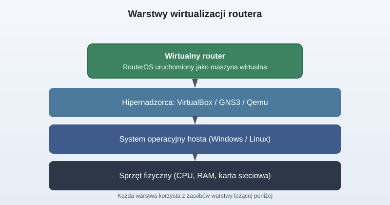
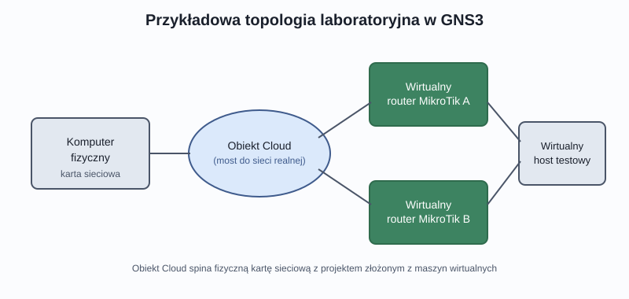
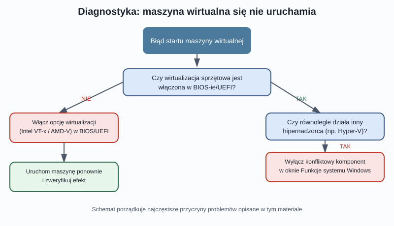

## Karta Pracy
[Karta Pracy](karta-pracy-mikrotik0.docx)

## Wprowadzenie

Nauka administrowania urządzeniami sieciowymi zwykle kojarzy się z półką pełną routerów, switchy i plątaniną kabli. Tymczasem większość podstawowych i średnio zaawansowanych zagadnień związanych z systemem RouterOS można przećwiczyć bez posiadania choćby jednego fizycznego urządzenia MikroTik. Kluczem jest **wirtualizacja** — technika, dzięki której pojedynczy komputer (stacjonarny lub laptop) może „udawać” kilka niezależnych routerów jednocześnie, a my — budować między nimi połączenia, testować routing, VPN-y czy reguły firewalla dokładnie tak, jakbyśmy pracowali na prawdziwym sprzęcie.

W tym materiale omawiamy trzy najpopularniejsze podejścia do wirtualizacji routera MikroTik:

- uruchomienie systemu RouterOS jako maszyny wirtualnej w **VirtualBox**,
- zbudowanie całej topologii sieciowej w symulatorze **GNS3**,
- lekką alternatywę w postaci **Qemu** na systemie Linux,

a na końcu — listę najczęstszych problemów, na jakie można natrafić, i sposoby ich rozwiązania.

---

## 1. Po co w ogóle wirtualizować router?

Zanim przejdziemy do konkretów, warto zrozumieć ideę stojącą za całym podejściem. Wirtualizacja polega na uruchomieniu pełnoprawnego systemu operacyjnego (w naszym przypadku RouterOS) wewnątrz „kontenera” programowego, który udaje prawdziwy komputer — ma wirtualny procesor, wirtualną pamięć RAM, wirtualny dysk i wirtualne karty sieciowe. Z punktu widzenia samego RouterOS-a nie ma żadnej różnicy: system nie „wie”, że działa na maszynie wirtualnej, a nie na dedykowanym urządzeniu.

Dzięki temu:

- możemy stawiać i kasować routery w kilka sekund, eksperymentując bez obaw o uszkodzenie sprzętu,
- jeden komputer wystarczy do zbudowania sieci złożonej z wielu routerów połączonych ze sobą,
- łatwo wracamy do punktu wyjścia dzięki migawkom (snapshotom) maszyny wirtualnej,
- ćwiczenia można powtarzać wielokrotnie w tych samych warunkach — co jest nieocenione podczas nauki.

Producent MikroTik ułatwia to zadanie, udostępniając gotowe obrazy systemu RouterOS przygotowane specjalnie pod popularne platformy wirtualizacyjne.

Jak widać na powyższym schemacie, każda warstwa „siedzi” na tej poniżej: sprzęt fizyczny obsługuje system operacyjny hosta, na nim działa hipernadzorca (np. VirtualBox), a dopiero w nim uruchamiamy wirtualny router. Zrozumienie tej hierarchii bardzo pomaga w diagnozowaniu problemów — jeśli coś nie działa, warto sprawdzać kolejne warstwy od dołu do góry.

---

## 2. VirtualBox — najprostszy start

VirtualBox to darmowe, wieloplatformowe narzędzie do tworzenia maszyn wirtualnych, dostępne zarówno dla Windows, jak i Linuksa czy macOS. Jego popularność wynika z prostoty obsługi oraz faktu, że nie wymaga zaawansowanej wiedzy, aby postawić pierwszą maszynę.

### Dwie drogi do tego samego celu

Istnieją w praktyce dwa wygodne sposoby uruchomienia RouterOS-a w VirtualBox:

**Gotowy szablon maszyny (plik OVA).** To najszybsza metoda — pobrany plik zawiera już skonfigurowaną maszynę wirtualną: odpowiednią ilość pamięci, wirtualny dysk oraz kartę sieciową. Import polega na wskazaniu pliku w kreatorze importu urządzenia wirtualnego — program sam odtworzy wszystkie parametry. To rozwiązanie polecane osobom, które chcą jak najszybciej przejść do właściwej konfiguracji sieci, bez przechodzenia przez ręczne tworzenie maszyny.

**Samodzielne złożenie maszyny z plikiem dysku (VDI).** Ta metoda wymaga nieco więcej pracy — tworzymy nową maszynę wirtualną ręcznie (określając liczbę rdzeni procesora, ilość RAM-u), a jako dysk twardy wskazujemy pobrany wcześniej plik z obrazem systemu. Zaletą tego podejścia jest pełna kontrola nad parametrami sprzętowymi maszyny oraz lepsze zrozumienie tego, z czego w ogóle składa się maszyna wirtualna — co jest cenną wiedzą przy pracy z innymi hipernadzorcami.

Niezależnie od wybranej metody, jeden krok jest wspólny i absolutnie kluczowy: **tryb pracy karty sieciowej**. Domyślnie VirtualBox izoluje maszynę wirtualną od sieci fizycznej (tryb NAT). Aby wirtualny router mógł otrzymać adres IP z tej samej sieci, w której pracuje nasz komputer, kartę sieciową maszyny należy przełączyć w tryb **mostkowany (bridged)**. Dopiero wtedy router „widzi” fizyczną sieć lokalną tak, jakby był do niej podłączony kablem.

### Pierwsze logowanie

Po uruchomieniu maszyny i przejściu ekranu logowania korzystamy z domyślnego konta administratora bez hasła (system poprosi o jego ustawienie przy pierwszym uruchomieniu). Jeśli w sieci lokalnej działa serwer DHCP, router automatycznie otrzyma adres IP — możemy go sprawdzić poleceniem `ip address print` w terminalu RouterOS-a. Od tego momentu mamy w pełni funkcjonalny, dostępny w sieci router, z którym możemy łączyć się zdalnie tak samo jak z prawdziwym urządzeniem.

### Uwaga o licencjonowaniu

MikroTik stosuje kilka poziomów licencji, które nie ograniczają dostępnych funkcji systemu, a jedynie maksymalną przepustowość interfejsów sieciowych. Darmowy poziom pozwala na połączenia rzędu pojedynczych megabitów na sekundę — w zupełności wystarczające do nauki i testowania większości mechanizmów, poza scenariuszami wymagającymi realnego testowania przepustowości łącza.

---

## 3. GNS3 — kiedy jeden router to za mało

Pojedyncza wirtualna maszyna wystarczy do poznania interfejsu i podstawowych poleceń, ale prawdziwa nauka administracji sieciami zaczyna się tam, gdzie routerów jest kilka i trzeba je ze sobą połączyć. Tu z pomocą przychodzi **GNS3** — narzędzie do graficznego projektowania i symulowania topologii sieciowych.

GNS3 samo w sobie nie emuluje systemu RouterOS — potrzebuje w tym celu współpracy z zewnętrznym hipernadzorcą, najczęściej właśnie VirtualBox. Dzięki temu możemy w prosty, graficzny sposób:

- przeciągać na obszar roboczy kolejne instancje wirtualnych routerów,
- łączyć je wirtualnymi kablami, tworząc dowolnie skomplikowaną topologię,
- podłączać całość do sieci fizycznej za pomocą specjalnego obiektu **Cloud**, który pełni rolę mostu między światem wirtualnym a rzeczywistą kartą sieciową komputera.

Powyższy schemat pokazuje typowy scenariusz: fizyczny komputer łączy się przez obiekt Cloud z projektem złożonym z dwóch wirtualnych routerów oraz wirtualnego hosta testowego. Taki układ pozwala na przykład przetestować routing statyczny między dwiema podsieciami albo zbudować tunel VPN między „lokalizacjami”, które w rzeczywistości są tylko procesami działającymi na jednym laptopie.

### GNS3 na Linuksie i alternatywa Qemu

Na systemach linuksowych GNS3 potrafi korzystać bezpośrednio z wbudowanego mechanizmu wirtualizacji **Qemu**, co pozwala uruchamiać routery bez pośrednictwa VirtualBox. To rozwiązanie bywa lżejsze dla zasobów komputera i często oferuje sprawniejsze działanie, zwłaszcza przy większej liczbie jednocześnie uruchomionych maszyn — co ma znaczenie przy budowie rozbudowanych topologii testowych.

### Praktyczna wskazówka: interfejs programowy zamiast fizycznego

Jeśli nie chcemy (lub nie możemy) angażować fizycznej karty sieciowej do połączenia z obiektem Cloud, dobrą alternatywą jest zainstalowanie programowego interfejsu sieciowego (tzw. adaptera pętli zwrotnej) za pomocą wbudowanego w system Windows kreatora dodawania sprzętu. Taki interfejs zachowuje się jak kolejna karta sieciowa i można go wykorzystać do połączenia z projektem GNS3 dokładnie w ten sam sposób co interfejs fizyczny — wystarczy pamiętać o dobraniu adresacji IP zgodnej z resztą projektu.

---

## 4. Gdy coś pójdzie nie tak — najczęstsze problemy

Wirtualizacja, mimo że dziś bardzo dojrzała technologia, potrafi czasem sprawiać niespodzianki. Poniżej zestawienie najczęściej spotykanych trudności.

### Maszyna wirtualna nie chce wystartować

Najczęstszą przyczyną jest **wyłączona w BIOS-ie/UEFI obsługa wirtualizacji sprzętowej** (Intel VT-x lub AMD‑V/SVM). Bez tej funkcji procesor nie potrafi efektywnie uruchamiać kodu maszyny wirtualnej i hipernadzorca zgłasza błąd. Rozwiązanie wymaga wejścia do ustawień firmware'u płyty głównej (zwykle klawiszem Del, F2, F10 lub F12 podczas uruchamiania komputera) i odszukania odpowiedniej opcji — jej nazwa i lokalizacja różnią się w zależności od producenta płyty i procesora. Stan tej funkcji można też szybko zweryfikować z poziomu systemu, np. w Menedżerze zadań na karcie wydajności procesora.

### Konflikt różnych mechanizmów wirtualizacji

Windows ma wbudowany własny hipernadzorca — Hyper-V. Problem w tym, że korzystanie z niego jednocześnie z innym rozwiązaniem (np. przyspieszeniem sprzętowym typu HAXM) zwykle kończy się błędami startu maszyny. Jeśli korzystamy z VirtualBox bez dodatkowych akceleratorów, konflikt zdarza się rzadziej, natomiast warto wiedzieć, że Hyper-V da się w każdej chwili włączyć lub wyłączyć w oknie funkcji systemu Windows.

### Wybór systemu: Windows czy Linux?

To pytanie, które prędzej czy później zadaje sobie każda osoba budująca własne laboratorium. Obie platformy dobrze radzą sobie z uruchamianiem VirtualBox i GNS3, jednak Linux bywa nieco bardziej stabilny i „lżejszy” w tym zastosowaniu — mniej tu nieoczekiwanych zawieszeń narzędzi. Nie jest to jednak reguła bezwzględna — wybór systemu warto potraktować jako kwestię indywidualnych preferencji i przyzwyczajeń.

Powyższy schemat porządkuje kolejność sprawdzania najczęstszych przyczyn problemów ze startem maszyny wirtualnej — od najprostszej (wirtualizacja wyłączona w BIOS-ie) po bardziej złożoną (konflikt hipernadzorców).

---

## 5. Podsumowanie

Wirtualizacja to dziś naturalny punkt wejścia do nauki administrowania siecią opartą na urządzeniach MikroTik. VirtualBox pozwala szybko postawić pojedynczy router, GNS3 umożliwia budowanie całych topologii złożonych z wielu urządzeń, a Qemu na Linuksie stanowi lżejszą alternatywę dla bardziej wymagających projektów. Znajomość typowych problemów — zwłaszcza tych związanych z ustawieniami BIOS-u/UEFI oraz konfliktami między hipernadzorcami — pozwala zaoszczędzić sporo czasu na etapie budowy laboratorium, zanim jeszcze przejdziemy do właściwej konfiguracji usług sieciowych.

---

## Pytania sprawdzające

1. Na czym polega idea wirtualizacji routera i dlaczego jest przydatna w nauce administracji siecią?
2. Jakie są dwa sposoby uruchomienia RouterOS-a w VirtualBox i czym się od siebie różnią?
3. Dlaczego domyślny (NAT-owy) tryb karty sieciowej w VirtualBox nie wystarczy do pracy z wirtualnym routerem i jaki tryb należy wybrać?
4. Jak sprawdzić, czy wirtualny router otrzymał adres IP z sieci lokalnej, i jakiego polecenia użyjemy w tym celu?
5. Co ogranicza darmowy poziom licencji RouterOS i czy jest to problem podczas nauki?
6. Jaką rolę pełni GNS3 względem VirtualBox — czy te narzędzia się zastępują, czy uzupełniają?
7. Do czego służy obiekt Cloud w projekcie GNS3?
8. Jaką zaletą Qemu na Linuksie w porównaniu z korzystaniem z VirtualBox przy większych topologiach?
9. Jaka jest najczęstsza przyczyna, dla której maszyna wirtualna nie chce się uruchomić, i jak ją zdiagnozować?
10. Dlaczego jednoczesne korzystanie z Hyper-V oraz innego hipernadzorcy (np. z akceleracją HAXM) może prowadzić do problemów?