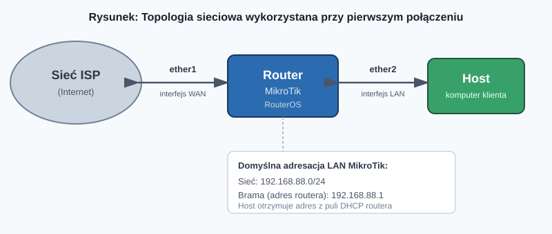
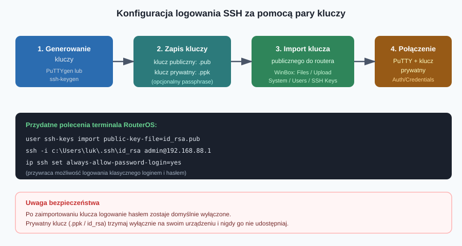
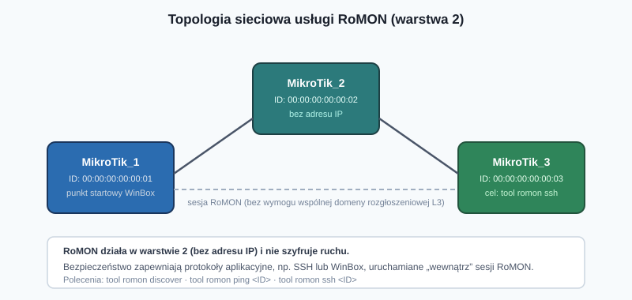

## Karta pracy
[Karta Pracy](karta-pracy-mikrotik.docx)
## Wprowadzenie

Zanim zaczniemy konfigurować jakąkolwiek usługę sieciową na routerze MikroTik, musimy w ogóle się z nim połączyć. Producent — łotewska firma MikroTik, twórca systemu operacyjnego **RouterOS** — dał administratorom dużą swobodę w tym zakresie. Można to zrobić przez przeglądarkę (Quick Set, WebFig), dedykowaną aplikację (WinBox), klasyczny terminal (lokalnie, przez Telnet lub SSH), a nawet w warstwie drugiej modelu OSI, bez adresu IP (RoMON).


### Punkt wyjścia: domyślna konfiguracja sieciowa

W routerach MikroTik domyślnie:

- **ether1** pełni rolę interfejsu **WAN** — to przez niego router łączy się z siecią dostawcy internetu (ISP),
- pozostałe porty Ethernet należą do **LAN**,
- host podłączony do LAN otrzymuje adres IP z domyślnej puli **192.168.88.0/24**,
- adresem bramy (czyli adresem samego routera) jest **192.168.88.1**.

Poniższy diagram pokazuje topologię: router łączy się z ISP przez `ether1`, a z komputerem administratora przez `ether2`.



---

## 2.1. Quick Set, WebFig oraz terminal

### Pierwsze logowanie

Po podłączeniu komputera do routera i otrzymaniu adresu IP z puli 192.168.88.0/24, wpisujemy w przeglądarce adres bramy — `192.168.88.1`. Pojawi się ekran logowania.

> **Domyślne dane logowania (starsze urządzenia):** login `admin`, hasło **puste**.

Jeśli to nie zadziała, dane dostępowe znajdziesz na naklejce znamionowej umieszczonej na spodzie urządzenia. Dobrą praktyką jest zrobienie jej zdjęcia — przyda się np. po przywróceniu ustawień fabrycznych.

Na ekranie logowania, poniżej pól *Login* i *Password*, znajdują się cztery ikony:

| Ikona | Funkcja |
|---|---|
| **WinBox** | pobranie aplikacji WinBox |
| **Graphs** | podgląd wykresów |
| **License** | wyświetlenie licencji urządzenia |
| **Help** | oficjalna dokumentacja i pomoc producenta |

Po pierwszym, poprawnym uwierzytelnieniu system **wymusi zmianę hasła** — to ważny mechanizm bezpieczeństwa, którego nie da się pominąć.

### Panel Quick Set

Po zalogowaniu trafiamy do panelu szybkich ustawień — **Quick Set**. To swoisty „kokpit” routera, w którym zebrano najważniejsze opcje podzielone na cztery sekcje:

1. **Wireless** — nazwa sieci Wi-Fi (SSID), hasło dostępowe, sieć gościa (dotyczy urządzeń z modułem radiowym). W tym samym oknie widoczna jest też lista aktywnych hostów (*Local Clients*).
2. **Internet** — sposób połączenia z ISP: statyczny adres IP, DHCP lub **PPPoE** (Point-to-Point Protocol over Ethernet). Zaznaczenie *Firewall Router* aktywuje zaporę sieciową.
3. **Local Network** — adres IP routera w sieci LAN oraz ustawienia serwera DHCP. Tu włączamy lub wyłączamy: serwer DHCP, **NAT** (Network Address Translation) oraz **UPnP** (Universal Plug-and-Play). Przycisk *Port Mapping* pozwala skonfigurować przekierowania portów.
4. **VPN** — szybkie uruchomienie zdalnego dostępu do urządzenia przez wirtualną sieć prywatną.

Poniżej sekcji znajduje się pasek przycisków akcji: aktualizacja routera, restart, reset ustawień, zmiana danych logowania oraz zatwierdzenie konfiguracji. W niektórych modelach w prawym górnym rogu dostępna jest dodatkowo rozwijana lista **trybów pracy routera**, dopasowująca ustawienia do konkretnego scenariusza sieciowego.

### WebFig — pełna konfiguracja z poziomu przeglądarki

Kliknięcie przycisku **WebFig** otwiera panel z *kompletem* ustawień urządzenia. To zdecydowanie więcej opcji niż w Quick Set — i, jak zauważa autor podręcznika, na pierwszy rzut oka może to przytłoczyć nawet doświadczonego administratora. WebFig to praktycznie graficzny odpowiednik terminala — pozwala dotrzeć do każdej funkcji RouterOS bez znajomości składni poleceń.

### Terminal — trzecia droga

RouterOS można też konfigurować wyłącznie poprzez **wiersz poleceń** — podobnie jak w urządzeniach Cisco. Wymaga to znajomości składni komend, ale daje pełną kontrolę i jest niezastąpione w automatyzacji (skrypty) oraz pracy zdalnej z ograniczoną przepustowością łącza. Dostęp do terminala uzyskamy z poziomu WebFig, WinBoksa, a także zdalnie — przez Telnet lub SSH.

---

## 2.2. WinBox

**WinBox** to dedykowane, natywne narzędzie do zarządzania urządzeniami MikroTik, dostępne do pobrania na stronie [mikrotik.com/download](https://mikrotik.com/download) (lub bezpośrednio z ekranu logowania).

### Wykrywanie routera — zakładka Neighbors

Po uruchomieniu aplikacji przechodzimy do zakładki **Neighbors**. WinBox automatycznie wykryje urządzenia MikroTik w sieci lokalnej i wyświetli:

- nazwę urządzenia,
- adres IP i adres MAC,
- wersję RouterOS,
- platformę sprzętową,
- czas działania (uptime).

Kliknięcie adresu IP na liście automatycznie uzupełnia pola logowania. Po podaniu hasła i kliknięciu **Connect** nawiązujemy połączenie.

### Unikalna cecha WinBoksa: łączenie po adresie MAC

To, co odróżnia WinBox od pozostałych metod, to możliwość nawiązania połączenia **w warstwie drugiej modelu OSI**, wykorzystując adres MAC urządzenia zamiast adresu IP. Jest to szczególnie przydatne, gdy występują problemy w warstwie trzeciej — konflikt adresów IP, awaria serwera DHCP itp.

> **Warunek:** komputer administratora i router muszą znajdować się w tej samej domenie rozgłoszeniowej (ten sam segment LAN, bez pośrednictwa urządzeń routujących).

Typ nawiązanego połączenia rozpoznasz po nagłówku okna:

- `<login>@<adres_IP>` — połączenie w warstwie 3,
- `<login>@<adres_MAC>` — połączenie w warstwie 2.

Od tego miejsca autor podręcznika prezentuje dalszą konfigurację właśnie z poziomu WinBoksa, pokazując równolegle odpowiedniki poleceń terminala.

---

## 2.3. Połączenie zdalne — Telnet

Sesje terminalowe można nawiązywać za pomocą dwóch protokołów, które w RouterOS są **domyślnie włączone**: Telnet i SSH.

### Dlaczego Telnet to zły pomysł na produkcji

Telnet przesyła wszystkie dane — łącznie z loginem i hasłem — **czystym tekstem**. Oznacza to, że każdy, kto przechwyci ruch sieciowy (np. atakiem typu man-in-the-middle albo zwykłym sniffingiem), pozna dane dostępowe do routera. Mimo to warto znać tę metodę — choćby po to, by rozpoznać ją w starszej dokumentacji lub środowisku laboratoryjnym.

### Jak nawiązać połączenie Telnet

**Windows** — po zainstalowaniu klienta Telnet (Win+R → `optionalfeatures` → zaznaczenie klienta Telnet):

```bash
telnet <adres_IP_routera>
```

albo:

```bash
telnet
open <adres_IP_routera>
```

**Linux** — instalacja klienta:

```bash
sudo apt install telnetd
```

### PuTTY jako alternatywa

Bardzo popularnym narzędziem do połączeń terminalowych jest darmowy **PuTTY** ([putty.org](https://www.putty.org/)). Oprócz Telnet i SSH obsługuje również połączenia szeregowe (np. do konsoli routerów/przełączników Cisco). Aby połączyć się przez Telnet: wpisujemy adres IP routera, typ połączenia ustawiamy na *Other*, a z listy wybieramy *Telnet*.

---

## 2.4. Połączenie zdalne — SSH

**SSH (Secure Shell)** to znacznie bezpieczniejszy odpowiednik Telnetu — cały ruch jest szyfrowany.

### Podstawowe połączenie

**Windows** (po instalacji klienta OpenSSH: *Ustawienia → Aplikacje → Funkcje opcjonalne → Wyświetl funkcje*) lub **Linux** (klient SSH jest wbudowany domyślnie):

```bash
ssh <nazwa_użytkownika>@<adres_IP_routera>
# np.
ssh admin@192.168.88.1
```

### Problem: „Host key verification failed”

Każdy odcisk klucza (*fingerprint*) zaakceptowany przy pierwszym połączeniu jest zapamiętywany w pliku `known_hosts` (katalog `\.ssh` w folderze użytkownika, np. `C:\Users\luk\.ssh`) i powiązany z konkretnym adresem IP. Jeśli pod tym samym adresem IP w innym czasie działało inne urządzenie (inny fingerprint), klient SSH zgłosi niezgodność. Rozwiązanie: usunąć wpis dotyczący spornego adresu IP z pliku `known_hosts`.

### Uwierzytelnianie parą kluczy (publiczny/prywatny)

To znacznie bezpieczniejsza — i zalecana w środowiskach produkcyjnych — metoda logowania SSH. Cały proces pokazuje poniższy schemat.



**Krok 1. Generowanie kluczy — PuTTY Key Generator**

Uruchamiamy narzędzie *PuTTYgen*, wybieramy typ i długość klucza (domyślnie RSA 2048 bitów jest wystarczający punkt startu), a losowe dane potrzebne do wygenerowania klucza zbieramy, poruszając myszą nad oknem programu. Klikamy **Generate**.

Opcjonalnie możemy dodać:
- **Key passphrase** — dodatkowe hasło zabezpieczające klucz prywatny,
- **Key comment** — komentarz identyfikujący klucz.

Klikamy **Save public key** oraz **Save private key**. Uwaga na rozszerzenia plików:

| Typ klucza | Rozszerzenie |
|---|---|
| Publiczny | trzeba dopisać ręcznie: `.pub` |
| Prywatny | `.ppk` |

**Krok 2. Import klucza publicznego do routera**

Dwie metody w WinBoksie:
1. przeciągnij i upuść plik klucza nad oknem aplikacji,
2. zakładka **Files** → przycisk **Upload**.

Następnie: **System → Users → SSH Keys → Import SSH Key** — wybieramy nazwę użytkownika i plik klucza, klikamy **Import SSH Key**. Plik klucza zostaje po tym usunięty z listy plików routera (kolejny import wymaga ponownego wgrania pliku).

Odpowiednik w terminalu:

```bash
user ssh-keys import public-key-file=id_rsa.pub
```

**Krok 3. Połączenie z użyciem klucza prywatnego — PuTTY**

W PuTTY: *Auth/Credentials* → w polu *Private keys file for authentication* wskazujemy plik klucza prywatnego → **Open**. Jeśli przy generowaniu ustawiliśmy hasło (*passphrase*), zostaniemy o nie poproszeni.

### Alternatywa: ssh-keygen

Zamiast PuTTYgen możemy użyć narzędzia `ssh-keygen`, dostępnego po instalacji klienta SSH:

```bash
ssh-keygen
```

Kreator zada dwa pytania: o nazwę/lokalizację plików oraz opcjonalne hasło. Domyślna lokalizacja to `C:\Users\<nazwa_użytkownika>\.ssh`. Powstają dwa pliki:

- `id_rsa` — klucz **prywatny**,
- `id_rsa.pub` — klucz **publiczny** (ten importujemy do routera).

Połączenie z użyciem klucza:

```bash
ssh -i c:\Users\luk\.ssh\id_rsa admin@192.168.88.1
```

> **Ważne:** pierwszą próbę połączenia wykonaj z kluczem zapisanym w domyślnej lokalizacji. W przeciwnym razie może pojawić się błąd `WARNING: UNPROTECTED PRIVATE KEY FILE!`, blokujący połączenie (zbyt szerokie uprawnienia do pliku klucza).

### Co się dzieje z logowaniem hasłem?

Zaimportowanie klucza SSH **wyłącza możliwość logowania loginem i hasłem**. Aby ją przywrócić:

- GUI: **IP → SSH → SSH Settings** → zaznaczamy *Always Allow Password Login*,
- terminal:

```bash
ip ssh set always-allow-password-login=yes
```

(ustawienie `no` ponownie zablokuje logowanie tradycyjne).

---

## 2.5. RoMON

**RoMON** (*Router Management Overlay Network*) to najbardziej nietypowa z prezentowanych metod — działa w **warstwie drugiej** modelu OSI. Oznacza to dwie ważne konsekwencje praktyczne:

- router **nie musi mieć przypisanego adresu IP**,
- urządzenia **nie muszą znajdować się w tej samej domenie rozgłoszeniowej**.

To czyni RoMON świetnym narzędziem ratunkowym — np. gdy trzeba dotrzeć do świeżo rozpakowanego urządzenia bez konfiguracji IP, znajdującego się „za” innymi routerami MikroTik.

### Identyfikacja urządzeń w sieci RoMON

Każdy router jest identyfikowany przez **RoMON ID** — domyślnie jest to jego adres MAC, ale administrator może nadać identyfikator ręcznie (musi zachować format adresu MAC).

### Bezpieczeństwo

RoMON **sam w sobie nie szyfruje** przesyłanych danych. Szyfrowanie realizowane jest na poziomie aplikacji „tunelowanej” przez RoMON — np. sesji SSH albo WinBoksa.

Przykładowa topologia z trzema routerami użyta do demonstracji usługi:



### Konfiguracja usługi

**GUI (WinBox):** *Tools → RoMON → RoMON Settings* → zaznaczamy **Enable**, w polu **ID** wpisujemy identyfikator routera.

**Terminal:**

```bash
tool romon set enabled=yes id=00:00:00:00:00:01
```

Czynność powtarzamy na każdym routerze, który ma uczestniczyć w sieci RoMON.

### Nawiązanie połączenia RoMON

Po aktywacji usługi na wszystkich urządzeniach łączymy się z jednym z routerów (tym, do którego mamy „zwykły” dostęp) i w WinBoksie klikamy **Connect to RoMON**. Wszyscy dostępni sąsiedzi RoMON pojawią się na zakładce **RoMON Neighbors** — wybieramy interesujący nas adres/identyfikator i klikamy **Connect**.

### Dodatkowe narzędzia RoMON

| Przycisk (GUI) | Funkcja |
|---|---|
| **Ports** | wybór interfejsów, przez które router będzie nasłuchiwał sesji RoMON (domyślnie: wszystkie) |
| **Discovery** | wykrywanie urządzeń w sieci RoMON |
| **Ping** | test osiągalności urządzenia (odpowiednik zwykłego `ping`, ale w warstwie RoMON) |

Odpowiedniki poleceń terminala:

```bash
tool romon port print                          # stan usługi
tool romon discover                            # wykrycie urządzeń
tool romon ping 00:00:00:00:00:03               # test osiągalności
tool romon ssh 00:00:00:00:00:03                # bezpieczne połączenie SSH przez RoMON
```

---

## Podsumowanie — którą metodę wybrać?

| Metoda | Warstwa OSI | Szyfrowanie | Wymaga adresu IP | Kiedy stosować |
|---|---|---|---|---|
| **Quick Set** | 7 (HTTP) | zależnie od HTTPS | tak | szybka, podstawowa konfiguracja |
| **WebFig** | 7 (HTTP) | zależnie od HTTPS | tak | pełna konfiguracja z przeglądarki |
| **Terminal (lokalny)** | — | — | nie dotyczy | praca bezpośrednio na urządzeniu, skrypty |
| **WinBox (po IP)** | 3 | tak (protokół własny) | tak | codzienna administracja |
| **WinBox (po MAC)** | 2 | tak | **nie** | diagnostyka problemów z L3 (DHCP, konflikt IP) |
| **Telnet** | 7 | **nie** | tak | tylko laboratoria / środowiska testowe |
| **SSH** | 7 | tak | tak | zdalna administracja produkcyjna, automatyzacja |
| **RoMON** | 2 | tylko poprzez aplikację „w tunelu” | **nie** | ratunkowy dostęp do urządzeń bez adresu IP |

Kluczowy wniosek: MikroTik daje mnóstwo dróg do tego samego celu, ale nie wszystkie są sobie równe pod względem bezpieczeństwa. Do codziennej pracy najlepiej sprawdza się **WinBox** (szybkość i wygoda) oraz **SSH z uwierzytelnianiem kluczem** (bezpieczeństwo i możliwość automatyzacji). Telnet warto znać teoretycznie, ale unikać go w praktyce, a RoMON trzymać w zanadrzu na sytuacje awaryjne.

---

## 10 pytań kontrolnych

1. Jaki jest domyślny adres IP routera MikroTik oraz maska sieci LAN?
2. Który interfejs Ethernet pełni domyślnie rolę WAN w routerach MikroTik?
3. Jakie są domyślne dane logowania do nowego (nieużywanego wcześniej) routera MikroTik i gdzie je znaleźć, jeśli standardowe dane nie zadziałają?
4. Wymień cztery sekcje ustawień dostępne w panelu Quick Set i krótko opisz, czego dotyczy każda z nich.
5. Czym różni się WebFig od Quick Set pod względem zakresu dostępnych ustawień?
6. Na czym polega unikalna cecha aplikacji WinBox pozwalająca połączyć się z routerem w warstwie 2, i w jakiej sytuacji jest to szczególnie przydatne?
7. Dlaczego protokół Telnet uznaje się za niebezpieczny do zarządzania urządzeniami sieciowymi?
8. Opisz krok po kroku proces konfiguracji logowania SSH za pomocą pary kluczy (od wygenerowania po nawiązanie połączenia).
9. Co się dzieje z możliwością logowania loginem i hasłem po zaimportowaniu klucza SSH do routera i jak przywrócić tradycyjne logowanie?
10. Czym jest usługa RoMON, w jakiej warstwie modelu OSI działa i dlaczego mimo braku własnego szyfrowania może być stosowana bezpiecznie?

---