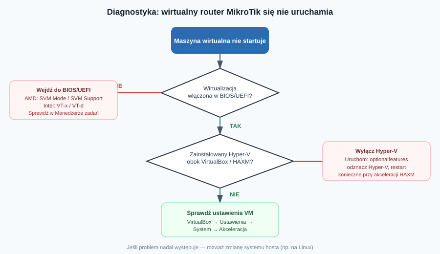
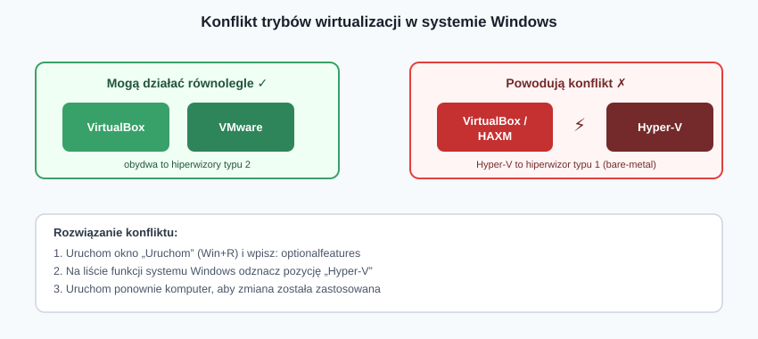
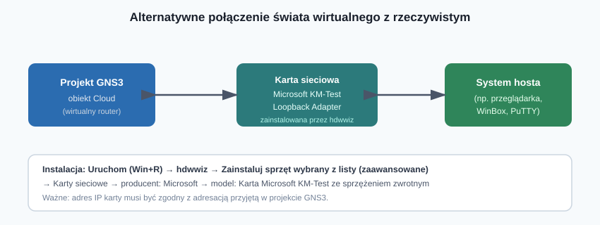

## Karta Pracy
[Karta Pracy](karta-pracy-wirtualizacja-routeros.docx)

## Wprowadzenie

Wirtualizacja to sposób na naukę konfiguracji urządzeń MikroTik bez konieczności kupowania fizycznego sprzętu — wystarczy VirtualBox lub GNS3 oraz obraz systemu RouterOS udostępniany bezpłatnie przez producenta. Teoria brzmi prosto, w praktyce jednak uruchomienie wirtualnego routera bywa źródłem frustracji: maszyna nie startuje, narzędzia się „gryzą”, a interfejsy sieciowe nie chcą się ze sobą komunikować.

Ten materiał to swoista **checklista diagnostyczna** — zbiór najczęstszych problemów napotykanych przy wirtualizacji RouterOS wraz z konkretnymi krokami ich rozwiązania.

---

## Problem 1. Maszyna wirtualna nie chce się uruchomić

### Objaw

Po utworzeniu wirtualnego routera (np. z pliku OVA lub VDI) próba jego uruchomienia kończy się błędem — system nie startuje.

### Najczęstsza przyczyna: wirtualizacja wyłączona w BIOS-ie/UEFI

To zdecydowanie najpopularniejsza przyczyna problemu. Większość płyt głównych ma tę funkcję **domyślnie wyłączoną**.

**Jak sprawdzić, czy wirtualizacja jest włączona (Windows):**

Otwórz **Menedżer zadań → karta Wydajność → Procesor**. Przy pozycji *Wirtualizacja* powinien widnieć zapis **Włączone**. Jeśli widnieje *Wyłączone* — konieczna jest zmiana ustawień w BIOS-ie/UEFI.

**Jak wejść do BIOS-u/UEFI:**

- **Metoda klasyczna:** zrestartuj komputer i podczas uruchamiania (ekran POST) wciśnij jeden z klawiszy: `DEL`, `F2`, `F10` lub `F12` — dokładny klawisz zależy od producenta płyty głównej.
- **Metoda uniwersalna (Windows):** przytrzymaj klawisz **Shift** podczas kliknięcia opcji *Uruchom ponownie*. System uruchomi narzędzie rozwiązywania problemów: **Rozwiąż problemy → Opcje zaawansowane → Ustawienia oprogramowania układowego UEFI**.

**Nazwa opcji zależy od producenta procesora:**

| Producent CPU | Szukana opcja w BIOS/UEFI |
|---|---|
| AMD | `SVM Mode` lub `SVM Support` |
| Intel | `Intel Virtualization Technology`, `Intel VT-d`, `Intel VT-x` |

Opcja znajduje się zazwyczaj w sekcji ustawień procesora (CPU Configuration), ponieważ to on odpowiada za sprzętową obsługę wirtualizacji.

Poniższy diagram porządkuje całą ścieżkę diagnostyczną.

---

## Problem 2. Konflikt aktywnych trybów wirtualizacji

### Objaw

VirtualBox (lub narzędzie korzystające z akceleracji HAXM) zgłasza błąd uruchomienia maszyny, mimo że wirtualizacja w BIOS-ie jest włączona.

### Przyczyna: różne hiperwizory na jednej maszynie

Nie wszystkie rozwiązania do wirtualizacji da się uruchomić równolegle:

- **VirtualBox i VMware** — mogą współistnieć bez problemu (oba to hiperwizory typu 2, działające jako aplikacje w systemie operacyjnym).
- **Hyper-V** — to hiperwizor typu 1 (bare-metal), który przejmuje kontrolę nad sprzętem na niższym poziomie niż system operacyjny. Jego jednoczesne działanie z VirtualBoksem lub akceleracją **HAXM** niemal zawsze powoduje konflikt.

### Rozwiązanie: wyłączenie Hyper-V

1. Otwórz okno *Uruchom* (`Win+R`) i wpisz `optionalfeatures`.
2. Na liście **Funkcje systemu Windows** odznacz pozycję **Hyper-V**.
3. Zatwierdź i uruchom ponownie komputer.

> **Uwaga:** dezaktywacja Hyper-V jest **obowiązkowa**, jeśli planujesz korzystać z akceleracji HAXM (używanej np. przez niektóre emulatory w GNS3).

Rozwiązaniem problemu bywa też zmiana ustawień samej maszyny wirtualnej: **VirtualBox → Ustawienia → System → Akceleracja**, gdzie można dopasować dostępny tryb wirtualizacji sprzętowej do możliwości hosta.

---

## Problem 3. Wybór systemu operacyjnego hosta — Windows czy Linux?

Autor podręcznika prezentuje obsługę VirtualBoksa i GNS3 zarówno w Windows, jak i Linuksie, i dzieli się osobistą obserwacją: narzędzia wirtualizacyjne **działają stabilniej pod Linuksem** — rzadziej dochodzi do sytuacji, w której aplikacja bez wyraźnej przyczyny „zawiesza się” lub przestaje odpowiadać.

To istotna wskazówka diagnostyczna: jeśli po wyczerpaniu powyższych kroków problemy z wirtualizacją nadal się powtarzają, warto rozważyć przeniesienie środowiska testowego na dystrybucję Linuksa — może to być skuteczniejsze niż dalsze „walczenie” z konfiguracją Windows.

---

## Problem 4. Brak komunikacji między światem wirtualnym a rzeczywistym

### Kontekst

Standardowym sposobem połączenia wirtualnego routera w GNS3 ze światem rzeczywistym jest obiekt **Cloud** powiązany z fizycznym interfejsem sieciowym komputera. Czasem jednak takie rozwiązanie nie działa poprawnie lub nie jest wygodne (np. chcemy odizolować ruch testowy od karty sieciowej używanej do codziennej pracy).

### Rozwiązanie: wirtualny interfejs pętli zwrotnej (loopback)

Alternatywą jest zainstalowanie **programowego interfejsu sieciowego**, który po instalacji sterowników pojawi się w systemie jako kolejna, w pełni funkcjonalna karta sieciowa.

**Instrukcja instalacji (Windows):**

1. W oknie *Uruchom* (`Win+R`) wpisz polecenie `hdwwiz` — uruchomi się **Kreator dodawania sprzętu**.
2. Na ekranie powitalnym kliknij *Dalej*.
3. Wybierz opcję **Zainstaluj sprzęt, który wybiorę z listy (zaawansowane)**.
4. Z listy typów urządzeń wybierz **Karty sieciowe**.
5. Jako producenta wskaż **Microsoft**, a jako model — **Karta Microsoft KM-Test ze sprzężeniem zwrotnym** (ang. *Microsoft KM-Test Loopback Adapter*).
6. Zatwierdź instalację. Nowy interfejs pojawi się w oknie **Połączenia sieciowe**.

Dalsze łączenie z obiektem Cloud w GNS3 przebiega dokładnie tak samo jak przy użyciu fizycznego interfejsu sieciowego — z jednym zastrzeżeniem:

> **Pamiętaj:** adres IP przypisany do interfejsu loopback musi być zgodny z adresacją przyjętą w projekcie GNS3, w przeciwnym razie komunikacja nie zostanie nawiązana.

---

## Podsumowanie — checklista diagnostyczna

Gdy wirtualny router MikroTik nie działa zgodnie z oczekiwaniami, przejdź kolejno przez poniższe punkty:

1. ☐ Sprawdź w Menedżerze zadań, czy wirtualizacja sprzętowa jest **włączona**.
2. ☐ Jeśli nie — włącz odpowiednią opcję w BIOS-ie/UEFI (`SVM Mode` dla AMD, `VT-x`/`VT-d` dla Intela).
3. ☐ Sprawdź, czy na komputerze nie jest jednocześnie aktywny **Hyper-V** obok VirtualBoksa/HAXM — jeśli tak, wyłącz go przez `optionalfeatures`.
4. ☐ Zweryfikuj ustawienia akceleracji w samej maszynie wirtualnej (VirtualBox → System → Akceleracja).
5. ☐ Jeśli problemy się powtarzają mimo poprawnej konfiguracji — rozważ przeniesienie środowiska na Linuksa.
6. ☐ Przy problemach z komunikacją wirtualny–rzeczywisty rozważ instalację interfejsu loopback (`hdwwiz`) jako alternatywy dla obiektu Cloud opartego na fizycznej karcie sieciowej.

---

## 10 pytań kontrolnych

1. Jaka jest najczęstsza przyczyna błędu uruchomienia wirtualnej maszyny z systemem RouterOS?
2. W jaki sposób można sprawdzić w systemie Windows, czy wirtualizacja sprzętowa jest włączona, bez wchodzenia do BIOS-u?
3. Jakich klawiszy używa się najczęściej do wejścia do BIOS-u/UEFI podczas uruchamiania komputera?
4. Opisz uniwersalną metodę wejścia do ustawień UEFI z poziomu systemu Windows (bez znajomości klawisza producenta płyty głównej).
5. Jakiej opcji należy szukać w BIOS-ie/UEFI na komputerze z procesorem AMD, a jakiej na komputerze z procesorem Intel?
6. Dlaczego jednoczesne działanie Hyper-V oraz VirtualBoksa (lub akceleracji HAXM) prowadzi do konfliktu? Odnieś się do różnicy między hiperwizorem typu 1 i typu 2.
7. Jak wyłączyć mechanizm Hyper-V w systemie Windows?
8. Jaką obserwację dotyczącą stabilności narzędzi wirtualizacyjnych w Windows i Linuksie przedstawia autor podręcznika?
9. Opisz krok po kroku, jak zainstalować w systemie Windows programowy interfejs sieciowy (loopback) do połączenia GNS3 ze światem rzeczywistym.
10. O czym trzeba pamiętać, konfigurując adres IP na interfejsie loopback połączonym z obiektem Cloud w GNS3?