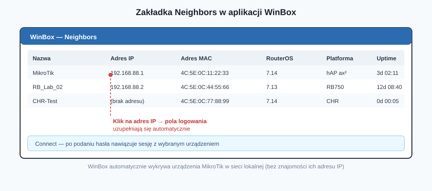
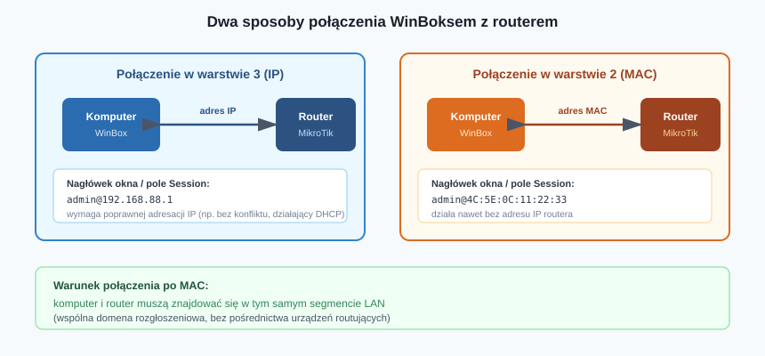
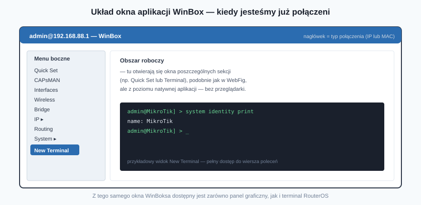

## Karta Pracy
[Karta Pracy](karta-pracy-winbox.docx)

## Wprowadzenie

Router MikroTik można skonfigurować na kilka sposobów: przez przeglądarkę (Quick Set, WebFig), terminal czy połączenia zdalne (Telnet, SSH). Wszystkie te metody mają jedną wspólną cechę — nie wymagają instalowania żadnego dodatkowego oprogramowania, wystarczy przeglądarka internetowa.

Producent oferuje jednak narzędzie stworzone specjalnie do zarządzania swoimi urządzeniami — **WinBox**. To natywna aplikacja, którą pobierzemy ze strony [mikrotik.com/download](https://mikrotik.com/download) lub bezpośrednio po kliknięciu jej ikony na ekranie logowania WebFig. Z racji wygody i dodatkowych możliwości, jakie oferuje, od tego miejsca w podręczniku autor prowadzi dalszą konfigurację właśnie z jej poziomu — a WinBox z czasem staje się podstawowym narzędziem pracy każdego administratora MikroTik.

---

## Wykrywanie urządzeń — zakładka Neighbors

Po zainstalowaniu i uruchomieniu aplikacji pierwszym krokiem jest przejście na zakładkę **Neighbors**. Po jej aktywacji WinBox automatycznie przeszukuje sieć lokalną i wyświetla listę wykrytych urządzeń MikroTik wraz z:

- nazwą urządzenia,
- adresem IP,
- adresem MAC,
- wersją oprogramowania RouterOS,
- platformą sprzętową,
- czasem działania (uptime).

To bardzo wygodna funkcja — nie musimy znać adresu IP routera, żeby się z nim połączyć. Aby sfinalizować połączenie, wystarczy kliknąć adres IP na liście — pola logowania (*Login*, *Address*) uzupełnią się automatycznie. Po podaniu hasła i kliknięciu **Connect** nawiązujemy sesję.

---

## Unikalna cecha WinBoksa: połączenie po adresie MAC

To, co naprawdę wyróżnia WinBoksa na tle innych metod konfiguracji, to możliwość nawiązania połączenia **w warstwie drugiej modelu OSI** — z wykorzystaniem adresu MAC urządzenia zamiast adresu IP.

### Kiedy się to przydaje?

Ta funkcja jest nieoceniona w sytuacjach, gdy występują problemy w warstwie trzeciej, np.:

- konflikt adresów IP w sieci,
- niedziałający serwer DHCP,
- błędna lub utracona konfiguracja adresacji na routerze.

W takich przypadkach połączenie po adresie IP może być niemożliwe, a adres MAC — jako identyfikator fizyczny karty sieciowej — pozostaje niezmienny i zawsze dostępny.

### Warunek: wspólny segment sieci

Aby połączenie po MAC doszło do skutku, komputer administratora oraz router **muszą znajdować się w tym samym segmencie sieci LAN** — czyli we wspólnej domenie rozgłoszeniowej, bez pośrednictwa urządzeń routujących (ruch w warstwie 2 nie jest przekazywany dalej przez router).

### Jak rozpoznać typ nawiązanego połączenia?

Typ użytego połączenia rozpoznamy po adresie widocznym w polu **Session** oraz w nagłówku okna aplikacji:

| Typ połączenia | Format nagłówka |
|---|---|
| Warstwa 3 (IP) | `<nazwa_użytkownika>@<adres_IP>` |
| Warstwa 2 (MAC) | `<nazwa_użytkownika>@<adres_MAC>` |

To prosta, ale bardzo praktyczna wskazówka diagnostyczna — jednym rzutem oka na pasek tytułowy sprawdzimy, w jaki sposób faktycznie jesteśmy połączeni z urządzeniem.

---

## Układ okna i dostępne narzędzia

Układ opcji wewnątrz WinBoksa przypomina panel WebFig, jednak sam sposób poruszania się po ustawieniach i ich edycji przebiega nieco inaczej — korzystamy z menu bocznego, a poszczególne okna otwierają się w obszarze roboczym aplikacji, bez przeładowywania całej strony (jak miałoby to miejsce w przeglądarce).

Z poziomu okna WinBoksa mamy dostęp zarówno do ekranu **szybkich ustawień (Quick Set)**, jak i do **terminala** — dzięki temu, pracując w jednej aplikacji, możemy swobodnie przełączać się między konfiguracją graficzną a wierszem poleceń, bez konieczności uruchamiania osobnych narzędzi.

---

## Dlaczego WinBox, a nie przeglądarka?

Różnorodność dostępnych metod sprawia, że urządzenia MikroTik można konfigurować na wiele sposobów — każda z nich ma swoje miejsce i zastosowanie. WinBox wyróżnia się jednak na tyle istotnymi zaletami, że w praktyce staje się narzędziem pierwszego wyboru:

- **szybkość działania** — natywna aplikacja reaguje sprawniej niż interfejs ładowany w przeglądarce,
- **automatyczne wykrywanie urządzeń** (Neighbors) — nie trzeba znać adresu IP,
- **połączenie w warstwie 2** — ratunek w sytuacjach awaryjnych, niedostępny dla żadnej z metod przeglądarkowych,
- **wygodny dostęp do terminala** z poziomu tego samego okna.

To właśnie dlatego dalsza konfiguracja prezentowana w podręczniku odbywa się z wykorzystaniem WinBoksa — równolegle pokazując, jak ten sam efekt uzyskać za pomocą poleceń terminala.

---

## Podsumowanie

WinBox to dedykowane narzędzie do zarządzania urządzeniami MikroTik, łączące wygodę graficznego interfejsu z elastycznością terminala. Jego kluczową przewagą nad metodami przeglądarkowymi jest możliwość nawiązania połączenia w warstwie drugiej (po adresie MAC) — funkcja niezastąpiona w diagnozowaniu i naprawianiu problemów sieciowych, gdy standardowa komunikacja po adresie IP zawodzi.

---

## 10 pytań kontrolnych

1. Skąd można pobrać aplikację WinBox i w jaki sposób (poza stroną producenta) można uruchomić jej pobieranie?
2. Jakie informacje o wykrytych urządzeniach wyświetla zakładka Neighbors w aplikacji WinBox?
3. Jak w praktyce wygląda proces nawiązania połączenia z routerem z poziomu zakładki Neighbors?
4. Na czym polega unikalna cecha WinBoksa pozwalająca połączyć się z routerem w warstwie drugiej modelu OSI?
5. W jakich sytuacjach (podaj co najmniej dwie) połączenie po adresie MAC jest szczególnie przydatne?
6. Jaki warunek muszą spełniać komputer administratora i router, aby możliwe było połączenie po adresie MAC?
7. Po czym rozpoznasz, czy aktualne połączenie z routerem zostało nawiązane po adresie IP, czy po adresie MAC?
8. Jaki format przyjmuje nagłówek okna WinBoksa przy połączeniu po adresie IP, a jaki przy połączeniu po adresie MAC?
9. Jakie dwa tryby pracy (ekrany) są dostępne z poziomu okna aplikacji WinBox?
10. Wymień co najmniej trzy zalety korzystania z WinBoksa względem konfiguracji przez przeglądarkę (Quick Set/WebFig).